---
title: 与我同 Go
subtitle: 
date: 2026 年 11 月 11 日
...

# 前言

Ai 编程的兴起，让以往的编程范式快速步入末法时代，而我在不经意中发现，Go 语言并非如我以前所想，不值得我涉足。之前我有一些想写的程序，若用 Go 语言来写，应该比用我现在熟悉的语言更为容易。若能对 Go 语言有所把握，驱动 AI 替我用 Go 语言写出这些程序，未必能襄我大业，至少也能卸下心里一些块垒。

在此番学习 Go 语言的过程中，我决定让 AI 充当助教，加快进度。我会尽力忠实记录这一过程。本文最终会成为一份另类的 Go 语言教程，它不会追求向你展示 Go 语言的一切，只是忠实于我个人的需求。弱水三千，我只能让你领略一瓢，但它应该足够精彩。我通常无法忍受乏味的事情，会尽力不让它们出现在这份文档里。若你觉得这份文档甚为乏味，也只是我内心存在着我无法觉察的乏味，而非你的品味出现了问题。

若你此前已经有了一些编程经验，亦即你已经熟悉了一种甚至多种编程语言，我认为无需再沿着最基本的变量、表达式、循环语句、函数、复合数据结构……这条面向零编程经验者的路线去学习 Go 语言，更应立足于自身需求，以问题驱动的方式去熟悉它。这种学习方法对于其他你想要学习的语言应该同样成立。

人类文明传续至今，而你深处其中，这通常意味着，无论学习任何知识，你都不是一张白纸。以问题驱动的学习方式，一直适合每个人，只是以往许多写教程的人，习惯性地将读者当成了零基础的人。

每当遇到自己难以理解之处，无需怀疑自己天资太差，而应当尽力凭借以往的经验或感受，逐步将其拆解并吸纳。这份文档也在尝试践行这一理念。或许在 AI 时代，这种学习方式会更为容易一些。借助 AI，你能快速检索到许多看似不如你的人的经验和感受，而其中往往包含着你因自恃聪明而忽略的一些视角。甚至可以断定，现在的 AI 之所以显得比人类聪明，正是因为它足够笨。

# 有朋自远方来

深夜，我在微信里跟老家的李雷说，Linux 系统里有一个命令叫 `echo`，你向它输入什么，它就会输出什么，像 f(x) = x，输入韩梅梅，它就会输出韩梅梅。李雷不信，世上怎么会有人如此无聊，写出如此无聊的命令。

我忽然发现，竟然一时无法向他证明此事。虽然我能够将 `echo` 命令的执行过程录成视频，但是他会怀疑我在拿 AI 生成的视频忽悠他，过去我时常这样骗他。他从未用过 Linux，自然不知如何通过 ssh 登陆我的机器，亲手敲一遍这个命令。

这次我不想再骗他。我觉得，我可以写一个网络程序，从一个网页里接收他输入的 `echo` 命令，转发到我本地的终端去执行，再将所得结果写入网页，让他看到。倘若他还是不信，那至少这个网页的行为和 `echo` 命令一模一样——他亲手输入，亲眼看到输出，总不能说我又在骗他，他顶多会说没想到我竟然如此无聊。

可是我不会写网络程序。我倒是懂一些 C socket API，但我总不能为了做这件无聊的事情，去写几百行 C 程序。我听说过 Go 是云计算时代的主力语言，于是问 DeepSeek 能否给我写一个最简单的程序，只要它能够让他人在远方通过网页浏览器便可调用，并在网页里输出「李雷，你好啊！」

我不会用 AI agent，因为我没钱。我是在免费的聊天网页里问的 DeepSeek，它并未歧视我很穷，很爽快地给出了答案，

<pre class="GO-lang"><span class="snippet-name-start">@</span><span class="snippet-name" id="xi-1"> hi-lilei.go </span><span class="snippet-name-stop">#</span>
package main

import (
        "fmt"
        "net/http"
)

func main() {
        http.HandleFunc("/", func(w http.ResponseWriter, r *http.Request) {
                fmt.Fprint(w, "李雷，你好啊！")
        })
        http.ListenAndServe(":8080", nil)
}
</pre>

先等等……我的机器上好像还没有 Go 编译器。DeepSeek 说，最好没有，你的 Linux mint 官方仓库里的 Go 编译器包 golang-go 太旧了，用最新的吧！去 Go 官方下载页面 <https://go.dev/dl/>，找到 Linux 对应的 go1.xx.x.linux-amd64.tar.gz 压缩包链接，下载，解包，安装到 /usr/local/go 目录，

```console
$ wget https://go.dev/dl/go1.27.4.linux-amd64.tar.gz
$ tar zxvf go1.27.4.linux-amd64.tar.gz
$ sudo rm -rf /usr/local/go  # 若之前在此装过 go，便将其删除
$ sudo mv go /usr/local
```

这些操作一气呵成后，只需再修改 Bash 配置文件 $HOME/.bashrc，在其中增加

```bash
export PATH=/usr/local/go/bin:$PATH
```

至此，在新开启的 Bash 命令行环境中，便可使用 `go` 命令编译 Go 语言所写的程序了。

这种安装和配置软件的任务，按照 DeepSeek 所说的步骤去做，虽然要动手，但是可以知道 Go 编译器从哪里来，到哪里去。若是有钱，也可以雇佣 DeepSeek 装好这一切，而我们装作什么都知道。这样的时代真好，大家不用再去比较 Windows 是不是比 Linux 更易用了。

然后呢？我问 DeepSeek。它说，将刚才给出的 Go 代码除第一行「`@ hi-lilei.go #`」 之外的所有内容保存为 hi-lilei.go 文件，执行

```console
$ go run hi-lilei.go
```

然后打开网页浏览器，输入 `127.0.0.1:8080`，回车，便可看到

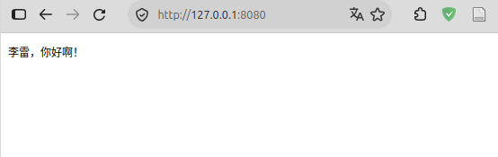

我有一件 t 恤衫，胸前印着「There is no place like 127.0.0.1」，我知道只要这个叫 127.0.0.1 的地方能让 hi-lilei.go 这个程序产生响应，就意味着有可能全世界的机器都能通过网络访问这个程序，只是全世界的人都不会这么无聊罢了。

根据我的一些编程经验，能够看得出来，

```go
func(w http.ResponseWriter, r *http.Request) {
        fmt.Fprint(w, "李雷，你好啊！")
}
```

是匿名函数，`w` 和 `r` 皆为该函数的参数。这个匿名函数的功能应该是将文本写到我访问的那个网页里，于是我看到了「`李雷，你好啊！`」。我将这几行代码写成 C 代码的样子，

```c
void 匿名函数(http.ResponseWriter w, http.Request *r) {
        fmt.Fprint(w, "李雷，你好啊！");
}
```

然后问 DeepSeek，这样理解可以？它说可以。然而我的理解也仅到这个程度，至于变量类型 `http.ResponseWriter` 和 `http.Request` 所指为何，我知道，只要我追问下去，DeepSeek 一定会给我详细解释清楚，然而那样会让我过早地陷入细节里，忘记了我要为李雷所写的这个程序该如何继续演绎成我想要的样子。我没有追问下去，而是问 DeepSeek，我现在是否可以顾名思义，`w` 像是可以在网页里写东西的工具，而 `fmt.Fprint` 是将所写的东西整理成指定的格式转交给 `w`？可以，DeepSeek 回应我。

我在 C 语言里见识过回调函数，我大概能猜得出来，`http.HandleFunc` 是在处理一个叫做 `"/"` 的事件，而那个匿名函数会被该事件触发。至于 `http.ListenAndServe(":8080", nil)` 便是这个 go 程序在等待别人访问我机器上的 `8080` 端口，一旦有人访问，便会触发 `"/"` 事件，于是匿名函数被调用，访问者就会得到写有内容的页面了。

DeepSeek 指出了我的猜想中的一个不实之处。`"/"` 是路径，既可表示根路径，也可用于兜底一些未被响应的路径。实际上，当我在网页浏览器输入 `127.0.0.1:8080` 并回车时，浏览器会自动补上 `/`，亦即浏览器发送的地址实际上是 `127.0.0.1:8080/`，当 Go 程序响应浏览器的请求时，会认为用户试图调用为 `"/"` 指派的函数。倘若我向浏览器提交的地址是 `127.0.0.1:8080/foo`，而程序中没有为 `"/foo"` 指派函数，则以 `"/"` 方式处理。

可是，我该如何让李雷访问这个程序呢？127.0.0.1 只是我的机器的自指地址。李雷若是用这个地址，他访问的只是自己的机器里一个不存在的网络程序。我想起来，之前曾用过一个用 Rust 语言编写的内网穿透工具，名字好像叫 bore-cli。我问 DeepSeek，在 Go 的世界里有没有类似工具，它想了想，说可以试试 expose，只需执行

```console
$ go install github.com/kernelshard/expose/cmd/expose@latest
```

就有了。我说，理论上可能如此，然而我在国内啊，这 github.com 时常可望而不可及。DeepSeek 说，无妨，可将 Go 语言模块下载站点设为国内镜像站点，

```console
$ go env -w GOPROXY=https://goproxy.cn,direct
```

我问，这样可一劳永逸？DeepSeek 说，没错，你若执行

```console
$ go env GOENV
```

便可得到 Go 环境变量文件所在路径，`go env -w` 可将所作的设定写入该文件里。之后，当你执行 `go install` 之类的命令时，便会先从设定的国内镜像站点下载文件。若所求文件，镜像站没有，会自动回退为 `direct`，亦即回退至 Go 模块的源仓库。

装好了 expose，然后呢？DeepSeek 说，执行

```console
$ expose tunnel 8080
```

注意端口号要与上面的 Go 程序所用的端口号相同。我执行了这个命令，得到了以下输出，

```
🚀 Tunnel[LocalTunnel] started for localhost:8080
✓ Public URL: https://legal-seals-camp.loca.lt
✓ Forwarding to: http://localhost:8080 (Ready)
✓ Provider: LocalTunnel
Press Ctrl+C to stop
```

当我用浏览器打开 `https://legal-seals-camp.loca.lt` 这个网址时，我以为它已经能映射到 `http://localhost:8080` 了，可实际上看到的是


这个页面里的 IP 地址，应该是我的网络运营商的分配的出口公网 IP。我的机器，像是住在一栋没有门牌号的大楼（内网）里，但整栋大楼有一个对外的门牌号（出口公网 IP）。我通过这台机器发出的所有网络请求，外界看到的都是这个大楼的门牌号。

expose 为了避免自身被大家滥用，便设立了一道门槛，要求大家手动将自己的公网 IP 当作「验证码」输入后点击 Continue，方能穿过这道门槛，从而访问到我机器上 8080 端口，亦即 `http://localhost:8080`，而后者等效于 `127.0.0.1:8080`。

我在完成 IP 验证后，通过 `https://legal-seals-camp.loca.lt` 便可访问尚在运行中的 hi-lilei.go 程序，结果为

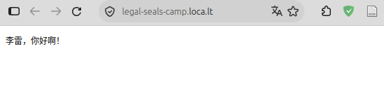

我将这个网址发给李雷，告诉他，在访问这个网址时，它会要求你输入页面上方给出的验证码，之后便可以看到来自远方的一句问候了。只是我有些累了，等明天我再为你创造那个 `echo` 命令。

# 李雷输入韩梅梅

李雷打开了我发给他的网址，看到了页面上显示的问候，然后在微信里说，哦，我看到了。

我能感受到他的语气非常平淡。他无法感受到，这世上有一个专为他而写的 Go 程序向他发来一句问候且仅此一次。即使他能感受到这些，回应的大概也不会变。毕竟这个页面所能产生的效果，还不如我直接从微信上给他发消息。他应该永远也无法理解我在激动什么，而我之所以激动，是因为在我写过的所有程序里，这是第一个能被别人在异地执行的。鲁迅早就说过，人类的悲欢并不相通。大概李雷只是觉得我吵闹……特别是那个需要手工输入 IP 地址的网页里含有太多的英文。

我很清楚，即使我能让他在那个网页里输入韩梅梅，他的反应也不过是，哦，我能输入……可是对于我而言，这个在我机器上运行的程序，若是能从异地获得别人输入的一些文字，宛若有了千里眼、顺风耳的法力。在接下来的故事里，DeepSeek 隐身了，但是你看到每一段代码，都是它写出来的。

一个能让他人输入一些文字的网页，若使让它足够简单，则其 HTML 代码为

```html
<!DOCTYPE html>
<html>
<head><meta charset="utf-8"></head>
<body>
    <form method="POST">
        <input type="text" name="from-lilei">
        <button>提交</button>
    </form>
</body>
</html>
```

如果你将上述代码保存至一份本地文件 foo.html，然后用浏览器打开它，所见网页会类似于


在上一节的 Go 程序里，只需用上述 HTML 代码替换「`李雷，你好啊！`」，

```go
http.HandleFunc("/", func(w http.ResponseWriter, r *http.Request) {
        fmt.Fprint(w, `<!DOCTYPE html>
<html>
<head><meta charset="utf-8"></head>
<body>
    <form method="POST">
        <input type="text" name="from-lilei">
        <button>提交</button>
    </form>
</body>
</html>`)
})
```

> Go 语言字符串的字面值有两种形式，可以是`"李雷，你好啊！"` 这种双引号形式，也可以是上述代码里所用的反引号形式，前者可用于表达含有一些转义字符的文本，例如可以用 `\n` 表示换行符，而后者通常用于表达多行文本的原始形式，亦即不支持任何字符的转义。

重新运行这个 Go 程序，李雷便可以看到这个含有一个文本输入框的网页了，只是无论他输入什么，这个 Go 程序都尚无法知悉。当李雷真的在输入框里敲下「韩梅梅」并点击「提交」按钮时，页面会闪烁一下，输入框里的「韩梅梅」会消失不见，因为这个 Go 程序目前不管收到什么请求，都原样返回这段 HTML 代码。

那么，这个 Go 程序如何得到李雷的输入的文字呢？上述 HTML 代码中的输入框亦即 `input` 标记，其 `name` 属性的值是 `from-lilei`，在 Go 程序里，可以用一个变量通过 `from-lilei` 获取输入框中传来的文字，

```go
http.HandleFunc("/", func(w http.ResponseWriter, r *http.Request) {
        input := r.FormValue("from-lilei")
        fmt.Printf("李雷的输入：%s\n", input)
        fmt.Fprint(w, `<!DOCTYPE html>
<html>
<head><meta charset="utf-8"></head>
<body>
    <form method="POST">
        <input type="text" name="from-lilei">
        <button>提交</button>
    </form>
</body>
</html>`)
})
```

> `fmt.Printf` 将格式化的文本在本地终端里输出，而 `fmt.Fprint` 是将格式化的文本输出到指定的对象，例如 `w`。

重新运行修改后的 Go 程序，若李雷在页面里输入了「韩梅梅」并提交，则这个程序会在其运行的终端里输出

```
李雷的输入：
李雷的输入：韩梅梅
```

李雷第一次的输入为空，是因为他刚访问页面时，还没有输入内容，但是为 `"/"` 指派的匿名函数已被调用了。当李雷开始输入内容并提交时，该匿名函数则又被调用一次，这次李雷输入的内容会被 `input` 接收，然后在我机器里的终端中被 `fmt.Printf` 输出。

可以用条件语句判断 `input` 是否有值，仅在其有值时，才在我的终端里将其输出，

```go
input := r.FormValue("from-lilei")
if input != "" {
        fmt.Printf("李雷的输入：%s\n", input)
}
```

> Go 语言的条件语句与 C 语言相似，只是条件表达式无需括号。

现在，将 hi-lilei.go 写完整，

```go
package main

import (
        "fmt"
        "net/http"
)

func main() {
        http.HandleFunc("/", func(w http.ResponseWriter, r *http.Request) {
                input := r.FormValue("from-lilei")
                if input != "" {
                        fmt.Printf("李雷的输入：%s\n", input)
                }
                fmt.Fprint(w, `<!DOCTYPE html>
                               <html>
                                 <head><meta charset="utf-8"></head>
                                 <body>
                                   <form method="POST">
                                     <input type="text" name="from-lilei">
                                     <button>提交</button>
                                   </form>
                                 </body>
                               </html>`)
        })
        http.ListenAndServe(":8080", nil)
}
```

现在可以在宏观上谈谈我对 hi-lilei.go 程序的一些理解了。一个 Go 程序的源码，若以 `package main` 开头，表示这个程序是名为 `main` 的包，若此包内含有 `main` 函数，则意味着这个包是一个可以独立运行的程序，`main` 函数是其入口。

`fmt.Fprint` 和 `fmt.Printf` 皆为 `fmt` 的函数，而 `http.HandleFunc` 和 `http.ListenAndServe` 皆为 `net/http` 的函数。`fmt` 和 `net/http` 也都是包，只是它们无法像 `main` 包那样作为程序运行，而是为其他包提供一些功能。要在 Go 程序中使用某些包的函数，须先用 `import` 载入这些包。

`http.HandleFunc` 函数为根路径指派的匿名函数的参数 `r`，现在大概能从直觉上确定它的意义了。它是一个指针，所指对象应该含有用户从浏览器发来的请求（request），而请求是什么呢？应该是一个数据包。当李雷在浏览器的一些孔洞里输入了内容并提交，则该数据包便包含李雷的输入且由浏览器发送给 Go 程序。浏览器的地址栏以及 HTML 的 `<input>` 标记都是孔洞，前者的内容可被 `http.HandleFunc` 接收，后者的内容则包含在 `http.Request` 对象中，在程序里通过 `FormValue` 根据 `<input>` 标记的名字获得。

匿名函数的另一个参数 `w`，顾名思义便是回应者（response writer）。Go 程序从浏览器发来的请求中获得数据，对其作出处理后，将结果格式化为 HTML 代码后交给 `w`，由后者将其写入数据包并发给浏览器。于是，从浏览器端来看，它向 Go 程序发送的一次请求，得到了一次回应，回应的结果便是网页的内容发生了变化。实际上，hi-lilei.go 已经创造了一个极为微小的动态网站。

不过，我没有打扰李雷，而是自己做了一些测试。我已明白，快乐其实很难与他人分享，而悲伤更是如此。当新的 hi-lilei.go 程序再度跑起来时，它已经很像一个 `echo` 命令了，只是我无法看到它的输入，而李雷没法看到它的输出，只是我自己去测试的时候，一切都能看到。

# 脚踏实地的感觉

我已经不在乎李雷是否还在乎 Linux 里真的有一个叫 `echo` 的命令。当我发现，使用 Go 语言写出 hi-lilei.go 这样的程序，能够很简单地与千里之外的人对话，才让我认识到 Go 语言值得我花一些时间学习，它可以让我不需要耗费太多心思便可让本地的一些程序具备远程交互能力，而这一切需要从一个最简单的事情开始，一个 Go 程序如何访问我的机器里的确存在着的 `echo` 命令呢？

据我所知，C 语言可以通过标准库提供的 `popen` 之类的函数调用本地其他程序并获得其输出，Go 语言也应该有类似的能力。Go 语言的确有这种能力，由 `os/exec` 包提供。现在，写一个 echo.go 程序，其代码为

```go
package main

import (
        "fmt"
        "os/exec"
)

func main() {
        cmd := exec.Command("echo", "韩梅梅")
        output, _ := cmd.Output()
        fmt.Printf("%s", output)
}
```

使用 `go run` 命令运行 echo.go，

```console
$ go run echo.go
韩梅梅
```

如我所愿，echo.go 程序执行了我的系统里的 `echo` 命令，且能将其输出转发给 `fmt.Printf` 函数，这也意味着若将 `output` 转发给 `http.ResponseWriter` 对象，则 `echo` 命令的输出发送给浏览器端了，亦即

```go
cmd := exec.Command("echo", "韩梅梅")
output, _ := cmd.Output()
http.HandleFunc("/echo", func(w http.ResponseWriter, r *http.Request) {
        fmt.Fprint(w, output)
})
http.ListenAndServe(":8080", nil)
```

用上述代码取代 echo.go 里 `main` 函数的内容，然后在 `import` 语句里载入 `net/http` 包，重新运行 echo.go 程序后，让浏览器访问 `127.0.0.1:8080/echo` 这个地址，可以看到

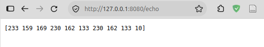

虽然所见并非韩梅梅，但应该能猜测到它是字符的某种编码。`cmd.Output` 返回两个值，第一个值是 `echo` 的输出，被我保存在 `output` 变量里，而第二个被一个我不想起名字的变量亦即 `_` 符号直接忽略掉了。不过，`output` 保存的值并非字符串，而是一个字节序列。`fmt.Printf` 函数的格式化标记 `%s` 能够将字节序列转化为正常的文本编码——UTF-8 编码，但 `fmt.Fprint` 不具备这种能力，它会将每个字节当作十进制数输出。不过，可以用 `string` 函数将字节序列转化为 UTF-8 编码，亦即只需将上述代码中为 `"/echo"` 指派的匿名函数修改为

```go
func(w http.ResponseWriter, r *http.Request) {
        fmt.Fprint(w, string(output))
}
```

再重新运行 echo.go 且重新访问 `127.0.0.1:8080/echo` 地址，则浏览器页面里便可看到「韩梅梅」。

于是，一个新世界的大门打开了，像是文明从石器时代跃迁至青铜甚至铁器时代。我试了试 `ls` 命令，亦即写一个 ls.go 程序，

```go
package main

import (
        "fmt"
        "os/exec"
        "net/http"
)

func main() {
        cmd := exec.Command("ls", "-l", "/home/garfileo")
        output, _ := cmd.Output()
        http.HandleFunc("/ls", func(w http.ResponseWriter, r *http.Request) {
                fmt.Fprint(w, string(output))
        })
        http.ListenAndServe(":8080", nil)
}
```

然后执行

```console
$ go run ls.go
```

当我访问 `127.0.0.1:8080/ls` 时，我看到了

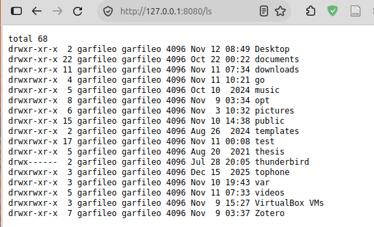

我的 Linux 里有很多命令，它们应该都能通过 Go 程序被他人调用。这意味着，即使我的 Go 语言学习过程就此戛然而止，受影响的应该主要是我写的页面没有机会变得更好看，交互方式也不再有机会变得更丰富，此外还有一些安全性问题——方便之门大开，风险自会涌入。

# 投我以木桃，报之以琼瑶

既然能够用 Go 语言将 `echo` 和 `ls` 等 Linux 命令封装为网络服务，对于更为复杂一些的软件，例如 Gnuplot，是否也能将其封装为网络服务呢？倘若可以，他人便可通过网页间接调用 Gnuplot 画出一些数学图形了。

若想实现上述需求，首先需要让网页能够支持用户输入多行文本。在网页的 HTML 代码里，将 `<input>` 标记换成 `<textarea>`，便可为用户构造支持多行文本的输入框，其初始尺寸可容纳 8 行文本，每行文本有 60 个字符的宽度，

```html
<!DOCTYPE html>
<html>
<head><meta charset="utf-8"></head>
<body>
    <form method="POST">
        <textarea name="gnuplot-code" rows="8" cols="60"></textarea>
        <button>提交</button>
    </form>
</body>
</html>
```

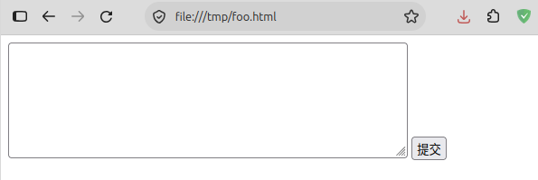

若让页面的外观略微正式一些，需要为 HTML 标记增加一些样式设定，

```html
<!DOCTYPE html>
<html>
<head><meta charset="utf-8"></head>
<body>
  <form method="POST" style="width: 480px">
    <textarea name="gnuplot-code" rows="8"
              style="display: block;
                     width: 100%;
                     box-sizing: border-box;
                     resize: vertical"></textarea>
    <button style="display: block;
                   margin-left: auto;
                   margin-bottom: 1em">提交</button>
  </form>
</body>
</html>
```

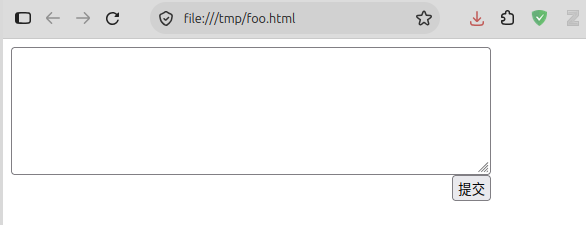

这些 HTML 样式的作用，我也不尽了然，我只知道它主要是设定了文本框的宽度以及「提交」按钮的位置。将这些 HTML 代码保存在全局变量 `page` 里，

```go
var page = `<!DOCTYPE html>
<html>
<head><meta charset="utf-8"></head>
<body>
  <form method="POST" style="width: 480px">
    <textarea name="gnuplot-code" rows="8"
              style="display: block;
                     width: 100%;
                     box-sizing: border-box;
                     resize: vertical">{{CODE}}</textarea>
    <button style="display: block;
                   margin-left: auto;
                   margin-bottom: 1em">提交</button>
  </form>
  {{IMG}}
</body>
</html>`
```

Go 语言的变量有两种声明方式，第一种是短变量声明，亦即前文所用的 `:=` 形式，例如

```go
a := 1
```

只要 `:=` 左侧是一个新的变量，则上述语句便声明了变量 `a`，并将它的值初始化为 1。短变量声明只能在函数内使用。另一种是 `var` 声明，例如

```go
var b = 1
```

声明了变量 `b` 并将其值初始化为 1。无论是短变量还是 `var` 声明，Go 编译器都能根据变量的值自动推断变量类型，上述示例中的变量 `a` 和 `b` 的类型皆被推断为 `int`。也可以在 `var` 声明中显式设定变量类型，例如

```go
var c uint = 42
```

在函数内，变量可以先声明，然后再赋值，例如

```go
var d float64
d = 3.1415
```

需要注意的是，在全局变量 `page` 的值内，我特意放置了占位符 `{{CODE}}` 与 `{{IMG}}`，前者表示用户输入的 Gnuplot 代码，后者是我机器里的 `gnuplot` 命令生成的位图文件。若想将占位符替换为具体的文本，可使用 `strings` 包的 `Replace` 函数，例如

```go
img := ``
page_with_img := strings.Replace(page, "{{IMG}}", img, 1)
```

则 `page` 中的占位符 `{{IMG}}` 部分便会被替换为给定的文本。`Replace` 函数的第 4 个参数用于设定文本替换次数，1 表示只替换一次，若该参数值为负数，表示占位符会被尽数替换。若让上述代码有效，需要在 `import` 语句中载入 `strings` 包。

现在若假设 `{{CODE}}` 的内容是一段可被 `gnuplot` 执行的代码，即

```gnuplot
var code = `set terminal png
set output "demo.png"
plot sin(1/x)`
```

则 `page` 中的 `{{CODE}}` 部分，可以替换为 `demo` 的值，

```go
page_with_code := strings.Replace(page, "{{CODE}}", code, 1)
```

于是，即使尚未开始调用 `gnuplot` 命令，也能写出一个具有欺骗性的 Go 程序 gnuplot.go，它能让别人看到一个代码输入界面和一个不存在的图片，

```go
package main

import (
        "fmt"
        "net/http"
        "strings"
)

var page = `<!DOCTYPE html>
<html>
<head><meta charset="utf-8"></head>
<body>
  <form method="POST" style="width: 480px">
    <textarea name="gnuplot-code" rows="8"
              style="display: block;
                     width: 100%;
                     box-sizing: border-box;
                     resize: vertical">{{CODE}}</textarea>
    <button style="display: block;
                   margin-left: auto;
                   margin-bottom: 1em">提交</button>
  </form>
  {{IMG}}
</body>
</html>`

func gnuplot(w http.ResponseWriter, r *http.Request) {
        var code = `set terminal png
set output "demo.png"
plot sin(1/x)`
        img := ``
        out := strings.Replace(page, "{{CODE}}", code, 1)
        input := r.FormValue("gnuplot-code")
        if input != "" {
                out = strings.Replace(out, "{{IMG}}", img, 1)
        }
        fmt.Fprint(w, out)
}

func main() {
        http.HandleFunc("/gnuplot", gnuplot)
        http.ListenAndServe(":8080", nil)
}
```

gnuplot.go 中与 `"/gnuplot"` 匹配的不再是匿名函数，而是普通的实名函数 `gnuplot`。按照 Go 语言的术语，应该称 `gnuplot` 是 `/gnuplot` 的路由函数。

现在若执行

```console
$ go run gnuplot.go
```

然后在浏览器中访问 `127.0.0.1:8080/gnuplot`，则所见如下

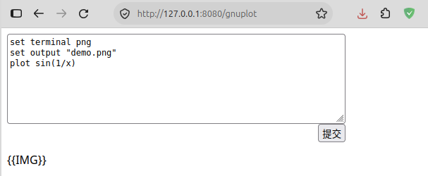

当我向 gnuplot.go 初次发送请求时，它检测到 `input` 为空，则写入网页的内容中会出现占位符 `{{IMG}}`，此时若是在网页里点「提交」按钮，则 gnuplot.go 再次接到请求，此时 `input` 不再为空，而是文本框里的代码，于是该程序便向网页中写入 `` 标签，以显示一张图片，只是该图片尚不存在，网页中会显示一个表示图片无效的图标，

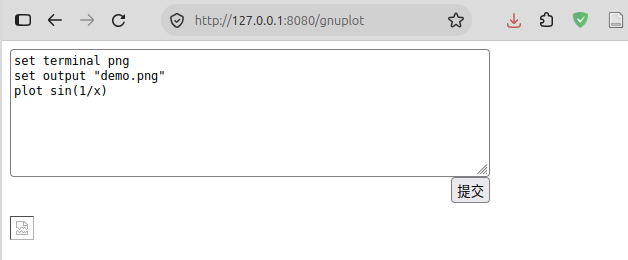

现在考虑，在 gnuplot.go 程序中，若 `input` 非空，则将其内容保存为 demo.gp 文件。该任务可由 `os.WriteFile` 函数完成，关键代码为

```go
import (
        ...
        "os"
)

os.WriteFile("demo.gp", []byte(input), 0644)
```

上述代码创建的 demo.gp 文件会与 gnuplot.go 位于同一目录，且文件权限以八进制编码 `0644` 表示。若以 Linux 权限的字母表示，该权限即 `rw-r--r--`，亦即该文件，我可以看，也可以写，而他人只能看。还需要注意，`os.WriteFile` 向文件写入的是字节序列——Go 语言称之为字节切片——，而 `input` 的值文本，亦即字符串，需要用 `[]byte` 将其转换为字节切片。若将字节切片转换为字符串，可用 `string`，前文曾做过此事。

demo.gp 文件实际上是 Gnuplot 脚本，可被 `gnuplot` 命令读取并执行其中语句，输出位图文件 demo.png。若用 Go 程序调用 `gnuplot` 命令完成此事，则关键代码可写成

```go
import (
        ...
        "os/exec"
)

if input != "" {
        os.WriteFile("demo.gp", []byte(input), 0644)
        cmd := exec.Command("gnuplot", "demo.gp")
        cmd.Run()
        out = strings.Replace(page, "{{CODE}}", input, 1)
        out = strings.Replace(out, "{{IMG}}", img, 1)
}
```

需要注意，之前用 `cmd.Output` 函数让 `cmd` 得以运行并获取所调用命令在终端里的输出内容，但是在这个例子并不需要 `gnuplot` 命令的输出内容，只需要让该命令得以运行，故而用的是 `cmd.Run` 函数。

现在，将 gnuplot.go 改进为

```go
package main

import (
        "fmt"
        "net/http"
        "strings"
        "os"
        "os/exec"
)

var page = `<!DOCTYPE html>
<html>
<head><meta charset="utf-8"></head>
<body>
  <form method="POST" style="width: 480px">
    <textarea name="gnuplot-code" rows="8"
              style="display: block;
                     width: 100%;
                     box-sizing: border-box;
                     resize: vertical">{{CODE}}</textarea>
    <button style="display: block;
                   margin-left: auto;
                   margin-bottom: 1em">提交</button>
  </form>
  {{IMG}}
</body>
</html>`

func gnuplot(w http.ResponseWriter, r *http.Request) {
        var code = `set terminal png
set output "demo.png"
plot sin(1/x)`
        out := strings.Replace(page, "{{CODE}}", code, 1)
        img := ``
        input := r.FormValue("gnuplot-code")
        if input != "" {
                os.WriteFile("demo.gp", []byte(input), 0644)
                cmd := exec.Command("gnuplot", "demo.gp")
                cmd.Run()
                out = strings.Replace(page, "{{CODE}}", input, 1)
                out = strings.Replace(out, "{{IMG}}", img, 1)
        }
        fmt.Fprint(w, out)
}

func main() {
        http.HandleFunc("/gnuplot", gnuplot)
        http.ListenAndServe(":8080", nil)
}
```

只是，执行这个程序后，若访问 `127.0.0.1:8080/gnuplot` 服务，即使向 gnuplot.go 提交了 Gnuplot 代码，网页里文本框的下方依然是图像无效标志，但是在 gnuplot.go 所在的目录中，的确已经有了 demo.png 文件。造成问题的原因是，浏览器得到 gnuplot.go 传来的网页后，会对 HTML 解析和渲染，当它遇到 `` 标记时，会自动向 gnuplot.go 再次发起请求，所用路径为 `/demo.png`，而 gnuplot.go 没有为该路径提供路由函数。

现在，为 `/demo.png` 提供路由函数，

```go
http.HandleFunc("/demo.png", func(w http.ResponseWriter, r *http.Request) {
        http.ServeFile(w, r, "demo.png")
})
```

`http.ServeFile` 函数的作用是将本地某个文件的内容作为此次请求的响应发送出去，当浏览器端得到了此次响应的内容，便将图片的内容呈现出来。将上述路由设定添加到 gnuplot.go 的 `main` 函数里，然后重新运行 gnuplot.go，此次若在浏览器里提交 Gnuplot 代码，结果为

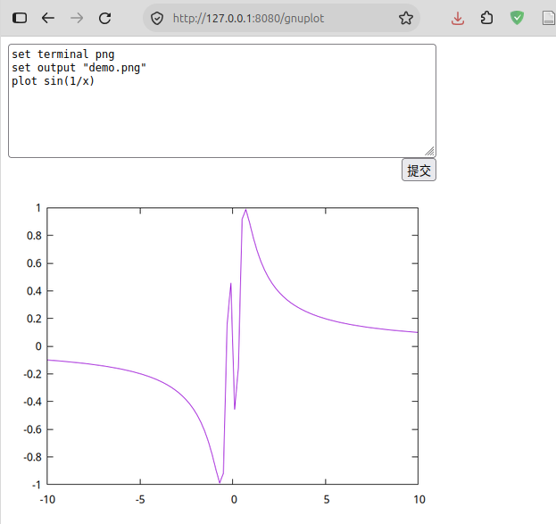

# 百手观音

上一节实现的 gnuplot.go 程序，只能用于证明此路可行，却不能证明此路甚好。实际上这个程序很是狭隘，理论上它只能有效回应一个人向它发起的请求。若是两个人或多个人同时向它发起请求，意味着他们在同时以间接方式将不同内容同时写入 demo.gp 文件，然后又以间接方式同时查看 gnuplot 命令生成的位图文件 demo.png，最终可能有人会看不到自己想要的结果。绝大多数网络程序，都要处理这种同时有很多输入和输出的情况。虽然 Go 语言已经尽力让这类任务变得颇为容易，却无法阻挡因缺乏基本并发处理意识的我写出脆弱的代码。

若让 gnuplot.go 变得更为正确一些，首先应该考虑，将每个用户的输入文本保存为文件时，应当保证该文件的名字具有唯一性。然后，让 gnuplot 命令输出的位图文件的名字也具有唯一性，这意味着之前用户可以在自己提交的 Gnuplot 代码里写

```gnuplot
set terminal png
set output "demo.png"
```

现在这个权限需要收回，用户也不会有任何反对，因为他们可以少写两行代码。

若让文件的名字具有唯一性，可以构造一个全局性的计数器，将计数器不断变化的值嵌入文件名，这是最简单也是最有效的办法。可以用一个无符号整型类型的全局变量表示这个计数器，

<pre class="go-lang"><span class="snippet-name-start">@</span><span class="snippet-name" id="xi-2"> 计数器 gp_id </span><span class="snippet-name-stop">#</span>
var gp_id uint = 0
=><span class="caller"><a class="snippet-reference" href="#xi-6"> gnuplot 函数 </a></span>
=><span class="caller"><a class="snippet-reference" href="#xi-16"> gnuplot 函数 [v2] </a></span>
</pre>

每次将用户的输入文本保存为文件前，让计数器增 1，当此值大于 100 时，便归零。这意味着 gnuplot.go 提供的服务最多同时支持 100 人在线访问。Go 语言提供了字符串格式化函数，可以将计数器的值转化为字面符号，作为文件名后缀，例如

<pre class="go-lang"><span class="snippet-name-start">@</span><span class="snippet-name" id="xi-3"> 构造唯一的文件名 </span><span class="snippet-name-stop">#</span>
if gp_id > 99 {
        gp_id = 0
}
gp_id++
gp_name := fmt.Sprintf("drawing-%d", gp_id)
gp_file_name := gp_name + ".gp"
=><span class="caller"><a class="snippet-reference" href="#xi-5"> 处理用户输入 </a></span>
</pre>

在将 gnuplot.go 中的 `input` 的值写入文件之前，在 `input` 首部加入 Gnuplot 图形输出终端的设定语句，

<pre class="go-lang"><span class="snippet-name-start">@</span><span class="snippet-name" id="xi-4"> 构造唯一的文件名 </span><span class="snippet-name-stop">#</span> +
new_input := "\nset terminal png\nset output "
new_input += `"` + gp_name + `.png"` + "\n" + input
</pre>

这一切都发生在 gnuplot.go 的 `input` 的值非空时，

<pre class="go-lang"><span class="snippet-name-start">@</span><span class="snippet-name" id="xi-5"> 处理用户输入 </span><span class="snippet-name-stop">#</span>
if input != "" {
        <span class="snippet-name-start">#</span><a class="snippet-reference" href="#xi-3"> 构造唯一的文件名 </a><span class="snippet-name-stop">@</span>
        os.WriteFile(gp_file_name, []byte(new_input), 0644)
        cmd := exec.Command("gnuplot", gp_file_name)
        cmd.Run()
        out = strings.Replace(page, "{{CODE}}", input, 1)
        img := `&lt;img src="` + gp_name + `.png" width="480px" /&gt;`
        out = strings.Replace(out, "{{IMG}}", img, 1)
}
=><span class="caller"><a class="snippet-reference" href="#xi-6"> gnuplot 函数 </a></span>
</pre>

上述所写的代码片段使用的 `@ ... #` 表示一个代码片段的名字。在一个代码片段里，若使用 `# ... @`，表示将指定名字的代码片段的内容插入此处。这些符号皆为我设计的文学编程标记，而非 Go 语言的语法。这些标记并非仅能用于示意，它们也方便从文档里抽取代码片段，详见《[xi：一个简单的文学编程工具](https://zhuanlan.zhihu.com/p/2096395349250269589)》。

gnuplot.go 的 `gnuplot` 函数现在可修改为

<pre class="go-lang"><span class="snippet-name-start">@</span><span class="snippet-name" id="xi-6"> gnuplot 函数 </span><span class="snippet-name-stop">#</span>
<span class="snippet-name-start">#</span><a class="snippet-reference" href="#xi-2"> 计数器 gp_id </a><span class="snippet-name-stop">@</span>
func gnuplot(w http.ResponseWriter, r *http.Request) {
        var code = "plot sin(1/x)"
        out := strings.Replace(page, "{{CODE}}", code, 1)
        input := r.FormValue("gnuplot-code")
        <span class="snippet-name-start">#</span><a class="snippet-reference" href="#xi-5"> 处理用户输入 </a><span class="snippet-name-stop">@</span>
        fmt.Fprint(w, out)
}
</pre>

用上述代码片段替换 gnuplot.go 中的 `gnuplot` 函数，便可保证多个用户可以同时提交 Gnuplot 代码而不会产生冲突。但是，当浏览器得到响应后，发现自己需要再次发送请求，方能获得诸如 drawing-1.png、drawing-2.png、…… 等位图文件，而 gnuplot.go 不可能为每个位图文件路径都提供路由函数。Go 语言的 `http` 包早已想到了这种需求，它提供了 http.FileServer 函数和 http.Dir 类型，可以将指定的目录作为浏览器端所认为的根目录，并将其作为 Go 程序中根路径的路由，亦即

<pre class="${language}-lang"><span class="snippet-name-start">@</span><span class="snippet-name" id="xi-7"> 设置网站根目录 </span><span class="snippet-name-stop">#</span>
http.Handle("/", http.FileServer(http.Dir(".")))
=><span class="caller"><a class="snippet-reference" href="#xi-8"> 设置了网站根目录的 main 函数 </a></span>
</pre>

`.` 表示当前目录，亦即 gnuplot.go 程序所在目录，该目录会被浏览器端视为根目录，然后便可请求 gnuplot.go 将该目录下的 `drawing-1.png`、`drawing-2.png`、…… 等文件作为响应发给它。

现在只需将 gnuplot.go 的 `main` 函数修改为

<pre class="${language}-lang"><span class="snippet-name-start">@</span><span class="snippet-name" id="xi-8"> 设置了网站根目录的 main 函数 </span><span class="snippet-name-stop">#</span>
func main() {
        http.HandleFunc("/gnuplot", gnuplot)
        <span class="snippet-name-start">#</span><a class="snippet-reference" href="#xi-7"> 设置网站根目录 </a><span class="snippet-name-stop">@</span>
        http.ListenAndServe(":8080", nil)
}
</pre>

便有了一个新的 Gnuplot 网络服务程序了，若用户 A 向它提交 drawing-1.gp 文件，则该程序以 gnuplot 命令生成的位图文件 drawing-1.png 作为响应，同时若用户 B 向它提交 drawing-2.gp 文件，则该程序以 gnuplot 命令生成的位图文件 drawing-2.png 作为响应……永远不会出现一个用户得到的是另一个用户想要的结果，前提是用户在线人数小于 100。

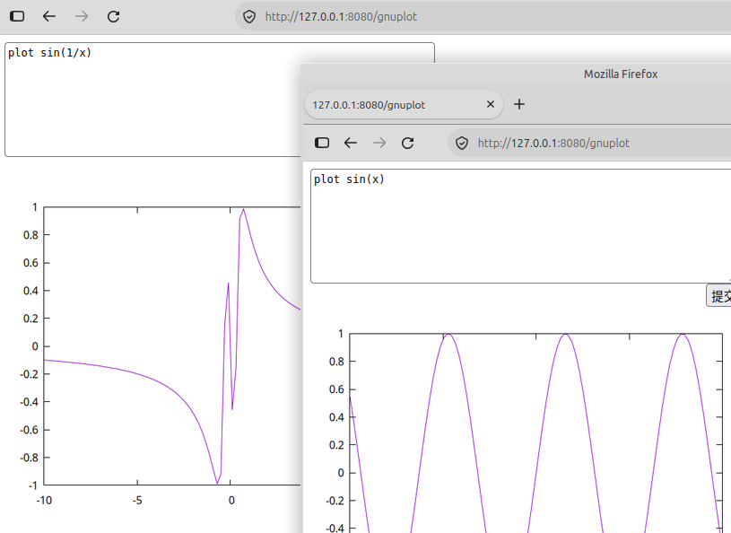

# 多闻数穷，不若守中

也许你已经发现了，上一节所写的 gnuplot.go 程序在本质上依然不支持多用户同时在线访问，它没有真正解决问题，只是将问题从固定的两个文件转移到了计数器身上了。问题集中在下面这几行代码上，

<pre class="go-lang"><span class="snippet-name-start">@</span><span class="snippet-name" id="xi-9"> 更新 gp_id </span><span class="snippet-name-stop">#</span>
if gp_id &gt; 99 {
        gp_id = 0
}
gp_id++
gp_name := fmt.Sprintf("drawing-%d", gp_id)
=><span class="caller"><a class="snippet-reference" href="#xi-16"> gnuplot 函数 [v2] </a></span>
</pre>

当多个用户同时向 gnuplot.go 发起请求时，后者便会同时执行上述代码多次，由于 `gp_id` 是全局变量，于是又出现了多次同时修改同一个对象的情况。可能用户 A 拿到的 `gp_id` 值本该是 1，但是用户 B 同时执行了这段代码，导致 A 拿到的值是 2，亦即 A 得到的文件名 `gp_name` 实际上是 B 之所求。观音虽有百手，但其本体却只有 1 个，`gp_id` 则是其本体的一部分。

为了克服这类问题，Go 语言的 `sync` 包提供了互斥锁机制。该机制的想法非常简单，就是给一段代码加一把锁。锁本身也是一个全局变量，例如

<pre class="go-lang"><span class="snippet-name-start">@</span><span class="snippet-name" id="xi-10"> gp_id 锁 </span><span class="snippet-name-stop">#</span>
var gp_id_mu sync.Mutex
=><span class="caller"><a class="snippet-reference" href="#xi-16"> gnuplot 函数 [v2] </a></span>
</pre>

对上述的「更新 gp_id」代码片段加锁和解锁的过程可表示为

<pre class="go-lang"><span class="snippet-name-start">@</span><span class="snippet-name" id="xi-11"> 更新 gp_id </span><span class="snippet-name-stop">#</span> ^+
gp_id_mu.Lock()
</pre>

<pre class="go-lang"><span class="snippet-name-start">@</span><span class="snippet-name" id="xi-12"> 更新 gp_id </span><span class="snippet-name-stop">#</span> +
gp_id_mu.Unlock()
</pre>

上述代码我用了两个新的文学编程标记，`^+` 表示指定的代码片段之前插入代码，`+` 则表示在指定的代码片段之后插入代码。上述示例产生的效果是，在名字为「`更新 gp_id`」这段代码之前添加

```go
gp_id_mu.Lock()
```

然后在其之后添加

```go
gp_id_mu.Unlock()
```

于是，意味着名字为「`更新 gp_id`」这段代码最终变为

```
gp_id_mu.Lock()
if gp_id > 99 {
        gp_id = 0
}
gp_id++
gp_name := fmt.Sprintf("drawing-%d", gp_id)
gp_id_mu.Unlock()
```

如此一来，对 `gp_id` 的修改和取值操作便会被 `gp_id_mu` 的 `Lock` 和 `Unlock` 构成的区域保护起来，这段区域称为临界区。

当多个用户同时发起请求，为其服务的 Go 程序里必须构造相应数量的程序流。这些程序流是同时运行的，至少是让人在感觉上是同时运行的，当它们抵达临界区时，其中某个程序流会得到一把锁，例如 `gp_id_mu`。持锁者可将临界区锁起（Lock），如此一来，其他程序流只能临界区外等候，直到持锁者在走出临界区时解锁（Unlock），下一个得锁的幸运者才有机会进入临界区，如此交替，直至所有程序流穿过临界区。这个过程自然是要以时间为代价的，亦即 gnuplot.go 程序不如之前的版本跑得快，只是用户通常感受不到这点差异，毕竟 gnuplot.go 在调用 gnuplot 命令时耗费的时间远大于更新 `gp_id` 的值。

现在，正式写出一个真正可用的 gnuplot.go 程序，并且再普及如何用文学编程的方式定义一些代码片段，并将其组装为完整的程序。首先，需要写出程序几乎千篇一律的开头，它们的区别通常仅仅是所需要的包有所不同，

<pre class="go-lang"><span class="snippet-name-start">@</span><span class="snippet-name" id="xi-13"> gnuplot.go 程序开头 </span><span class="snippet-name-stop">#</span>
package main

import (
        <span class="snippet-name-start">#</span><a class="snippet-reference" href="#xi-14"> gnuplot 服务所需要的包 </a><span class="snippet-name-stop">@</span>
)
=><span class="caller"><a class="snippet-reference" href="#xi-18"> gnuplot.go 程序 </a></span>
</pre>

gnuplot.go 需要以下包

<pre class="go-lang"><span class="snippet-name-start">@</span><span class="snippet-name" id="xi-14"> gnuplot 服务所需要的包 </span><span class="snippet-name-stop">#</span>
"fmt"
"net/http"
"strings"
"os"
"os/exec"
"sync"
=><span class="caller"><a class="snippet-reference" href="#xi-13"> gnuplot.go 程序开头 </a></span>
</pre>

gnuplot.go 的网页界面保存在全局变量 `page` 中，

<pre class="go-lang"><span class="snippet-name-start">@</span><span class="snippet-name" id="xi-15"> gnuplot 的网页界面 </span><span class="snippet-name-stop">#</span>
var page = `&lt;!DOCTYPE html&gt;
&lt;html&gt;
&lt;head&gt;&lt;meta charset="utf-8"&gt;&lt;/head&gt;
&lt;body&gt;
  &lt;form method="POST" style="width: 480px"&gt;
    &lt;textarea name="gnuplot-code" rows="8"
              spellcheck="false"
              style="display: block;
                     width: 100%;
                     box-sizing: border-box;
                     resize: vertical"&gt;{{CODE}}&lt;/textarea&gt;
    &lt;button style="display: block;
                   margin-left: auto;
                   margin-bottom: 1em"&gt;提交&lt;/button&gt;
  &lt;/form&gt;
  {{IMG}}
&lt;/body&gt;
&lt;/html&gt;`
=><span class="caller"><a class="snippet-reference" href="#xi-18"> gnuplot.go 程序 </a></span>
</pre>

对于用户从网页文本框中提交的文本，处理过程为

<pre class="go-lang"><span class="snippet-name-start">@</span><span class="snippet-name" id="xi-16"> gnuplot 函数 [v2] </span><span class="snippet-name-stop">#</span>
<span class="snippet-name-start">#</span><a class="snippet-reference" href="#xi-10"> gp_id 锁 </a><span class="snippet-name-stop">@</span>
<span class="snippet-name-start">#</span><a class="snippet-reference" href="#xi-2"> 计数器 gp_id </a><span class="snippet-name-stop">@</span>
func gnuplot(w http.ResponseWriter, r *http.Request) {
        var code = "plot sin(1/x)"
        out := strings.Replace(page, "{{CODE}}", code, 1)
        input := r.FormValue("gnuplot-code")
        if input != "" {
                <span class="snippet-name-start">#</span><a class="snippet-reference" href="#xi-9"> 更新 gp_id </a><span class="snippet-name-stop">@</span>
                gp_file_name := gp_name + ".gp"
                os.WriteFile(gp_file_name, []byte(new_input), 0644)
                cmd := exec.Command("gnuplot", gp_file_name)
                cmd.Run()
                out = strings.Replace(page, "{{CODE}}", input, 1)
                img := `&lt;img src="` + gp_name + `.png" width="480px" /&gt;`
                out = strings.Replace(out, "{{IMG}}", img, 1)
        }
        fmt.Fprint(w, out)
}
=><span class="caller"><a class="snippet-reference" href="#xi-18"> gnuplot.go 程序 </a></span>
</pre>

在 gnuplot.go 的 `main` 函数中，设定路由函数，并启动网络服务，

<pre class="go-lang"><span class="snippet-name-start">@</span><span class="snippet-name" id="xi-17"> gnuplot.go 的 main 函数 </span><span class="snippet-name-stop">#</span>
func main() {
        http.HandleFunc("/gnuplot", gnuplot)
        http.Handle("/", http.FileServer(http.Dir(".")))
        http.ListenAndServe(":8080", nil)
}
=><span class="caller"><a class="snippet-reference" href="#xi-18"> gnuplot.go 程序 </a></span>
</pre>

将上述代码片段组装起来，便可得到 gnuplot.go 程序，

<pre class="go-lang"><span class="snippet-name-start">@</span><span class="snippet-name" id="xi-18"> gnuplot.go 程序 </span><span class="snippet-name-stop">#</span>
<span class="snippet-name-start">#</span><a class="snippet-reference" href="#xi-13"> gnuplot.go 程序开头 </a><span class="snippet-name-stop">@</span>
<span class="snippet-name-start">#</span><a class="snippet-reference" href="#xi-15"> gnuplot 的网页界面 </a><span class="snippet-name-stop">@</span>
<span class="snippet-name-start">#</span><a class="snippet-reference" href="#xi-16"> gnuplot 函数 [v2] </a><span class="snippet-name-stop">@</span>
<span class="snippet-name-start">#</span><a class="snippet-reference" href="#xi-17"> gnuplot.go 的 main 函数 </a><span class="snippet-name-stop">@</span>
</pre>

若已经装了 xi 程序，且已获得本文档的源文件「[go-with-me.xi](https://liyanrui.github.io/2026/go-with-me/go-with-me.xi)」，执行

```console
$ xi -t -e "gnuplot.go 程序" -o gnuplot.go go-with-me.xi
```

便可得到完整的且含有本节更新内容的 gnuplot.go 程序，它已经是一个可以真正使用的网络服务程序了，只是该程序调用的 `gnuplot` 命令不是足够安全，不过运行该程序，仅向自己的朋友提供服务基本可行。

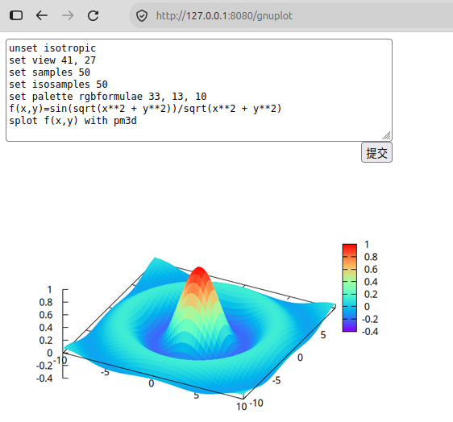

# 创建一个网站

在「百手观音」一节，为了让用户的浏览器端能够获得 Gnuplot 生成的位图文件，使用了以下代码

```go
http.Handle("/", http.FileServer(http.Dir(".")))
```

将 gnuplot.go 程序的工作目录暴露出来，让浏览器端觉得该目录即这个网站根目录。若此时 gnuplot.go 程序正在运行，在浏览器端访问 `127.0.0.1:8080`，所见景象为

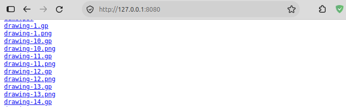

这意味着，当浏览器端向 gnuplot.go 程序发来根路径的请求是，后者会将自身工作目录里的文件列表作为响应发送给浏览器端，这也意味着浏览器端可以访问该目录里的任何一个文件。DeepSeek 在审阅前文时，已多次指出这个问题。它把写教程，当成做项目了。

`http.FileServer` 有一个特殊效用，它暴露出的目录若含有 index.html 文件，则浏览器不再显示文件列表，而是显示这个网页。这意味着即使 Go 程序没有在该目录内生成任何东西，该目录也可以作为一个静态网站使用。

我曾写过一个可以构建静态网站的 Bash 脚本，见「[如何用 90 行代码写一个静态网站构造工具](https://zhuanlan.zhihu.com/p/2097600582026637372)」，实际上这个脚本建立的只是一些目录，且每个目录内皆有 index.html 文件。以前，我若想让他人访问该网站，需要在 nginx 中部署，虽然不难，但是现在用 Go 程序部署这个网站，也只是三言两语。例如，我在 `/home/garfileo/public` 目录中用上述 Bash 脚本构建了一个静态网站，其根目录为 `my-site`，则下面的这个 Go 程序便可将该目录部署为可让他人访问的网站，

<pre class="${language}-lang"><span class="snippet-name-start">@</span><span class="snippet-name" id="xi-19"> my-site.go </span><span class="snippet-name-stop">#</span>
package main
import ("net/http")
func main() {
        http.Handle("/", http.FileServer(http.Dir("/home/garfileo/public/my-site")))
        http.ListenAndServe(":8080", nil)
}
</pre>

如此一来，每当他人用浏览器访问我的网站时，若需要载入图片之类的资源，例如浏览器遇到

```html

```

它会向 my-site.go 程序发起请求，要求后者处理 `/drawing-1.png` 路径。由于 my-site.go 没有为该路径设定路由函数，故而会以 `/` 路径的路由函数兜底。于是 `http.FileServer` 会接手这个请求，它先将 `http.Dir("/home/garfileo/public/my-site")` 当作网站根目录，然后将请求路径 `/drawing-1.png` 映射成文件路径 `/home/garfileo/public/my-site/drawing-1.png`，若该文件存在，它便将文件内容作为此次请求的最终响应传给浏览器。

若是大致能明白 `http.FileServer` 所做的工作，便可对前文中已经多次修改的 gnuplot.go 程序再作一些修改，将其输入数据和输出的位图文件放在一个专门划定目录里，如此可让 gnuplot.go 的工作目录不再充满许多 drawing-xx.gp 和 drawing-xx.png 之类的文件了。不过，我不打算尝试。虽然这的确是一件有意义的事，可是出现在教程里，会过于乏味，不过倒是可以作为一道练习题。

# 相似性

关于 Go 语言的 http 包的故事至此应该结束了，再继续下去，会陷入到蜂拥而至的网络技术细节里，而理解 Go 语言之精髓的机会变得越来越小，更何况我现在并没有打算向成为网络编程专家的方向发展。不过，这个教程仍需继续，因为我还没学会 Go 语言。为了维持这个目标，我需要将问题变换为，如何使用 Go 语言写一些命令行程序，在单机环境里模拟网络后端程序效果。我这样说，可能会让你产生错觉，认为我要重新写一个自己的 http 包，至少 DeepSeek 有这种错觉。实际上并非如此，例如这一节的任务是写一个简单的命令行程序，使之能响应 `echo` 命令传给它的路径，例如

```console
$ echo "127.0.0.1:8080/" | go run hi.go
There is no place like it.
```

亦即 hi.go 程序通过管道，将 `echo` 命令的输出作为请求，给出的响应是在终端输出的很随便的一句话，然而 `echo` 命令的行为很像浏览器地址栏里输入 `127.0.0.1:8080` 并回车提交。

在 Linux 或其他类 Unix 系统中，一个普通的命令行程序通常会假设其输入来自标准输入设备（例如键盘），程序运行结果则发送给标准输出设备（例如计算机屏幕）。管道 `|` 可以将一个命令的输出作为另一个命令的输入，如此便可将多个命令行程序衔接起来。上述的 `echo` 命令和 `go run hi.go` 命令用管道衔接起来之后，你便可以从直觉上认为，`echo` 在向一个程序提交请求。换言之，你所理解的网络服务机制，在单机环境里存在着与之结构相似的机制，且后者更为简单。再例如，你觉得微分与积分很难，却不会觉得数数与求和很难。简单的机制可以帮助你建立思维模型，亦即形成某种直觉。

在 Go 语言中，标准输入设备即 `os.Stdin`，可以用 `io.ReadAll` 从标准输入中获取全部数据，例如

```
package main

import (
        "fmt"
        "io"
        "os"
)

func main() {
        data, _ := io.ReadAll(os.Stdin)
        fmt.Print(string(data))
}
```

假设上述代码即 hi.go 程序，运行它，

```console
$ go run hi.go
```

便会发现这个程序什么都不做，但也不退出，而在准备从标准输入设备里读取数据，然而此刻无数据可读。利用管道，便可将 `echo` 命令的输出与 hi.go 的 `os.Stdin` 对接，后者便有数据可读，它将读出来的数据保存在 `data` 变量里，然后调用 `fmt.Print` 函数将 `data` 的值写入默认的标准输出设备亦即屏幕，于是便造就了一个很无聊的程序，

```console
$ echo "127.0.0.1:8080/" | go run hi.go
127.0.0.1:8080/
```

实际上借助管道，还能将 Go 程序的输出再作为另一个命令的输入，例如

```console
$ echo "127.0.0.1:8080/" | go run hi.go | cat
127.0.0.1:8080/
```

> `cat` 命令可以读取标准输入中的内容，然后将读取结果写入标准输出。

现在，我希望 hi.go 能够识别根路径，并作出响应。`strings.Index` 可以从一个字符串中搜索指定目标，搜索结果是目标在字符串中首次出现的位置，例如

```go
// 导入 strings 包
import (
        ...
        "strings"
)

// 输出 14，即查找目标在字符串中的下标，是字节下标，而非字符下标
fmt.Printf("%d\n", strings.Index("127.0.0.1:8080/", "/"))
```

Go 语言允许字符串使用字节切片语法，基于字节下标，从字符串里截取一段，例如

```go
a := "hello"
// 输出字符串 "ll"
fmt.Printf("%s", a[2:4])
```

用下标设定切片范围时，下标从 0 开始，且构造的区间是左闭右开的。如果切片范围未指定区间右界，则默认以字符串长度作为右界，接上例，

```go
// 输出字符串 "llo"
fmt.Printf("%s", a[2:])
```

上述代码等效于

```go
// 输出字符串 "llo"
fmt.Printf("%s", a[2:len(a)])
```

基于 `strings.Index` 和字符串切片语法，可将 `127.0.0.1:8080/` 中根路径之前文本消除，

```go
url := "127.0.0.1:8080/"
// 输出字符串 "/"
fmt.Printf("%s", url[strings.Index(url, "/"):]) 
```

现在，可以写出符合需求的 hi.go 了，

<pre class="${language}-lang"><span class="snippet-name-start">@</span><span class="snippet-name" id="xi-20"> hi.go </span><span class="snippet-name-stop">#</span>
package main

import (
        "fmt"
        "io"
        "os"
        "strings"
)

func main() {
        data, _ := io.ReadAll(os.Stdin)
        url := string(data)
        request := url[strings.Index(url, "/"):]
        response := "There is no place like it."
        if request == "/" {
                fmt.Printf("%s\n", response)
        }
}
</pre>

可是，此时若执行

```console
$ echo "127.0.0.1:8080/" | go run hi.go
```

不会得到任何输出，因为 `echo` 会自动在其输出的文本之后添加换行符 `\n`，故而代码里与 `request` 比较的应该是 `"/\n"`。不过，不改动 hi.go 也无妨，`echo` 命令可以用 `-n` 选项禁止在文本之后添加换行符，例如

```console
$ echo -n "127.0.0.1:8080/" | go run hi.go
There is no place like it.
```

需要注意的是，若 `strings.Index` 未能在字符串中发现目标的存在，会返回 -1，为了让 hi.go 更为健壮，需要处理这种特殊情况，

```go
i := strings.Index(url, "/")
if i < 0 {
        return
}
request := url[i:]
```

实际上，还有一种意外情况，即读取 `os.Stdin` 中的内容时，`io.ReadAll` 可能会返回错误值，然而本文档在前文中一向是用 `_` 忽略错误值的情况。从现在开始，应尽力不推卸处理错误的责任，故而需将 `os.Stdin` 获取数据的过程写得更稳严谨一些，

```go
data, err := io.ReadAll(os.Stdin)
if err != nil {
        fmt.Fprintln(os.Stderr, err)
        return
}
```

> Go 语言的 fmt 包中常用的几种 `print` 函数，若以 `ln` 为后缀，表示会在输出的信息尾部添加换行符；若以 `f` 为后缀，则支持字符串格式化；若以 `F` 为前缀，表示将字符串写入某个对象，例如文件；若以 `S` 为前缀，表示返回新的字符串。`f` 与 `ln` 二选一，不会同时出现。

错误处理，通常只需输出错误信息，然后让函数提前返回。注意，错误信息是用 `fmt.Fprinfln` 写到标注错误设备，如此可防止错误信息出现在程序的正常输出中。`nil` 表示「无值」。

# 小题大做

当 hi.go 程序看到路径 `/` 时，它的内心并未出现任何异样，因为这不过是仅含有 1 个字符的字符串，直到有一天它忽然明白了，出来混，面子要自己给，即使自身如此简陋，依然不妨碍自己郑重宣布 `/` 是根路径，并且认为它的出现会触发一个函数，也不妨碍它雇佣一个叫做 `handle_func` 的函数，将路径与其要触发的函数关联起来。

`handle_func` 函数需要接受两个参数，

```go
func handle_func(path string, 第 2 个参数的类型是什么？) {
        ... ... ...
}
```

第 2 个参数是函数，可是函数类型该如何写呢？由于我希望第 2 个参数的样子像

```go
func handle_func(w *string, r string) {
        ... ... ...
}
```

故而 `handle_func` 函数的第 2 个参数的类型可写为 `func(*string, string)`，其中 `*string` 是字符串指针类型。若对指针类型一无所知，可暂且保持无知，先写出 `handle_func` 的定义，

```go
func handle_func(path string, handler func(*string, string)) {
        如何建立 path 与 handler 的映射？
}
```

Go 语言提供了 `map` 容器，可用于关联两个对象，只是创建这种容器对象的语法有些古怪，例如，

<pre class="GO-lang"><span class="snippet-name-start">@</span><span class="snippet-name" id="xi-21"> 路由表 </span><span class="snippet-name-stop">#</span>
var routers = make(map[string]func(*string, string))
=><span class="caller"><a class="snippet-reference" href="#xi-27"> 有面子的 hi.go 程序 </a></span>
=><span class="caller"><a class="snippet-reference" href="#xi-31"> hi.go 长生之一 </a></span>
=><span class="caller"><a class="snippet-reference" href="#xi-33"> hi.go 长生之二 </a></span>
=><span class="caller"><a class="snippet-reference" href="#xi-35"> hi.go 长生之三 </a></span>
=><span class="caller"><a class="snippet-reference" href="#xi-40"> hi.go 长生之四 </a></span>
=><span class="caller"><a class="snippet-reference" href="#xi-44"> 可分身的 hi.go </a></span>
</pre>

要创建 `map` 容器需要用 `make` 函数。上述代码所创建的 `map` 容器，可以容纳 `string` 类型到 `func(*string, string)` 类型的映射，也可将方括号内的类型理解为「键」类型，将方括号之后跟随的类型理解为「值」类型，亦即将 `map` 理解为散列表。

将 `handle_func` 函数的两个参数存入 `routers` 便可建立二者的映射，

<pre class="GO-lang"><span class="snippet-name-start">@</span><span class="snippet-name" id="xi-22"> handle_func 函数 </span><span class="snippet-name-stop">#</span>
func handle_func(path string, handler func(*string, string)) {
        routers[path] = handler
}
=><span class="caller"><a class="snippet-reference" href="#xi-27"> 有面子的 hi.go 程序 </a></span>
=><span class="caller"><a class="snippet-reference" href="#xi-31"> hi.go 长生之一 </a></span>
=><span class="caller"><a class="snippet-reference" href="#xi-33"> hi.go 长生之二 </a></span>
=><span class="caller"><a class="snippet-reference" href="#xi-35"> hi.go 长生之三 </a></span>
=><span class="caller"><a class="snippet-reference" href="#xi-40"> hi.go 长生之四 </a></span>
=><span class="caller"><a class="snippet-reference" href="#xi-44"> 可分身的 hi.go </a></span>
</pre>

假设有一个 `func(*string, string)` 类型的函数，其定义为

<pre class="GO-lang"><span class="snippet-name-start">@</span><span class="snippet-name" id="xi-23"> handle 实例 foo </span><span class="snippet-name-stop">#</span>
func foo(w *string, r string) {
        *w = fmt.Sprintf("对于 %s，我认为烟涛微茫信难求！", r)
}
=><span class="caller"><a class="snippet-reference" href="#xi-27"> 有面子的 hi.go 程序 </a></span>
=><span class="caller"><a class="snippet-reference" href="#xi-31"> hi.go 长生之一 </a></span>
=><span class="caller"><a class="snippet-reference" href="#xi-33"> hi.go 长生之二 </a></span>
=><span class="caller"><a class="snippet-reference" href="#xi-35"> hi.go 长生之三 </a></span>
=><span class="caller"><a class="snippet-reference" href="#xi-40"> hi.go 长生之四 </a></span>
=><span class="caller"><a class="snippet-reference" href="#xi-44"> 可分身的 hi.go </a></span>
</pre>

若让 `/` 映射到 `foo`，只需

<pre class="GO-lang"><span class="snippet-name-start">@</span><span class="snippet-name" id="xi-24"> 建立路径 / 到 foo 的映射 </span><span class="snippet-name-stop">#</span>
handle_func("/", foo)
=><span class="caller"><a class="snippet-reference" href="#xi-27"> 有面子的 hi.go 程序 </a></span>
=><span class="caller"><a class="snippet-reference" href="#xi-31"> hi.go 长生之一 </a></span>
=><span class="caller"><a class="snippet-reference" href="#xi-33"> hi.go 长生之二 </a></span>
=><span class="caller"><a class="snippet-reference" href="#xi-35"> hi.go 长生之三 </a></span>
=><span class="caller"><a class="snippet-reference" href="#xi-40"> hi.go 长生之四 </a></span>
=><span class="caller"><a class="snippet-reference" href="#xi-44"> 可分身的 hi.go </a></span>
=><span class="caller"><a class="snippet-reference" href="#xi-55"> hi.go：协程 + 信道 </a></span>
=><span class="caller"><a class="snippet-reference" href="#xi-57"> hi.go：并发 + 信道 </a></span>
</pre>

hi.go 程序从标准输入中获取其他程序请求的路径，

<pre class="GO-lang"><span class="snippet-name-start">@</span><span class="snippet-name" id="xi-25"> 获取其他程序请求的路径 </span><span class="snippet-name-stop">#</span>
data, err := io.ReadAll(os.Stdin)
if err != nil {
        fmt.Fprintln(os.Stderr, err)
        return
}
url := string(data)
i := strings.Index(url, "/")
if i &lt; 0 {
        return
}
request := url[i:]
=><span class="caller"><a class="snippet-reference" href="#xi-27"> 有面子的 hi.go 程序 </a></span>
=><span class="caller"><a class="snippet-reference" href="#xi-28"> 需要长生的代码片段 </a></span>
</pre>

然后通过 `routers[request]` 便可调用路由表中的函数，

<pre class="GO-lang"><span class="snippet-name-start">@</span><span class="snippet-name" id="xi-26"> 触发路由函数 </span><span class="snippet-name-stop">#</span>
var response string
if routers[request] != nil {
        routers[request](&amp;response, request)
} else {
        routers["/"](&amp;response, request)
}
fmt.Println(response)
=><span class="caller"><a class="snippet-reference" href="#xi-27"> 有面子的 hi.go 程序 </a></span>
=><span class="caller"><a class="snippet-reference" href="#xi-28"> 需要长生的代码片段 </a></span>
=><span class="caller"><a class="snippet-reference" href="#xi-31"> hi.go 长生之一 </a></span>
=><span class="caller"><a class="snippet-reference" href="#xi-33"> hi.go 长生之二 </a></span>
=><span class="caller"><a class="snippet-reference" href="#xi-34"> 有请求则响应，否则静默片刻 </a></span>
=><span class="caller"><a class="snippet-reference" href="#xi-39"> 受 /tmp/hi.sig 控制的请求/响应过程 </a></span>
</pre>

于是，一个颇有气势的 hi.go 程序就此诞生，

<pre class="GO-lang"><span class="snippet-name-start">@</span><span class="snippet-name" id="xi-27"> 有面子的 hi.go 程序 </span><span class="snippet-name-stop">#</span>
package main

import (
        "fmt"
        "io"
        "os"
        "strings"
)

<span class="snippet-name-start">#</span><a class="snippet-reference" href="#xi-21"> 路由表 </a><span class="snippet-name-stop">@</span>
<span class="snippet-name-start">#</span><a class="snippet-reference" href="#xi-22"> handle_func 函数 </a><span class="snippet-name-stop">@</span>
<span class="snippet-name-start">#</span><a class="snippet-reference" href="#xi-23"> handle 实例 foo </a><span class="snippet-name-stop">@</span>

func main() {
        <span class="snippet-name-start">#</span><a class="snippet-reference" href="#xi-24"> 建立路径 / 到 foo 的映射 </a><span class="snippet-name-stop">@</span>
        <span class="snippet-name-start">#</span><a class="snippet-reference" href="#xi-25"> 获取其他程序请求的路径 </a><span class="snippet-name-stop">@</span>
        <span class="snippet-name-start">#</span><a class="snippet-reference" href="#xi-26"> 触发路由函数 </a><span class="snippet-name-stop">@</span>
}
</pre>

hi.go 程序的面子里，有几分是指针类型添的彩。在触发路由函数的语句里，

```go
var response string
routers[request](&response, request)
```

路由函数的第一个参数是 `reponse` 的地址，而在路由函数 `foo` 的定义中，会更新该地址中的数据，亦即

```go
*w = fmt.Sprintf("对于 %s，我认为烟涛微茫信难求！", r)
```

`request` 变量是在 `main` 函数中定义的，但是却能在 `foo` 函数中修改。即使你对指针一无所知，也可以将其理解为，基于指针可以「远程」操作变量，指针就像网线，通过它可以传递数据。

试着运行新的 hi.go 程序，

```console
$ echo -n "127.0.0.1:8080" | go run hi.go
$ echo -n "127.0.0.1:8080/" | go run hi.go
对于 /，我认为烟涛微茫信难求！
$ echo -n "127.0.0.1:8080/foo" | go run hi.go
对于 /foo，我认为烟涛微茫信难求！
```

若一个 Go 程序，要反复运行测试，每次都用 `go run` 命令，意味着每次都要用 Go 语言编译器 go 编译该程序，这是没必要的资源和时间浪费。go 可以将 Go 程序从源码编译为可执行文件，若反复运行后者，便可省去其编译过程，例如

```console
$ go build hi.go
$ echo -n "127.0.0.1:8080" | ./hi
$ echo -n "127.0.0.1:8080/" | ./hi
对于 /，我认为烟涛微茫信难求！
$ echo -n "127.0.0.1:8080/foo" | ./hi
对于 /foo，我认为烟涛微茫信难求！
```

go 在编译 hi.go 时，生成的可执行文件默认与 Go 程序源码文件同名，故而生成的可执行文件名为 hi，它是可以独立运行的程序。

# 可以长生吗？

hi.go 有一天忽然问我，这世上有长生之道吗？我没有回答，只是敲了它三下脑袋。它貌似心领神会，入夜，候在我门外，待我传授一些法门。我告诉它，所谓长生，不过是重生。

有些代码片段，天造地设，出现在一种叫做 `for` 的语句里，例如

```go
for {
        var i = 42
        fmt.Printf("长生 i，其值为 %d\n", i)
}
```

于是这段代码在一轮又一轮的重生中得以长生。

在 `for` 语句里，也能够给一段代码的重生设定次数，亦即赋予它寿命，例如

```go
for i := 0; i < 10; i++ {
        fmt.Printf("%d 岁了\n", i)
}
```

上述代码等效于 `for` 语句的另一种形式，即

```go
i := 0
for i < 10 {
        fmt.Printf("%d 岁了\n", i)
        i++
}
```

hi.go 若有所悟，它认为自己若想得到长生，只需在 `main` 函数内如此使用 `for` 语句，

<pre class="GO-lang"><span class="snippet-name-start">@</span><span class="snippet-name" id="xi-28"> 需要长生的代码片段 </span><span class="snippet-name-stop">#</span>
for {
        <span class="snippet-name-start">#</span><a class="snippet-reference" href="#xi-25"> 获取其他程序请求的路径 </a><span class="snippet-name-stop">@</span>
        <span class="snippet-name-start">#</span><a class="snippet-reference" href="#xi-26"> 触发路由函数 </a><span class="snippet-name-stop">@</span>
}
</pre>

我说方向是对的，但实际上在管道命令里无法成功，例如

```console
$ echo -n "127.0.0.1:8080/" | go run hi.go
```

原因在于，hi.go 程序从标准输入中获取数据时，首次便已将 `os.Stdin` 中的数据读取殆尽。当 `for` 语句中的代码首次重生时，从 `os.Stdin` 里读不到任何数据，亦即以下代码

```go
data, err := io.ReadAll(os.Stdin)
if err != nil {
        fmt.Fprintln(os.Stderr, err)
        return
}
```

所得 `data` 中没有数据，继而触发以下代码中的条件语句，导致 `main` 函数提前返回，

```go
url := string(data)
i := strings.Index(url, "/")
if i < 0 {
        return
}
```

于是， 你就会失去长生的机会，我拍了拍 hi.go 的肩膀说。

hi.go 甚是沮丧，那么，难道我无法以长生的形式获得其他程序发来的请求吗？

我说，现在倘若你独立运行，你构想的 `for` 语句可以不断重生，而且每次重生时，都会等待 `os.Stdin` 的输入。例如

```console
$ go run hi.go
```

然后输入 `127.0.0.1:8080/`，敲击回车键，便可将该输入提交到 `os.Stdin`，然后再摁 `Ctrl + D` 键，则 `io.ReadAll` 便可从 `os.Stdin` 获得数据。`Ctrl + D` 键表示 EOF，即 End of File，亦即文件自此结束。完成这个输入过程后，hi.go 会对所获请求予以响应，之后便进入 `for` 语句中代码的首次重生过程，此时 `io.ReadAll` 再次等待 `os.Stdin` 中出现数据。

不过，hi.go 听了这个方案之后，并未高兴起来，它不想这样运行。它觉得这种工作方式，像是在强求别人的施舍，宛若独裁者。它还是喜欢管道的方式，那样会让它觉得能够与世上许多有输出的程序平等合作，共同发展。

我想了一会，才缓缓说道，也许可以试试命名管道。它其实是一个文件，其他程序可将提交给你的请求写入该文件，每一行表示一个请求。你只需从你开始运行到你每次重生的过程里，每次从该文件里读取一行，亦即你得到了一个请求，随后你对其做出响应即可。听了这个方案，hi.go 的眼中一亮，翻了个跟头，急切追问，此法可得长生吗？我说，在 Linux 或类 Unix 系统中应该可以，我们不妨一试。

首先用 `mkfifo` 命令在 /tmp 目录创建命名管道 hi-pipe，

```console
$ mkfifo /tmp/hi-pipe
```

但是，在 hi.go 的 `for` 语句里，每一次都要用 `os.Open` 以文件的形式打开该管道，


<pre class="GO-lang"><span class="snippet-name-start">@</span><span class="snippet-name" id="xi-29"> 从命名管道获取数据 </span><span class="snippet-name-stop">#</span>
input, err := os.Open("/tmp/hi-pipe")
if err != nil {
        fmt.Fprintln(os.Stderr, err)
        return
}
data, err := io.ReadAll(input)
input.Close() // 关闭命名管道
if err != nil {
        fmt.Fprintln(os.Stderr, err)
        return
}
=><span class="caller"><a class="snippet-reference" href="#xi-31"> hi.go 长生之一 </a></span>
</pre>

另外，为了让 hi.go 不会在 `for` 语句里提前终止，需要将

```go
url := string(data)
i := strings.Index(url, "/")
if i < 0 {
        return
}
request := url[i:]
```

中的 `return` 换成 `continue`，亦即

<pre class="GO-lang"><span class="snippet-name-start">@</span><span class="snippet-name" id="xi-30"> 获取请求，若失败则重生 </span><span class="snippet-name-stop">#</span>
url := string(data)
i := strings.Index(url, "/")
if i &lt; 0 {
        continue
}
request := url[i:]
=><span class="caller"><a class="snippet-reference" href="#xi-31"> hi.go 长生之一 </a></span>
</pre>


这意味着即使 hi.go 并未从管道中获得有效请求，也需要让 `for` 循环继续，而非自裁身亡。

如此一来，hi.go 需要独立运行，

```console
$ go run hi.go
```

其他命令只需向 /tmp/hi-pipe 写入请求即可，例如

```console
$ echo -n "127.0.0.1:8080/foo" > /tmp/hi-pipe
```

当 `echo` 命令结束后，hi.go 程序会随即做出响应，输出

```console
对于 /foo，我认为烟涛微茫信难求！
```

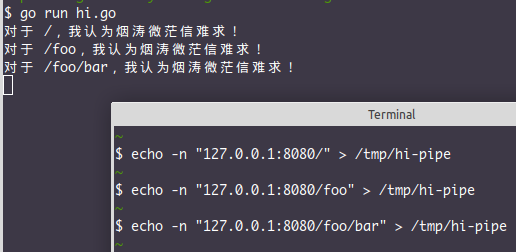

现在，我给出全新的 hi.go 程序的全貌，

<pre class="GO-lang"><span class="snippet-name-start">@</span><span class="snippet-name" id="xi-31"> hi.go 长生之一 </span><span class="snippet-name-stop">#</span>
package main

import (
        "fmt"
        "io"
        "os"
        "strings"
)

<span class="snippet-name-start">#</span><a class="snippet-reference" href="#xi-21"> 路由表 </a><span class="snippet-name-stop">@</span>
<span class="snippet-name-start">#</span><a class="snippet-reference" href="#xi-22"> handle_func 函数 </a><span class="snippet-name-stop">@</span>
<span class="snippet-name-start">#</span><a class="snippet-reference" href="#xi-23"> handle 实例 foo </a><span class="snippet-name-stop">@</span>

func main() {
        <span class="snippet-name-start">#</span><a class="snippet-reference" href="#xi-24"> 建立路径 / 到 foo 的映射 </a><span class="snippet-name-stop">@</span>
        for {
                <span class="snippet-name-start">#</span><a class="snippet-reference" href="#xi-29"> 从命名管道获取数据 </a><span class="snippet-name-stop">@</span>
                <span class="snippet-name-start">#</span><a class="snippet-reference" href="#xi-30"> 获取请求，若失败则重生 </a><span class="snippet-name-stop">@</span>
                <span class="snippet-name-start">#</span><a class="snippet-reference" href="#xi-26"> 触发路由函数 </a><span class="snippet-name-stop">@</span>
        }
}
</pre>

此时，hi.go 说，我觉得我像一个服务器。

# 惯性

我想试试 hi.go 的长生能力，在它运行时，我在另一个命令行窗口里输入了

```console
$ for ((i = 0; i < 30; i++)); do echo -n "/" > /tmp/hi-pipe; done
```

这行命令可以向 hi.go 发起 30 次请求，然而 hi.go 却只给出两句响应，且不尽正确，

```
对于 //，我认为烟涛微茫信难求！
对于 /，我认为烟涛微茫信难求！
```

更奇怪的是，执行我的命令的命令行窗口被一种神秘力量关闭了。hi.go 摊开自己的双手，愣了一会，我练出了什么神通？

是的……也许所有的神通，都是愚蠢而勇敢的尝试所带来的副作用。这 30 条 `echo` 命令里，可能会出现死亡事故，吓得命令行窗口立马主动关闭了。

管道两端分别成为读端和写端。/tmp/hi-pipe 的读端由 hi.go 掌控，它的 `for` 语句每一次执行时，都会打开读端，若管道内没有数据，则等待，否则读取管道内的所有数据，然后再关闭读端。/tmp/hi-pipe 的写端是由批量的 30 次 `echo` 命令掌控。每一条 `echo` 命令在打开管道的写端时，若管道的读端是打开的，便将内容写入，否则等待读端打开。这是管道的正常读写过程。

然而上述示例里的管道读写出现了一种异常情况，一条 `echo` 命令检测到管道读端是打开的，待它正要向其中写入数据时，读端却被 hi.go 当前的一轮循环关闭了，然而此时的这条 `echo` 命令像是一辆速度很快的车在惯性的作用下狠狠地撞上了已被关闭的隧道出口，一命归西。

hi.go 听得目瞪口呆，他未曾想到自己的长生无意中祸及了无辜。我说，幸好 `echo` 本是蜉蝣之命，但是这长生之术需要改进，以免酿成更大的祸事。

首先，管道的读端只应打开和关闭一次，在读取管道是，不可再用 `io.ReadAll` 一次读尽，而是每次只读一行。之前做的几次试验，虽然很像逐行读取管道，然而那只不过是 `echo -n` 命令所造成的假象。

如何从文件里每次只读一行呢？Go 语言的方式有些特别，它需要 `bufio` 包提供的文件扫描器功能。假设 /tmp/hi-pipe 已经以文件 `input` 的形式打开，以下代码可为该文件创造一个扫描器，

```go
scanner := bufio.NewScanner(input)
```

之后，每次执行 `scanner.Scan` 函数，便可从 `input` 里读取一行数据（不包括换行符），若数据是文本，可使用 `scanner.Text` 函数取出，例如

```go
for scanner.Scan() {
        fmt.Printf("%s\n", scanner.Text())
}
```

`scanner.Scan` 的返回值类型是 `bool`，成功读取一行数据，返回 `true`，否则返回 `false`，后者又分为两种情况，一种是读到 EOF，即文件末尾，另一种是读取过程中出现错误。

于是，hi.go 处理输入的过程可改造为，

<pre class="GO-lang"><span class="snippet-name-start">@</span><span class="snippet-name" id="xi-32"> 从当前一行的内容中获取请求 </span><span class="snippet-name-stop">#</span>
url := scanner.Text()
i := strings.Index(url, "/")
if i &lt; 0 {
        continue
}
request := url[i:]
=><span class="caller"><a class="snippet-reference" href="#xi-33"> hi.go 长生之二 </a></span>
=><span class="caller"><a class="snippet-reference" href="#xi-34"> 有请求则响应，否则静默片刻 </a></span>
=><span class="caller"><a class="snippet-reference" href="#xi-39"> 受 /tmp/hi.sig 控制的请求/响应过程 </a></span>
=><span class="caller"><a class="snippet-reference" href="#xi-55"> hi.go：协程 + 信道 </a></span>
=><span class="caller"><a class="snippet-reference" href="#xi-56"> 并发处理请求，逐一作出响应 </a></span>
</pre>

其他过程可保持不变，于是一个不会祸及无辜的长生 hi.go 程序诞生了，

<pre class="GO-lang"><span class="snippet-name-start">@</span><span class="snippet-name" id="xi-33"> hi.go 长生之二 </span><span class="snippet-name-stop">#</span>
package main

import (
        "fmt"
        "os"
        "strings"
        "bufio"
)

<span class="snippet-name-start">#</span><a class="snippet-reference" href="#xi-21"> 路由表 </a><span class="snippet-name-stop">@</span>
<span class="snippet-name-start">#</span><a class="snippet-reference" href="#xi-22"> handle_func 函数 </a><span class="snippet-name-stop">@</span>
<span class="snippet-name-start">#</span><a class="snippet-reference" href="#xi-23"> handle 实例 foo </a><span class="snippet-name-stop">@</span>

func main() {
        <span class="snippet-name-start">#</span><a class="snippet-reference" href="#xi-24"> 建立路径 / 到 foo 的映射 </a><span class="snippet-name-stop">@</span>
        input, err := os.Open("/tmp/hi-pipe")
        if err != nil {
                fmt.Fprintln(os.Stderr, err)
                return
        }
        for {
                scanner := bufio.NewScanner(input)
                for scanner.Scan() {
                        <span class="snippet-name-start">#</span><a class="snippet-reference" href="#xi-32"> 从当前一行的内容中获取请求 </a><span class="snippet-name-stop">@</span>
                        <span class="snippet-name-start">#</span><a class="snippet-reference" href="#xi-26"> 触发路由函数 </a><span class="snippet-name-stop">@</span>
                }
        }
        input.Close()
}
</pre>

hi.go 让我再度将其运转起来，等待着我在另一个命令行窗口里输入

```console
$ for ((i = 0; i < 30; i++)); do echo "/" > /tmp/hi-pipe; done
```

> 因为 hi.go 已经具备按行读入文本的能力，故而在 `echo` 命令里无需再用 `-n` 选项去消除 `cho` 命令为文本自动添加的换行符。

这一次，我输入命令的窗口不再消失，hi.go 也着实响应了三十次 `echo` 命令提交的请求，一切看似甚好。然而没过一会，hi.go 央求我将它停下来，他说这次的长生太令人晕眩了。我急忙查看 hi 程序的 CPU 占用情况，

```console
$ top -p $(pgrep -n hi)
```

之所以要查 hi 程序，是因为 `go run hi.go` 本质上将 hi.go 编译成可执行文件 hi，然后运行 hi。我看到的结果是，hi 程序正在让 CPU 全速奔跑，

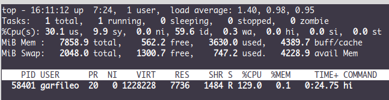

看来，hi.go 程序的 `main` 函数中的外层 `for` 语句不能再像之前的版本那样，在遇到管道内无数据时则等待。现在即使管道内无数据，外层的 `for` 也会持续运行，因为其内部任何一条语句都无法产生等待效应。之前所用的 `io.ReadAll` 函数是具备等待效应的，在操作系统的术语上，这种效应称为 I/O 阻塞，亦即当 `io.ReadAll` 遇到文件无内容时，会让整个程序停下来等待，亦即 CPU 无需再继续运行该程序。

我现在没有什么好办法了，只能在 hi.go 的内层 `for` 语句里插入一条主动阻塞 3 秒的语句，

<pre class="GO-lang"><span class="snippet-name-start">@</span><span class="snippet-name" id="xi-34"> 有请求则响应，否则静默片刻 </span><span class="snippet-name-stop">#</span>
for {
        scanner := bufio.NewScanner(input)
        for {
                if !scanner.Scan() {
                        time.Sleep(3 * time.Second)
                        break
                }
                <span class="snippet-name-start">#</span><a class="snippet-reference" href="#xi-32"> 从当前一行的内容中获取请求 </a><span class="snippet-name-stop">@</span>
                <span class="snippet-name-start">#</span><a class="snippet-reference" href="#xi-26"> 触发路由函数 </a><span class="snippet-name-stop">@</span>
        }
}
=><span class="caller"><a class="snippet-reference" href="#xi-35"> hi.go 长生之三 </a></span>
</pre>

`time.Sleep` 能够让程序主动停下指定的时间长度，`timeSecond` 是 1 秒。待 hi.go 逐渐平静下来，我无奈地叹了口气，对它说，惯性是物体的固有属性，而我们却幻想着能消灭它，最后增加的这 3 秒静默时间，可以体现出你的惯性……

hi.go 可以接受这个方案，且为自己每周能有 3 秒的休息时间略感幸福……

<pre class="GO-lang"><span class="snippet-name-start">@</span><span class="snippet-name" id="xi-35"> hi.go 长生之三 </span><span class="snippet-name-stop">#</span>
package main

import (
        "fmt"
        "os"
        "strings"
        "bufio"
        "time"
)

<span class="snippet-name-start">#</span><a class="snippet-reference" href="#xi-21"> 路由表 </a><span class="snippet-name-stop">@</span>
<span class="snippet-name-start">#</span><a class="snippet-reference" href="#xi-22"> handle_func 函数 </a><span class="snippet-name-stop">@</span>
<span class="snippet-name-start">#</span><a class="snippet-reference" href="#xi-23"> handle 实例 foo </a><span class="snippet-name-stop">@</span>

func main() {
        <span class="snippet-name-start">#</span><a class="snippet-reference" href="#xi-24"> 建立路径 / 到 foo 的映射 </a><span class="snippet-name-stop">@</span>
        input, err := os.Open("/tmp/hi-pipe")
        if err != nil {
                fmt.Fprintln(os.Stderr, err)
                return
        }
        <span class="snippet-name-start">#</span><a class="snippet-reference" href="#xi-34"> 有请求则响应，否则静默片刻 </a><span class="snippet-name-stop">@</span>
        input.Close()
}
</pre>

# 三极管

hi.go 程序现在遇到的最大问题是，如果它希望每一个向它提交请求的命令不会死于非命，那么它自身需要疲于奔命。我想了很久，试着尽力只凭现有的知识来解决这个问题。

若让 hi.go 彻底不疲于奔命，最简单的办法是使之重新获得阻塞能力。我们现在所掌握的知识，只有几个与标准输入/输出设备以及命名管道相关的操作才能使得程序阻塞。例如，用 `os.Open` 打开一个写端尚未开启的命名管道，会发生阻塞。用 `io.ReadAll` 读取已开启写端的命名管道时，只要未读到 EOF，也会发生阻塞。可以用一个简单的例子将这两种阻塞现象激发出来，先写出 foo.go 程序，

<pre class="GO-lang"><span class="snippet-name-start">@</span><span class="snippet-name" id="xi-36"> foo.go：演示管道阻塞 </span><span class="snippet-name-stop">#</span>
package main

import (
	"os"
	"fmt"
	"io"
)

func main() {
	fmt.Println("开始")
	input, _ := os.Open("/tmp/demo.pipe")
	fmt.Println("等待接收管道数据")
	data, _ := io.ReadAll(input)
	fmt.Printf("管道数据接收完毕，收到 %d 字节\n", len(data))
	input.Close()
	fmt.Println("结束")
}
</pre>

然后创建管道 /tmp/demo.pipe，

```console
$ mkfifo /tmp/demo.pipe
```

继而运行 foo.go 程序，

```console
$ go run foo.go
开始
```

foo.go 会先在屏幕上输出「开始」，然后等待 /tmp/demo.pipe 的写端被打开。可以用 Linux 的 `cat` 命令打开管道写端，只需另开一个命令行窗口，执行

```console
$ cat > /tmp/demo.pipe

```

当 `cat` 命令运行后，它需要我们通过标准输入向其提交数据，然后它再将所得数据写入管道，亦即此时 `cat` 命令尚未将任何数据写入 /tmp/demo.pipe，但是该管道的写端已经打开了，foo.go 程序里的 `os.Open` 语句便失去阻塞能力，于是 foo.go 程序会输出

```
等待接收管道数据
```

但是 foo.go 会立刻被 `io.ReadAll` 阻塞。此时，我们在执行 `cat` 的命令行窗口里随意输入一些内容，然后回车提交，

```console
$ cat > /tmp/demo.pipe
今天天气不错
```

当我们输入「今天天气不错」之后敲回车键，所输入的内容便会进入 `cat` 的标准输入，然后 `cat` 会将其写入 /tmp/demo.pipe，此时 foo.go 中的 `io.ReadAll` 虽然开始工作，但是由于它未读到 EOF，所以会继续阻塞 foo.go。在上述试验环节里，根据 `cat` 的运行状况，可以确认程序从标准输入中读取数据时，也会发生阻塞。

当我们在执行 `cat` 的命令行窗口里摁下组合键 `Ctrl + D` 时，`cat` 认为我们输入了 EOF，亦即它认为已经得到了全部的输入，便将 EOF 写入 /tmp/demo.pipe，然后退出。此时，foo.go 程序得到了 `cat` 发来的 EOF，于是 `io.ReadAll` 也完成自己的工作，结束对 foo.go 的阻塞，随后 foo.go 便继续输出

```
管道数据接收完毕，收到 %d 字节 19
结束
```

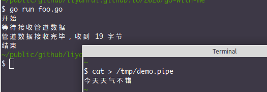


用 `bufio.NewScanner` 为读取命名管道而创建的扫描器在工作时也具有阻塞效应。现在，将 foo.go 程序的工作过程改写为逐行读取管道内容，

<pre class="GO-lang"><span class="snippet-name-start">@</span><span class="snippet-name" id="xi-37"> foo.go：演示 Scanner 阻塞 </span><span class="snippet-name-stop">#</span>
package main

import (
	"os"
	"fmt"
	"bufio"
)

func main() {
	fmt.Println("开始")
	input, _ := os.Open("/tmp/demo.pipe")
	scanner := bufio.NewScanner(input)
	for scanner.Scan() {
		fmt.Printf("收到：%s\n", scanner.Text())
	}
	input.Close()
	fmt.Println("结束")
}
</pre>

重复上述试验过程，只是在执行 `cat` 命令时，多输入几行文字，最后 `Ctrl + D` 键终止，则 foo.go 便可将 `cat` 命令获得的输入逐行输出。

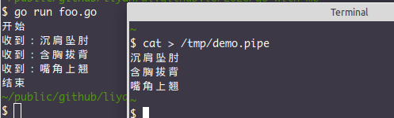

当一个命名管道的读端未开启时，若有程序要向其写入数据，会在打开该管道时出现阻塞。例如，创建一个新的管道，

```console
$ mkfifo /tmp/8080.pipe
```

然后执行 `echo` 命令，向这个新管道写入数据，

```console
$ echo "hi" > /tmp/8080.pipe
```

这条命令会卡住，无法完成，除非在此期间其他程序开启了该管道的读端。

只要以 `os.Open` 函数打开管道，便意味着开启了管道读端，所以要让上述 `echo` 命令得以完成，只需在其运行后，再运行一次 foo.go 程序即可。

我对 hi.go 说，也许我可以为你创建一个 /tmp/hi.sig 管道，以该管道的打开操作阻塞你的 `for` 语句，当该管道能打开时，你就读取其全部数据，亦即将其清空，至于你读到什么，并不重要。这个管道像是一个开关，有内容，便意味着开，无内容便意味着关。不过，你只是负责关掉这个开关，至于它如何打开，需要交给另一个程序，后者负责观察 /tmp/hi-pipe 管道，若它能发现该管道的写端已被打开，便会向 /tmp/hi.sig 管道写入数据，对你而言意味着开关打开了，你便可以从 /tmp/hi-pipe 管道读取数据。

hi.go 被我绕晕了，我忽然意识到管道很像二极管，而我似乎发明了三极管，/tmp/hi-pipe 管道的写端是集电极，其读端则是发射极，而 /tmp/hi.sig 管道是基极。

围绕 /tmp/hi.sig 的电路……哦……程序可以写成 observer.go，

<pre class="${language}-lang"><span class="snippet-name-start">@</span><span class="snippet-name" id="xi-38"> observer.go：/tmp/hi-pipe 的观察者 </span><span class="snippet-name-stop">#</span>
package main

import (
	"fmt"
	"os"
)

func main() {
        input, err := os.Open("/tmp/hi-pipe")
        if err != nil {
        	fmt.Fprintln(os.Stderr, err)
        	return
        }
        os.WriteFile("/tmp/hi.sig", []byte("!"), 0)
        input.Close()
}
</pre>

observer.go 负责监控 /tmp/hi-pipe 管道，一旦有其他程序打开该管道的写端，则 `os.Open` 语句便失去阻塞作用，`os.WriteFile` 语句便向 /tmp/hi.sig 管道写入一个 `!`，随后 observer.go 关闭 /tmp/hi-pipe 管道并退出。需要注意的是，`os.WriteFile` 语句实际上包含了打开文件和关闭文件的操作，亦即它大概等效于

```go
output, err := os.OpenFile("/tmp/hi.sig", O_WRONLY, 0)
if err != nil {
        fmt.Fprintln(os.Stderr, err)
        return
}
n, err := output.Write([]byte("!"))
if err != nil {
        fmt.Fprintln(os.Stderr, err)
        return
}
output.Close()
```

需要注意的是，要向管道或文件写入数据，不能用 `os.Open` 函数，因为该函数打开的管道或文件仅支持读，不支持写。`os.OpenFile` 是更为通用的管道/文件打开函数，上述示例是以「只写」的方式打开管道 /tmp/hi.sig。

我对 hi.go 说，现在我要对你做一个简单的手术。hi.go 说，来吧，我当效关云长刮骨疗毒之遗风。于是，我将 hi.go 的外层 `for` 语句修改为

<pre class="GO-lang"><span class="snippet-name-start">@</span><span class="snippet-name" id="xi-39"> 受 /tmp/hi.sig 控制的请求/响应过程 </span><span class="snippet-name-stop">#</span>
for {
        // 阻塞
        sig, _ := os.Open("/tmp/hi.sig")
        io.ReadAll(sig)
        sig.Close()
        // 获取每个请求并给出响应
        scanner := bufio.NewScanner(input)
        for scanner.Scan() {
                <span class="snippet-name-start">#</span><a class="snippet-reference" href="#xi-32"> 从当前一行的内容中获取请求 </a><span class="snippet-name-stop">@</span>
                <span class="snippet-name-start">#</span><a class="snippet-reference" href="#xi-26"> 触发路由函数 </a><span class="snippet-name-stop">@</span>
        }
}
=><span class="caller"><a class="snippet-reference" href="#xi-40"> hi.go 长生之四 </a></span>
=><span class="caller"><a class="snippet-reference" href="#xi-44"> 可分身的 hi.go </a></span>
</pre>

注意，为了让上述代码更能体现意图，我忽略了一些错误处理过程。新的 hi.go 的全部内容为

<pre class="GO-lang"><span class="snippet-name-start">@</span><span class="snippet-name" id="xi-40"> hi.go 长生之四 </span><span class="snippet-name-stop">#</span>
package main

import (
        "fmt"
        "os"
        "io"
        "strings"
        "bufio"
)

<span class="snippet-name-start">#</span><a class="snippet-reference" href="#xi-21"> 路由表 </a><span class="snippet-name-stop">@</span>
<span class="snippet-name-start">#</span><a class="snippet-reference" href="#xi-22"> handle_func 函数 </a><span class="snippet-name-stop">@</span>
<span class="snippet-name-start">#</span><a class="snippet-reference" href="#xi-23"> handle 实例 foo </a><span class="snippet-name-stop">@</span>

func main() {
        <span class="snippet-name-start">#</span><a class="snippet-reference" href="#xi-24"> 建立路径 / 到 foo 的映射 </a><span class="snippet-name-stop">@</span>
        input, err := os.Open("/tmp/hi-pipe")
        if err != nil {
                fmt.Fprintln(os.Stderr, err)
                return
        }
        <span class="snippet-name-start">#</span><a class="snippet-reference" href="#xi-39"> 受 /tmp/hi.sig 控制的请求/响应过程 </a><span class="snippet-name-stop">@</span>
        input.Close()
}
</pre>

现在开始验证 /tmp/hi-pipe 和 /tmp/hi.sig 这两个管道所构成的三极管是否可作为一个完美的开关，去控制 hi.go 读取 /tmp/hi-pipe 的过程，我们需要先运行 hi.go，

```console
$ go run hi.go
```

然后另开一个命令行窗口运行 observer.go，

```console
$ go run observer.go
```

再开一个命令行窗口执行 `echo` 命令，

```console
$ for ((i = 0; i < 7; i++)); do echo "/foo" > /tmp/hi-pipe; done
```

试验记过是，observer.go 会结束，而 hi.go 在输出以下内容后，继续保持运行，且 CPU 占用率为 0%。

```
对于 /foo-0，我认为烟涛微茫信难求！
对于 /foo-1，我认为烟涛微茫信难求！
对于 /foo-2，我认为烟涛微茫信难求！
对于 /foo-3，我认为烟涛微茫信难求！
对于 /foo-4，我认为烟涛微茫信难求！
对于 /foo-5，我认为烟涛微茫信难求！
对于 /foo-6，我认为烟涛微茫信难求！
```

observer.go 退出是正常的，因为我并未让它长生。现在可以让它长生了，

<pre class="${language}-lang"><span class="snippet-name-start">@</span><span class="snippet-name" id="xi-41"> 长生的 observer.go </span><span class="snippet-name-stop">#</span>
package main

import (
	"fmt"
	"os"
)

func main() {
        for {
                input, err := os.Open("/tmp/hi-pipe")
                if err != nil {
                	fmt.Fprintln(os.Stderr, err)
                	return
                }
                os.WriteFile("/tmp/hi.sig", []byte("!"), 0)
                input.Close()
        }
}
</pre>

若在重复一次上述的试验过程，hi.go 便在响应批量 `echo` 命令时，不会再有 `echo` 命令撞死在 /tmp/hi-pipe 管道的读端，因为该管道的读端在 hi.go 内打开后直到 hi.go 退出时才会关闭。

不过，需要注意，当 observer.go 在向 /tmp/hi.sig 管道写数据时，依然会遇到该管道被 hi.go 关闭的情况，此时 observer.go 的 `os.WriteFile` 语句便会出错，但是这种错误不会影响 observer.go 继续运行下去，而且出错的概率通常很小。

这个三极管方案并没有消除惯性，只是将惯性集中到了 observer.go 中，并承认它具有合法性，而且整个过程中没有哪个程序或命令死于非命。hi.go 认为此法极秒，然而我却有些茫然，三极管有了，后面的路我一时竟不知该如何前进了。难道所有的程序，不过是运行在计算机上的模拟电路？

# 分身有术

今天早上我还没起床时下过了雨。到了中午，天蓝得不像话，风也冷得不像话，树上的黄叶簌簌落下，却也无法达到真正意义上的归根。在这样清冷而宏大的气氛里，我对正在窗外愉快翻着跟头的 hi.go 说，其实那个 observer.go 没必要存在。它之所以存在，是因为你还没学会分身术。

hi.go 从窗外跳进来，给我泡了一杯茶，浓得不像话。好学吗？它问。似乎不难，我也只是听说过，从未试验过。大概就是写一个函数，然后对它说一句「敕」之类的咒语……表面上是你调用了这个函数，实际上它可以与你同时运行。我话音刚落，hi.go 便纵身跳入我的硬盘，来改我一试！

我为 hi.go 增加了一个函数 `observer`，其定义直接就是 observer.go 的 `main` 函数中的内容，

<pre class="GO-lang"><span class="snippet-name-start">@</span><span class="snippet-name" id="xi-42"> observer 函数 </span><span class="snippet-name-stop">#</span>
func observer() {
	for {
                input, err := os.Open("/tmp/hi-pipe")
                if err != nil {
                	fmt.Fprintln(os.Stderr, err)
                	return
                }
                os.WriteFile("/tmp/hi.sig", []byte("!"), 0)
                input.Close()
        }
}
=><span class="caller"><a class="snippet-reference" href="#xi-44"> 可分身的 hi.go </a></span>
=><span class="caller"><a class="snippet-reference" href="#xi-55"> hi.go：协程 + 信道 </a></span>
=><span class="caller"><a class="snippet-reference" href="#xi-57"> hi.go：并发 + 信道 </a></span>
</pre>

然后在 hi.go 的 `main` 函数的起始处调用 `observer` 函数，只是在调用语句之前增加了 `go`，

<pre class="GO-lang"><span class="snippet-name-start">@</span><span class="snippet-name" id="xi-43"> 启动 observer </span><span class="snippet-name-stop">#</span>
go observer()
=><span class="caller"><a class="snippet-reference" href="#xi-44"> 可分身的 hi.go </a></span>
=><span class="caller"><a class="snippet-reference" href="#xi-55"> hi.go：协程 + 信道 </a></span>
=><span class="caller"><a class="snippet-reference" href="#xi-57"> hi.go：并发 + 信道 </a></span>
</pre>

于是，修改后的 hi.go 的样子为

<pre class="GO-lang"><span class="snippet-name-start">@</span><span class="snippet-name" id="xi-44"> 可分身的 hi.go </span><span class="snippet-name-stop">#</span>
package main

import (
        "fmt"
        "os"
        "io"
        "strings"
        "bufio"
)

<span class="snippet-name-start">#</span><a class="snippet-reference" href="#xi-21"> 路由表 </a><span class="snippet-name-stop">@</span>
<span class="snippet-name-start">#</span><a class="snippet-reference" href="#xi-22"> handle_func 函数 </a><span class="snippet-name-stop">@</span>
<span class="snippet-name-start">#</span><a class="snippet-reference" href="#xi-23"> handle 实例 foo </a><span class="snippet-name-stop">@</span>
<span class="snippet-name-start">#</span><a class="snippet-reference" href="#xi-42"> observer 函数 </a><span class="snippet-name-stop">@</span>

func main() {
        <span class="snippet-name-start">#</span><a class="snippet-reference" href="#xi-43"> 启动 observer </a><span class="snippet-name-stop">@</span>
        <span class="snippet-name-start">#</span><a class="snippet-reference" href="#xi-24"> 建立路径 / 到 foo 的映射 </a><span class="snippet-name-stop">@</span>
        input, err := os.Open("/tmp/hi-pipe")
        if err != nil {
                fmt.Fprintln(os.Stderr, err)
                return
        }
        <span class="snippet-name-start">#</span><a class="snippet-reference" href="#xi-39"> 受 /tmp/hi.sig 控制的请求/响应过程 </a><span class="snippet-name-stop">@</span>
        input.Close()
}
</pre>

在保证 /tmp/hi-pipe 和 /tmp/hi.sig 两个管道存在的前提下，重新运行 hi.go，然后在另一个命令行窗口里批量执行一组 `echo` 命令，所得结果与上一节的试验没有区别。

hi.go 说，一切居然简单得不像话，这到底发生了什么？我调用了 `observer` 函数后，它本应该将我阻塞了，可我后面的代码为何还能执行？我说，这就是并发。`go` 语句可以让被调用的函数与你的本体同时运行。如此运行的函数，称为 goroutine，亦称 go 协程。

事实上，/tmp/hi.sig 管道也是不必要的，因为 go 协程与你的本体，或者不同的 go 协程之间，可以用 `channel` 通信。我们可以将 `channel` 称为信道，它与我们之前已经打过多次交道的管道相似，与信道相关的一些操作也具有阻塞效果，所以可以用它取代 /tmp/hi.sig。

hi.go 睁大了眼睛，信道用起来，也简单得不像话吗？

我说，好像是吧，我也只是听说过……信道是一个变量，之前我们构造映射容器的时候用的 `make` 也能构造信道。例如，

<pre class="${language}-lang"><span class="snippet-name-start">@</span><span class="snippet-name" id="xi-45"> 构造 sig 信道 </span><span class="snippet-name-stop">#</span>
hi_sig := make(chan int)
</pre>

`hi_sig` 便是一个信道对象，它可以存储整数，它的类型是 `chan int`。为了简单起见，假设 `hi_sig` 为全局对象，亦即 `observer` 函数和 `main` 函数皆能访问它。

Go 语言提供了 `<-` 符号用于信道的读写，若信道对象在其左侧，表示向信道对象写入数据；若信道对象在其右侧，表示从信道对象读取数据。若信道对象没有数据，其读取数据的操作便会阻塞。信道对象里的数据一经读取，就会消失。

为了更清楚信道的用法，我们需要写一个简单的例子，预演一番，而不是直接上手术台折腾 hi.go。在这个简单的例子是

<pre class="${language}-lang"><span class="snippet-name-start">@</span><span class="snippet-name" id="xi-46"> chan-demo.go </span><span class="snippet-name-stop">#</span>
package main

import (
        "fmt"
        "time"
)

var sig = make(chan int)

func foo() {
	fmt.Println("foo 开始")
        time.Sleep(3 * time.Second)
        sig &lt;- 42
	fmt.Println("foo 结束")
}

func main() {
	fmt.Println("main 开始")
        go foo()
        fmt.Println("等待接收信道数据")
        a := &lt;- sig
        fmt.Printf("收到 %d\n", a)
        fmt.Println("main 结束")
}
</pre>

运行 chan-demo.go，

```console
$ go run chan-demo.go
main 开始
等待接收信道数据
foo 开始
foo 结束
收到 42
main 结束
```

chan-demo.go 演示了是 `main` 和 `foo` 这两个函数如何通过一条管道协同工作。在 `main` 函数里，`foo` 以 go 协程的方式运行，然后变量 `a` 在等待接收信道 `sig` 中的值，若此时信道无值，则 chan-demo.go 会阻塞于这条 `a` 的定义语句处。大概要等 3 秒，`foo` 函数会向 `sig` 里写入值 42，于是 `main` 函数中的变量 `a` 便接收到了这个值。

上述试验也展现了 `foo` 函数与 `main` 函数是同时运行的，因为虽然在 `main` 函数输出「等待接收信道数据」之前便调用了 `foo` 函数，然而该函数输出的「foo 开始」却出现在 `main` 函数输出的「等待接收信道数据」之后。注意，所谓同时，意思是不分先后。

现在对 chan-demo.go 略作修改，让 `foo` 函数写信道三次，再让 `main` 函数读信道三次，

<pre class="${language}-lang"><span class="snippet-name-start">@</span><span class="snippet-name" id="xi-47"> 可活三岁的 chan-demo.go </span><span class="snippet-name-stop">#</span>
package main

import (
        "fmt"
        "time"
)

var sig = make(chan int)

func foo() {
        for i := 0; i &lt; 3; i++ {
	        fmt.Println("foo 开始")
                time.Sleep(3 * time.Second)
                sig &lt;- i
	        fmt.Println("foo 结束")
        }
}

func main() {
	fmt.Println("main 开始")
        go foo()
        for i := 0; i &lt; 3; i++ {
                fmt.Println("等待接收信道数据")
                a := &lt;- sig
                fmt.Printf("收到 %d\n", a)
        }
        fmt.Println("main 结束")
}
</pre>

运行新的 chan-demo.go，会在大概 9 秒的时间里陆续输出以下内容，

```
main 开始
等待接收信道数据
foo 开始
收到 0
等待接收信道数据
foo 结束
foo 开始
foo 结束
收到 1
等待接收信道数据
foo 开始
foo 结束
收到 2
main 结束
```

我对 hi.go 说，现在可以作手术了。hi.go 说，我觉得刚才的 `observer` 已经很符合我的气质了，而且我觉得我们对信道的认识还是不太够。

# 从容不迫，有条不紊

自从习得 go 协程，hi.go 在初冬的白杨树下苦思 1 日，似有所得。它说，若有命令通过 /tmp/hi-pipe 管道向我发来请求时，该请求会触发路由函数，若将路由函数化为 go 协程，岂不意味着我可以同时响应很多请求么？我让它先写出代码来看。它写出

<pre class="${language}-lang"><span class="snippet-name-start">@</span><span class="snippet-name" id="xi-48"> 触发路由函数，以协程形式运行 </span><span class="snippet-name-stop">#</span>
var response string
if routers[request] != nil {
        go routers[request](&amp;response, request)
} else {
        go routers["/"](&amp;response, request)
}
fmt.Println(response)
</pre>

这想法大致可行，只是路由函数会与 `main` 函数同时运行，`response` 变量的值由前者赋予，故而它在后者中得以输出时，可能尚未有值。hi.go 说，`response` 的值是路由函数赋予的，既然如此，为何不直接在路由函数直接将其输出呢？

我说，也许以后我们要对 `response` 的值再作一些包装，例如在其前后增加一些信息。若是在路由函数内便将其输出，就失去包装它的机会了。若是让路由函数代为包装，则意味着可能每个路由函数都要重复写一段包装代码。实际上，我们应该将 `response` 改为信道变量，亦即

<pre class="GO-lang"><span class="snippet-name-start">@</span><span class="snippet-name" id="xi-49"> response 信道 </span><span class="snippet-name-stop">#</span>
response := make(chan string)
=><span class="caller"><a class="snippet-reference" href="#xi-55"> hi.go：协程 + 信道 </a></span>
=><span class="caller"><a class="snippet-reference" href="#xi-57"> hi.go：并发 + 信道 </a></span>
</pre>

路由表以及 `handle_func` 函数也要改为信道形式，

<pre class="GO-lang"><span class="snippet-name-start">@</span><span class="snippet-name" id="xi-50"> 路由表：信道版本 </span><span class="snippet-name-stop">#</span>
var routers = make(map[string]func(chan string, string))
=><span class="caller"><a class="snippet-reference" href="#xi-55"> hi.go：协程 + 信道 </a></span>
=><span class="caller"><a class="snippet-reference" href="#xi-57"> hi.go：并发 + 信道 </a></span>
</pre>

<pre class="GO-lang"><span class="snippet-name-start">@</span><span class="snippet-name" id="xi-51"> handle_func 函数：信道版本 </span><span class="snippet-name-stop">#</span>
func handle_func(path string, handler func(chan string, string)) {
        routers[path] = handler
}
=><span class="caller"><a class="snippet-reference" href="#xi-55"> hi.go：协程 + 信道 </a></span>
=><span class="caller"><a class="snippet-reference" href="#xi-57"> hi.go：并发 + 信道 </a></span>
</pre>

用作示例的路由函数 `foo` 需要修改为

<pre class="GO-lang"><span class="snippet-name-start">@</span><span class="snippet-name" id="xi-52"> handle 实例 foo：信道版本 </span><span class="snippet-name-stop">#</span>
func foo(w chan string, r string) {
        w &lt;- fmt.Sprintf("对于 %s，我认为烟涛微茫信难求！", r)
}
=><span class="caller"><a class="snippet-reference" href="#xi-55"> hi.go：协程 + 信道 </a></span>
=><span class="caller"><a class="snippet-reference" href="#xi-57"> hi.go：并发 + 信道 </a></span>
</pre>

依然基于 /tmp/hi.sig 管道实现 hi.go 的阻塞，

<pre class="GO-lang"><span class="snippet-name-start">@</span><span class="snippet-name" id="xi-53"> /tmp/hi.sig 开关 </span><span class="snippet-name-stop">#</span>
sig, _ := os.Open("/tmp/hi.sig")
io.ReadAll(sig)
sig.Close()
=><span class="caller"><a class="snippet-reference" href="#xi-55"> hi.go：协程 + 信道 </a></span>
=><span class="caller"><a class="snippet-reference" href="#xi-57"> hi.go：并发 + 信道 </a></span>
</pre>

然后将路由函数的触发过程修改为

<pre class="GO-lang"><span class="snippet-name-start">@</span><span class="snippet-name" id="xi-54"> 触发路由函数，以协程 + 信道形式运行 </span><span class="snippet-name-stop">#</span>
if routers[request] != nil {
        go routers[request](response, request)
} else {
        go routers["/"](response, request)
}
result := &lt;- response
fmt.Println(result)
=><span class="caller"><a class="snippet-reference" href="#xi-55"> hi.go：协程 + 信道 </a></span>
</pre>

现在，将 hi.go 升级为

<pre class="GO-lang"><span class="snippet-name-start">@</span><span class="snippet-name" id="xi-55"> hi.go：协程 + 信道 </span><span class="snippet-name-stop">#</span>
package main

import (
        "fmt"
        "os"
        "io"
        "strings"
        "bufio"
)

<span class="snippet-name-start">#</span><a class="snippet-reference" href="#xi-50"> 路由表：信道版本 </a><span class="snippet-name-stop">@</span>
<span class="snippet-name-start">#</span><a class="snippet-reference" href="#xi-51"> handle_func 函数：信道版本 </a><span class="snippet-name-stop">@</span>
<span class="snippet-name-start">#</span><a class="snippet-reference" href="#xi-52"> handle 实例 foo：信道版本 </a><span class="snippet-name-stop">@</span>
<span class="snippet-name-start">#</span><a class="snippet-reference" href="#xi-42"> observer 函数 </a><span class="snippet-name-stop">@</span>

func main() {
        <span class="snippet-name-start">#</span><a class="snippet-reference" href="#xi-43"> 启动 observer </a><span class="snippet-name-stop">@</span>
        <span class="snippet-name-start">#</span><a class="snippet-reference" href="#xi-24"> 建立路径 / 到 foo 的映射 </a><span class="snippet-name-stop">@</span>
        input, err := os.Open("/tmp/hi-pipe")
        if err != nil {
                fmt.Fprintln(os.Stderr, err)
                return
        }
        <span class="snippet-name-start">#</span><a class="snippet-reference" href="#xi-49"> response 信道 </a><span class="snippet-name-stop">@</span>
        for {
                <span class="snippet-name-start">#</span><a class="snippet-reference" href="#xi-53"> /tmp/hi.sig 开关 </a><span class="snippet-name-stop">@</span>
                scanner := bufio.NewScanner(input)
                for scanner.Scan() {
                        <span class="snippet-name-start">#</span><a class="snippet-reference" href="#xi-32"> 从当前一行的内容中获取请求 </a><span class="snippet-name-stop">@</span>
                        <span class="snippet-name-start">#</span><a class="snippet-reference" href="#xi-54"> 触发路由函数，以协程 + 信道形式运行 </a><span class="snippet-name-stop">@</span>
                }
        }
        input.Close()
}
</pre>

我让 hi.go 跑了一下试试。hi.go 认为，现在觉得一举一动，轻松自如。我说，这应该只是 go 协程给了你某种心理暗示，导致你产生了错觉，实际上你跟之前几乎一样笨重。

当你用 `go` 运行函数 `foo` 时，它的确是与 `main` 函数同时运行了，可是随后从 `response` 信道取值时，`main` 函数中的内层 `for` 循环会被阻塞，亦即在该循环里没处理一次请求，都会被 `response` 信道取值语句阻塞一次。这样相当于所有的请求依然是在排队且被逐一处理，而不是你所想象的，有一组请求同时被处理了。

hi.go 思索片刻说，我明白了，应该将信道取值过程从 `main` 函数的内层 `for` 语句里移出来，单独构成一个循环，亦即

<pre class="GO-lang"><span class="snippet-name-start">@</span><span class="snippet-name" id="xi-56"> 并发处理请求，逐一作出响应 </span><span class="snippet-name-stop">#</span>
n := 0
scanner := bufio.NewScanner(input)
for scanner.Scan() {
        <span class="snippet-name-start">#</span><a class="snippet-reference" href="#xi-32"> 从当前一行的内容中获取请求 </a><span class="snippet-name-stop">@</span>
        if routers[request] != nil {
                go routers[request](response, request)
        } else {
                go routers["/"](response, request)
        }
        n++
}
for i:= 0; i &lt; n; i++ {
        result := &lt;- response
        fmt.Println(result)
}
=><span class="caller"><a class="snippet-reference" href="#xi-57"> hi.go：并发 + 信道 </a></span>
</pre>

我说，你能想到要统计信道写入数据的次数，并基于该次数从信道取数据，甚为明智。hi.go 说，过奖了，有没有无需统计的办法？我说，不知道，即使有，未必就比统计更好。现在，我将你更新为

<pre class="GO-lang"><span class="snippet-name-start">@</span><span class="snippet-name" id="xi-57"> hi.go：并发 + 信道 </span><span class="snippet-name-stop">#</span>
package main

import (
        "fmt"
        "os"
        "io"
        "strings"
        "bufio"
)

<span class="snippet-name-start">#</span><a class="snippet-reference" href="#xi-50"> 路由表：信道版本 </a><span class="snippet-name-stop">@</span>
<span class="snippet-name-start">#</span><a class="snippet-reference" href="#xi-51"> handle_func 函数：信道版本 </a><span class="snippet-name-stop">@</span>
<span class="snippet-name-start">#</span><a class="snippet-reference" href="#xi-52"> handle 实例 foo：信道版本 </a><span class="snippet-name-stop">@</span>
<span class="snippet-name-start">#</span><a class="snippet-reference" href="#xi-42"> observer 函数 </a><span class="snippet-name-stop">@</span>

func main() {
        <span class="snippet-name-start">#</span><a class="snippet-reference" href="#xi-43"> 启动 observer </a><span class="snippet-name-stop">@</span>
        <span class="snippet-name-start">#</span><a class="snippet-reference" href="#xi-24"> 建立路径 / 到 foo 的映射 </a><span class="snippet-name-stop">@</span>
        input, err := os.Open("/tmp/hi-pipe")
        if err != nil {
                fmt.Fprintln(os.Stderr, err)
                return
        }
        <span class="snippet-name-start">#</span><a class="snippet-reference" href="#xi-49"> response 信道 </a><span class="snippet-name-stop">@</span>
        for {
                <span class="snippet-name-start">#</span><a class="snippet-reference" href="#xi-53"> /tmp/hi.sig 开关 </a><span class="snippet-name-stop">@</span>
                <span class="snippet-name-start">#</span><a class="snippet-reference" href="#xi-56"> 并发处理请求，逐一作出响应 </a><span class="snippet-name-stop">@</span>
        }
        input.Close()
}
</pre>

hi.go 又跑了几次，感慨道，现在的确身轻如燕……处理请求的过程可谓从容不迫，作出响应的过程可谓有条不紊。

# 祖传老中医

hi.go 说，我发现有很多人觉得 Go 语言的错误处理机制在设计上实属败笔。

我说，我有同感。不过，瑕不掩瑜。何况对于多数错误处理代码，我们可以用宏将其遮掩起来。

hi.go 说，Go 语言没有宏啊。

我说，我们有 GNU 家的 m4 宏语言和 awk 文本处理语言，若将这两种微型语言组合起来，为 Go 语言设计一些错误处理宏，问题应该能解决。

> 注：我有《[m4 的咒语](https://zhuanlan.zhihu.com/p/2099184764834025671)》一文。

先容我设计两条基本咒语。第一条形如

```go
_safe([[a, b, err := /os.Open/("/tmp/hi-pipe")]])
```

我希望它能展开为

```go
a, b, err:= os.Open("/tmp/hi-pipe"); if err != nil { fmt.Fprintln(os.Stderr, err); return }
```

这种咒语适合在 `main` 函数里用。

第二条咒语形如

```go
_safe([[a, b, err = /os.Open/("/tmp/hi-pipe") => c, d]])
```

我希望它能展开为

```go
a, b, err= os.Open("/tmp/hi-pipe"); if err != nil { return c, d, fmt.Errorf("os.Open: %w", err) }
```

如何实现这两种咒语到合法 Go 代码的转换呢？用 m4 语言实现宏 `_safe`，用于抓取代码。再写一个 awk 脚本解析，用于解析 `_safe` 所抓取的代码。

上述咒语里所用的 `[[` 和 `]]` 皆为 m4 默认引号的替代， 亦即

```m4
changequote(`[[', `]]')
```

m4 默认的引号是反引号太像飞尘，我相信你不会想这样念咒语，

```go
_safe(`a, b, err = /os.Open/("/tmp/hi-pipe") => c, d')
```

然后便可定义 `_safe` 宏，

```m4
define([[_safe]], [[esyscmd([[awk -f go-err.awk <<'_M4EOF'
$1
_M4EOF]])]])
```

这个宏其实很简单，就是通过 GNU m4 的 `esyscmd` 将 `_safe` 的参数转发给 awk 脚本 go-err.awk，只是为了避免 `_safe` 的参数里出现单引号之类奇怪的东西而导致 Shell 晕掉，故而使用了 Shell 的 HERE DOCUMENT 功能。

以下 `_safe` 调用语句

```go
_safe([[a, b, err = /os.Open/("/tmp/hi-pipe") => c, d]])
```

展开结果中包含的 awk 命令为

```shell
awk -f go-err.awk <<'_M4EOF'
a, b, err = /os.Open/("/tmp/hi-pipe") => c, d
_M4EOF
```

当 Shell 遇到第 2 个 `_M4EO`F 时，便告诉 awk，输入就此结束，你可以工作了。然后 awk 便执行 go-err.awk 脚本处理输入。

go-err.awk 脚本该如何写呢？由于最近 DeepSeek 限流，每天我问不了它几个问题，它就 BUSY 了。我叛变到豆包那边，让豆包去写出这个脚本，这种脏活累活，让谁干都一样，

```awk
#!/usr/bin/gawk -f
BEGIN {
    RS=""
}

function process(s,    c, i, n, state, lhs, op, fn, call, ret, buf, inStr)
{
    state = 0
    lhs = ""; op = ""; fn = ""; call = ""; ret = ""; buf = ""
    inStr = 0   # 是否在双引号字符串内
    n = length(s)

    for(i=1; i<=n; i++) {
        c = substr(s,i,1)

        # 字符串内，只处理引号，其它原样收集
        if (inStr) {
            buf = buf c
            if (c == "\"") {
                inStr = 0
            }
            continue
        }

        if (state == 0) {
            # S0: 收集LHS，匹配 := 或者 =
            if (c == ":" && substr(s,i+1,1)=="=") {
                lhs = buf
                op = ":="
                buf = ""
                state = 1
                i++
            } else if (c == "=") {
                lhs = buf
                op = "="
                buf = ""
                state = 1
            } else {
                buf = buf c
            }
        }
        else if (state == 1) {
            # S1: 跳过空白，等待 /
            if (c ~ /[ \t]/) continue
            if (c == "/") {
                state = 2
            }
        }
        else if (state == 2) {
            # S2: 收集函数名直到 /
            if (c == "/") {
                fn = buf
                buf = ""
                state = 3
            } else {
                buf = buf c
            }
        }
        else if (state == 3) {
            # S3:收集函数调用，检测 =>；遇到双引号进入字符串模式
            if (c == "\"") {
                buf = buf c
                inStr = 1
                continue
            }
            if (c == " " && substr(s,i+1,2)=="=>") {
                call = buf
                buf = ""
                state = 4
                i += 2
            } else {
                buf = buf c
            }
        }
        else if (state == 4) {
            # S4:收集return列表
            ret = ret c
        }
    }
    # 循环结束，仍在S3，buf是call
    if (state ==3) {
        call = buf
    }

    # 清理两端空白
    gsub(/^[ \t]+|[ \t]+$/, "", lhs)
    gsub(/^[ \t]+|[ \t]+$/, "", call)
    gsub(/^[ \t]+|[ \t]+$/, "", ret)

    # 拆分lhs取error变量
    errVar=""
    if (lhs != "") {
        m = split(lhs,vars,/,/)
        errVar = vars[m]
        gsub(/[ \t]/,"",errVar)
    }

    if (ret != "") {
        return lhs op " " fn call "; if " errVar " != nil { return " ret ", fmt.Errorf(\"" fn ": %w\", " errVar ") }"
    } else {
        return lhs op " " fn call "; if " errVar " != nil { fmt.Fprintln(os.Stderr, " errVar "); return }"
    }
}

{
    line = $0
    # 简单前置判断，有模板标记才处理
    if (match(line, /.*(=|:=).*\/.*\//)) {
        printf "%s", process(line)
    } else {
        printf "%s", line
    }
}
```

代码都写好了，怎么用呢？

先制作一份 m4 脚本，名曰 safe.m4，其内容为

```m4
divert(-1)
changequote(`[[', `]]')
define([[_safe]], [[esyscmd([[awk -f go-err.awk <<'_M4EOF'
$1
_M4EOF]])]])
divert(0)dnl
```

然后便可以在 Go 代码里使用 _safe，例如 demo.go 有以下代码

```go
func do_work() int, error {
    return 42, fmt.Errorf("oops")
}
func foo() int, error {

        _safe([[a, err := /do_work/() => 0]])
}
func main() {
        _safe([[input, err := /os.Open/("/tmp/hi-pipe")]])
	response := make(chan string)
        for {
                _safe([[sig, err := /os.Open/("/tmp/hi.sig")]])
                ... ... ...
        }
}
```

需要注意，函数名一定要用一对 `/` 围着，在需要返回错误时，要用函数名包装错误信息，go-err.awk 脚本能够基于 `/.../` 提取函数名，然后才能构造出 `fmt.Errorf` 语句。例如，

```go
_safe([[a, err := /do_work/() => 0]])
```

`=>` 符号之后的值是错误处理部分需要返回的值，而错误 `err` 会被包装为

```go
fmt.Errorf("do_work: %w", err)
```

作为最后一个返回值。

safe.m4 脚本的用法为，

```console
$ m4 safe.m4 demo.go > real-demo.go
```

我知道，一定会有一些意外情况，只是我对 Go 语言了解甚浅，也不知以后会遇到什么怪物。不过，遇到问题也不怕，重新设计咒语，然后让 AI 去改 go-err.awk 脚本即可。

hi.go 看完我这一系列操作，有些鄙夷，觉得我这是中医保守疗法。我说，管用就行，以后我们再写代码，就尽量用 `_safe` 宏。
