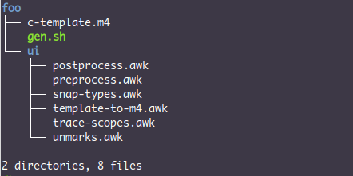

现在可以收网了，我们的收获是，

* c-template.m4：提供 `_begin_scope_`，`_end_scope_`，`_var`, `_expr`, `_func` 等关键字；
* snap-types.awk：从函数参数表中类型标记 `<...>` 中获取类型；
* unmarks.awk：从函数参数表去除类型标记 `<...>`；
* preprocess.awk, template-to-c.awk, trace-scopes.awk 以及 postprocess.awk：将 C 代码中的 `@template` 和 `@func_template` 块转换为 m4 代码，然后将 C 代码中表示作用域开始和结束的花括号分别替换为 `_begin_scope_` 和 `_end_scope_`。

上述文件只有 c-template.m4 是我们所写，其他 awk 脚本皆由 DeepSeek 所写。这些文件我已打包，位于

> <https://liyanrui.github.io/2026/m4-and-c/test/c-template.zip>

现在，假设我们要创建一个小型 C 项目，其目录为 foo，若希望使用本文档创建的 C 泛型层，可按照以下步骤创造项目目录 foo，

```console
$ wget https://liyanrui.github.io/2026/m4-and-c/test/c-template.zip
$ unzip c-template.zip && rm c-template.zip
$ mv c-template foo
$ cd foo
```

此时，foo 目录的结构如下图所示，



在 foo 项目里，我要构造几个简单的例子，演示其泛型层的基本用法。首先，在 foo 目录创建 defs.template 文件，其内容为

```m4
#include <stdio.h>
divert(-1)
define(`print',
       `ifelse(_arg_t(`$2'), _type_id(`int'), `printf("%s%d%s", $@)',
               _arg_t(`$2'), _type_id(`double'), `printf("%s%.3f%s", $@)',
               `$0'_arg_t($2)($@))')
divert(0)dnl
_func(`print', (const char *prefix, <const char *>a, const char *suffix), void) {
        printf("%s%s%s\n", prefix, a, suffix);
}
```

> `_arg_t` 可宏可根据实参变量名获得其类型 id，`_type_id` 可基于类型名获得类型 id。c-template.m4 能保证同一类型的 id 是相等的。

这些代码看着很吓人，不过对于读过[《m4 的咒语》](https://zhuanlan.zhihu.com/p/2100470786247213189)的人而言，可一眼洞悉其意。在 m4 的 -1 流中定义的 `print` 宏，用于将参数转发给合适的代码。在 m4 的 0 号流中定义了 `print` 函数的 `const char *` 版本。

执行以下命令，可将 defs.template 的内容展开，

```console
$ awk -f ui/preprocess.awk defs.template \
      | awk -f ui/template-to-m4.awk \
      | awk -f ui/trace-scopes.awk \
      | awk -f ui/postprocess.awk \
      | m4 c-template.m4 -
```


展开结果为

```c
#include <stdio.h>
void print_1(const char *prefix, const char *a, const char *suffix) {
        printf("%s%s%s\n", prefix, a, suffix);
}
```

需要注意的是，在 m4 的 -1 流里，宏定义是有效的，但是所有的文本会被 m4 抛弃，这意味着 `print` 宏定义中所引入空行，不会被输出。

gen.sh 脚本将上述冗长的管道命令封装了起来，执行以下命令，依然可正确展开 defs.template，

```console
$ ./gen.sh defs.template
```

为了演示 `print` 宏以及 `print` 函数的 `const char *` 版本的用法，可新建 foo.template 文件，其内容为

```c
int main(void) {
        _var(a, int, 42);
        _var(b, double, 3.14);
        print("a = ", a, "\n");
        print("b = ", b, "\n");
        print("", _expr("hello", const char *), "\n");
        return 0;
}
```

`_var` 记录了 `a` 和 `b` 的类型信息，`print` 宏会根据二者的类型选出合适的 `printf` 语句。注意，第 3 条 `print` 宏调用语句，其第二个参数是表达式，`_expr` 将其类型信息 `const char *` 也记录了下来，使得 `print` 宏能为之选出 `print` 的 `const char *` 版本。倘若执行

```console
$ ./gen.sh defs.template foo.template
```

便可展开 defs.template 和 foo.template 中的内容，并将结果一并输出，结果为

```c
#include <stdio.h>
void print_1(const char *prefix, const char *a, const char *suffix) {
        printf("%s%s%s\n", prefix, a, suffix);
}
int main(void) {
        int a = 42;
        double b = 3.14;
        printf("%s%d%s", "a = ",a,"\n");
        printf("%s%.3f%s", "b = ",b,"\n");
        print_1("c = ","hello","\n");
        return 0;
}
```

现在想必你已经掌握了这个 C 泛型层的基本用法了，接下来，可以修改 defs.template，定义一个简单的结构体模板，

```c
#include <stdio.h>
@template(Array) {
        size_t n;
        $1 *body;
}
```

`$1` 是模板参数。此时，若执行 gen.sh 脚本，将 defs.template 展开，结果只是 

```c
#include <stdio.h>
```

原因是 `@template` 块本质上是定义了一些 m4 宏，需要调用这些宏，才能生成模板实例代码，例如将 defs.template 修改为

```c
#include <stdio.h>
@template(Array) {
        size_t n;
        $1 *body;
}
Array_type(int);
Array_type(double);
```

亦即给 `Array` 模板填上 `int` 和 `double` 参数，展开后，便可得到两个结构体类型的定义，

```c
#include <stdio.h>
typedef struct {
        size_t n;
        int *body;
} Array_type_1;
typedef struct {
        size_t n;
        double *body;
} Array_type_2;
```

在模板代码中自然不能直接用 `Array_type_1` 这样的类型去声明变量，上述的 `@template` 块会定义 `Array` 宏，只需为其设定类型参数，便可声明变量，例如在 defs.template 中增加以下代码，

```c
Array(int) a;
Array(double) b;
```

则这两行代码会被 gen.sh 展开为

```c
Array_type_1 a;
Array_type_2 b;
```

最后来看函数模板的用法。在上述示例所用的 defs.template 文件中添加以下内容，

```m4
@func_template(array_print)(Array($1) *a) {
        printf("{");
        for (size_t i = 0; i < a->n - 1; i++) {
            print("", _expr(a->body[i], $1), `", "');
        }
        print("", _expr(a->body[a->n - 1], $1), "}\n");
}
```

此时，若使用 gen.sh 展开 defs.template，也会一无所得，但是会暗自定义出 `array_print_func` 和 `array_print_with` 宏，牵着用于生成函数实例，后者用于根据指定类型调用相应的函数版本，例如在 defs.template 里增加以下内容

```m4
void array_print_func(double);

array_print_with(double)(b);
```

其展开结果为

```c
void array_print_2(Array_type_2 *a) {
        printf("{");
        for (size_t i = 0; i < a->n - 1; i++) {
            print("", a->body[i], ", ");
        }
        print("", a->body[a->n - 1], "}\n");
}

array_print_2(b);
```
