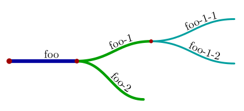
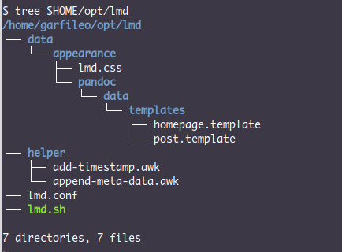
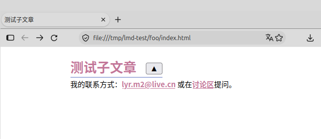
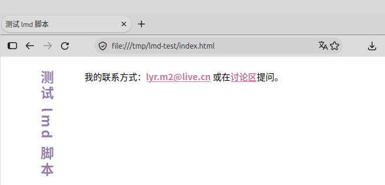
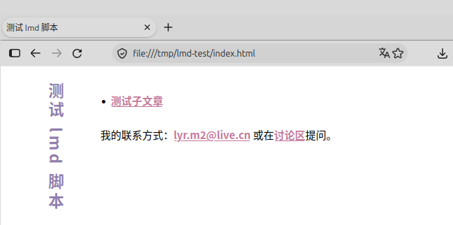

title: Foo
subtitle: 
category: ../index.html
lang: zh-CN
footer: 我的联系方式：<lyr.m2@live.cn> 或在[讨论区](https://github.com/liyanrui/liyanrui.github.io/issues)提问。
...

```

有一种特殊的文章，该文章结构除了拥有 figures 目录和 index.md 文件之外，还有 appearance 目录以及 lmd.conf 文件。这种文章称为根文章。函数 `lmd_init` 专用于创建根文章，

<pre class="bash-lang"><span class="snippet-name-start">@</span><span class="snippet-name" id="xi-8"> lmd_init 函数 </span><span class="snippet-name-stop">#</span>
function lmd_init {
    lmd_new_post "$1" "$2" "$3"
    cp -r "$LMD_SELF_PATH/data/appearance" ./
    cp $LMD_SELF_PATH/lmd.conf ./
}
=><span class="caller"><a class="snippet-reference" href="#xi-9"> lmd-init-test.sh </a></span>
=><span class="caller"><a class="snippet-reference" href="#xi-22"> lmd 脚本核心 </a></span>
</pre>

例如，

<pre class="bash-lang"><span class="snippet-name-start">@</span><span class="snippet-name" id="xi-9"> lmd-init-test.sh </span><span class="snippet-name-stop">#</span>
#!/bin/bash
<span class="snippet-name-start">#</span><a class="snippet-reference" href="#xi-4"> 全局变量 LMD_SELF_PATH </a><span class="snippet-name-stop">@</span>
<span class="snippet-name-start">#</span><a class="snippet-reference" href="#xi-6"> lmd_new_post 函数 </a><span class="snippet-name-stop">@</span>
<span class="snippet-name-start">#</span><a class="snippet-reference" href="#xi-8"> lmd_init 函数 </a><span class="snippet-name-stop">@</span>
lmd_init "Foo" foo
</pre>

使用 xi 提取 lmd-init-test.sh 脚本并将其置于 lmd 脚本的环境里，假设该环境有 lmd.conf 和 data/appearance 目录，然后执行 lmd-init-test.sh，便可创造出根文章 foo。方便起见，可模拟执行该过程，

<pre class="bash-lang"><span class="snippet-name-start">@</span><span class="snippet-name" id="xi-10"> run-lmd-init-test.sh </span><span class="snippet-name-stop">#</span>
#!/bin/bash
mkdir -p /tmp/lmd-init-test 
xi -t -e "lmd-init-test.sh" -o /tmp/lmd-init-test/lmd-init-test.sh $1
cd /tmp/lmd-init-test
mkdir -p data/appearance && touch lmd.conf
bash lmd-init-test.sh
</pre>

使用 xi 提取 run-lmd-init-test.sh 脚本并执行，

```
$ xi -t -e "run-lmd-init-test.sh" -o run-lmd-init-test.sh lmd.xi
$ bash run-lmd-init-test.sh lmd.xi
```

可在 /tmp/lmd-init-test 目录创造出根文章 foo，其结构为

```
foo
├── appearance 目录
├── figures 目录
├── index.md 文件
└── lmd.conf 文件
```

# 文章树溯源

无论是 `lmd_init` 创造的根文章，还是 `lmd_new_post` 创造的普通文章，二者本质上是目录，而目录可以嵌套，于是可以形成树状结构，即文章树。根文章是树的根节点，其下可以有多层普通文章节点，例如

```
# 创造根节点
lmd_init "Foo" foo && cd foo
# 创造两个子节点
lmd_new_post "Foo 1" foo-1
lmd_new_post "Foo 2" foo-2
# 为第一个子节点创造两个子节点
cd foo-1
lmd_new_post "Foo 1-1" foo-1-1
lmd_new_post "Foo 1-2" foo-1-2
```

将构造的目录画成图，会更为直观，



如果当前正在 foo-1-2 节点中工作，如何获得该节点到根节点的相对路径呢？这又是一个我在何处的问题，但不能像定义 `LMD_SELF_PATH` 那样解决该问题，因为现在的问题是，根节点相对于我在何处。

从当前节点向根节点逐级走去，将走过的路径记录下来，便可获得当前节点到根节点的相对路径。在此行走过程中，如何获知所达节点是根节点呢？观其目录是否含有 lmd.conf 文件。若是走到文件系统的根目录 `/` 也未能发现文章树的根节点，则报错。这个过程可以写成递归函数，

<pre class="bash-lang"><span class="snippet-name-start">@</span><span class="snippet-name" id="xi-11"> path_to_root 函数 </span><span class="snippet-name-stop">#</span>
function path_to_root {
    local relative_path="$1"
    if [ "$(pwd)" = "/" ]; then
        echo "Error: I can not find right path!"
        exit -1
    elif [ -e lmd.conf ]; then
        echo "${relative_path%/}"
    else
        relative_path="../$relative_path"
        cd ../
        path_to_root "$relative_path"
    fi
}
=><span class="caller"><a class="snippet-reference" href="#xi-12"> lmd_path_to_root 函数 </a></span>
</pre>

执行 `path_to_root` 函数时，若传给它空文本，则表示从当前节点出发，向文章树的根节点前进。该函数正常结束时，会输出当前节点到根节点的相对路径。在实际场景中，需将 `path_to_root` 置于命令替换环境，方能获取其结果，

<pre class="bash-lang"><span class="snippet-name-start">@</span><span class="snippet-name" id="xi-12"> lmd_path_to_root 函数 </span><span class="snippet-name-stop">#</span>
<span class="snippet-name-start">#</span><a class="snippet-reference" href="#xi-11"> path_to_root 函数 </a><span class="snippet-name-stop">@</span>
function lmd_path_to_root {
    local relative_path="$(path_to_root "")"
    if [ "$relative_path" = "" ]; then
        relative_path="."
    fi
    echo "$relative_path"
}
=><span class="caller"><a class="snippet-reference" href="#xi-13"> run-lmd-path-to-root-test.sh </a></span>
=><span class="caller"><a class="snippet-reference" href="#xi-19"> lmd-append-meta-data-test.sh </a></span>
=><span class="caller"><a class="snippet-reference" href="#xi-22"> lmd 脚本核心 </a></span>
</pre>

若想快速验证 `lmd_path_to_root` 是否灵验，可为其构造一个模拟运行环境，

<pre class="bash-lang"><span class="snippet-name-start">@</span><span class="snippet-name" id="xi-13"> run-lmd-path-to-root-test.sh </span><span class="snippet-name-stop">#</span>
#!/bin/bash
<span class="snippet-name-start">#</span><a class="snippet-reference" href="#xi-12"> lmd_path_to_root 函数 </a><span class="snippet-name-stop">@</span>
mkdir -p /tmp/foo/foo-1/foo-1-{1,2}
mkdir -p /tmp/foo/foo-2
touch /tmp/foo/lmd.conf
cd /tmp/foo/foo-1/foo-1-2
lmd_path_to_root
</pre>

执行 run-lmd-path-to-root-test.sh，可得

```
../..
```

如果你熟悉 bash 的相对路径语法，应该能确定该结果是正确的。为什么如此执着获取当前节点到文章树根节点的相对路径呢？因为 lmd 脚本要驱动 pandoc 工作，需要基于该路径访问位于根节点的 appearance 目录中的文件。

# 元数据

在文章树的任一节点里，能够获得位于根节点的 appearance 目录，将其保存至一个局部变量，

```
local lmd_face="$(lmd_path_to_root)"/appearance
```

根文章类似于书籍的封面页，在其目录内，使用 pandoc 命令将其转换为 html 文档，

```
pandoc index.md --standalone --table-of-contents \
       --css="$lmd_face"/lmd.css \
       --data-dir="$lmd_face"/pandoc/data \
       --template=homepage.template \
       --mathjax=https://cdn.bootcss.com/mathjax/3.2.2/es5/tex-mml-chtml.js \
       --output foo.html
```

所用的 pandoc 的选项，

* `--standalone`：可让 pandoc 生成完整的 HTML 文件，即可在浏览器中呈现的网页文件；
* `--table-of-contents`：可让 pandoc 生成文章目录；
* `--data-dir`：设定模板文件目录所在路径；
* `--mathjax`：设定 MathJax 脚本 CDN 地址，以 TeX 方式渲染文档中的数学公式；
* `--output`：设定输出文件。

同理，在 pandoc 的命令中，使用 post.template 作为模板文件，便可将普通文章转换为 html 文档。可是，文章树中的各个节点之间的联系，仅表现为目录层次关系，而在文章的内容里却无丝毫反映。虽然在撰写文章时，可以利用超级链接建立起文章之间的联系，但是这些联系有一部分是可以通过 lmd 脚本自动构建。例如，每当新建一篇文章时，可以自动在文章内容里添加通向其父节点文章的链接，亦即 ../index.html，通过这种链接，便可从文章树的任一节点回溯到根文章。

pandoc 所支持的 markdown 文档格式实际上并不纯粹，它允许文档头部含有 YAML 格式的元数据，在创建文章时，已经填写了两个元数据，

```
---
title: Foo
subtitle:
category: ../index.html
lang: zh-CN
footer: 我的联系方式：<lyr.m2@live.cn> 或在[讨论区](https://github.com/liyanrui/liyanrui.github.io/issues)提问。
...
```

`---` 和 `...` 分别是 YAML 文档的开始和结束标记。`title` 是文章标题。`subtitle` 是文章次标题，默认为空。在文档头部里，也能加入任何我们所需要的数据，例如父节点文章的位置，

```
category: ../index.html
```

lmd 脚本可以利用该信息，在文章里创建通往父节点文章的链接。

此外，无论是根文章还是普通文章，其 index.md 的头部还需要添加 `lang` 和 `footer` 信息，例如

```
lang: zh-CN
footer: 我的联系方式：<lyr.m2@live.cn>
```

pandoc 会将 `lang` 和 `footer` 的值传递给文章模板 home.template 和 post.template，从而生成的 html 文档里含有这些信息。

这些元数据可以手工写入每篇文章，但我没有这种耐心，想必你也不是一直都有。这个工作应该交由 lmd 脚本完成。一个简单的策略是，由 lmd 脚本向将每篇文章的 index.md 文件的复本填充元数据，然后用 pandoc 将该复本转换为 html 文件，最后将复本删除。如此偷梁换柱，index.md 文件能保持其头部原本的清爽状态，而你就像从未关心过这些元数据。

根文章只需要增加 `lang` 和 `footer`，因为它没有父节点文章。这两个元数据，在根文章的 lmd.conf 文件里定义，载入该文件便可获得，

<pre class="bash-lang"><span class="snippet-name-start">@</span><span class="snippet-name" id="xi-14"> 载入 lmd.conf </span><span class="snippet-name-stop">#</span>
source "$(lmd_path_to_root)/lmd.conf"
=><span class="caller"><a class="snippet-reference" href="#xi-18"> lmd_append_meta_data 函数 </a></span>
</pre>

向根文章复本写入元数据，此任务使用 awk 语言所写的脚本更为容易，

<pre class="bash-lang"><span class="snippet-name-start">@</span><span class="snippet-name" id="xi-15"> 向根文章写入元数据 </span><span class="snippet-name-stop">#</span>
awk -v lang="$LMD_LANGUAGE" \
    -v footer="$LMD_FOOTER" \
    -f "$LMD_SELF_PATH/helper/append-meta-data.awk" \
    index.md > ._tmp_index.md
=><span class="caller"><a class="snippet-reference" href="#xi-18"> lmd_append_meta_data 函数 </a></span>
</pre>

`LMD_LANGUAGE` 和 `LMD_FOOTER` 皆为 lmd.conf 文件中定义的变量。append-meta-data.awk 是 awk 脚本，位于 lmd 脚本所在目录的 helper 目录，负责向 ._tmp_index.md 文件写入元数据，其内容为

<pre class="AWK-lang"><span class="snippet-name-start">@</span><span class="snippet-name" id="xi-16"> append-meta-data.awk </span><span class="snippet-name-stop">#</span>
/^---/, /\.\.\./ {
    if ($0 == "...") { # 在 YAML 结束符之前插入元数据
        if (category) print "category:", category
        if (lang) print "lang:", lang
        if (footer) print "footer:", footer
    }
}
{ print $0 }
</pre>

在 append-meta-data.awk 脚本里，元数据以 awk 命令选项参数的形式传入，元数据的左值便自动成为脚本里的变量，元数据的右值则是变量的值。处理根文章时，awk 命令未提供 `category` 选项，意味着该脚本中，变量 `category` 无值，作为条件表达式时，为假，故而不会输出 `category` 的值。

向普通文章写入元数据时，可以给出 `category` 的值，

<pre class="bash-lang"><span class="snippet-name-start">@</span><span class="snippet-name" id="xi-17"> 向普通文章写入元数据 </span><span class="snippet-name-stop">#</span>
awk -v lang="$LMD_LANGUAGE" \
    -v footer="$LMD_FOOTER" \
    -v category="../index.html" \
    -f "$LMD_SELF_PATH/helper/append-meta-data.awk" \
    index.md > ._tmp_index.md
=><span class="caller"><a class="snippet-reference" href="#xi-18"> lmd_append_meta_data 函数 </a></span>
</pre>

`lmd_append_meta_data` 函数可根据当前目录是否存在 lmd.conf 文件，对文章酌情处理，

<pre class="bash-lang"><span class="snippet-name-start">@</span><span class="snippet-name" id="xi-18"> lmd_append_meta_data 函数 </span><span class="snippet-name-stop">#</span>
function lmd_append_meta_data {
    <span class="snippet-name-start">#</span><a class="snippet-reference" href="#xi-14"> 载入 lmd.conf </a><span class="snippet-name-stop">@</span>
    if [ -e lmd.conf ]; then
        <span class="snippet-name-start">#</span><a class="snippet-reference" href="#xi-15"> 向根文章写入元数据 </a><span class="snippet-name-stop">@</span>
    else
        <span class="snippet-name-start">#</span><a class="snippet-reference" href="#xi-17"> 向普通文章写入元数据 </a><span class="snippet-name-stop">@</span>
    fi
}
=><span class="caller"><a class="snippet-reference" href="#xi-19"> lmd-append-meta-data-test.sh </a></span>
=><span class="caller"><a class="snippet-reference" href="#xi-22"> lmd 脚本核心 </a></span>
</pre>

构造一个简单的试验环境，验证 `lmd_append_meta_data` 函数是否可用，

<pre class="bash-lang"><span class="snippet-name-start">@</span><span class="snippet-name" id="xi-19"> lmd-append-meta-data-test.sh </span><span class="snippet-name-stop">#</span>
#!/bin/bash
<span class="snippet-name-start">#</span><a class="snippet-reference" href="#xi-6"> lmd_new_post 函数 </a><span class="snippet-name-stop">@</span>
<span class="snippet-name-start">#</span><a class="snippet-reference" href="#xi-12"> lmd_path_to_root 函数 </a><span class="snippet-name-stop">@</span>
<span class="snippet-name-start">#</span><a class="snippet-reference" href="#xi-18"> lmd_append_meta_data 函数 </a><span class="snippet-name-stop">@</span>
# 准备 $LMD_SELF_PATH/helper
LMD_SELF_PATH=/tmp
mkdir -p /tmp/helper
xi -t -e "append-meta-data.awk" "$1"
# 试验目录
mkdir -p /tmp/lmd-append-meta-data-test
cd /tmp/lmd-append-meta-data-test
# 根文章
lmd_new_post "根文章" foo
echo "LMD_LANGUAGE=zh-CN" > lmd.conf
echo "LMD_FOOTER=\"联系我...\"" >> lmd.conf
lmd_append_meta_data
cat ._tmp_index.md
# 子文章
lmd_new_post "子文章" foo-1
lmd_append_meta_data
cat ._tmp_index.md
</pre>

lmd-append-meta-data-test.sh 脚本所接受的参数是 [lmd.xi](lmd.xi) 文件。执行该脚本，

```
$ xi -t -e "lmd-append-meta-data-test.sh" lmd.xi
$ bash "lmd-append-meta-data-test.sh" lmd.xi
```

所得结果应该为

```
---
title: 根文章
subtitle: 
lang: zh-CN
footer: 联系我...
...


---
title: 子文章
subtitle: 
category: ../index.html
lang: zh-CN
footer: 联系我...
...


```

注意，在使用 xi 提取文学程序片段时，若片段名是文件名，可省略 `-o` 选项。xi 默认会以片段名作为输出文件名。

# 驱动 pandoc

经过一番精心准备，驱动 pandoc 的任务就非常简单了，

<pre class="bash-lang"><span class="snippet-name-start">@</span><span class="snippet-name" id="xi-20"> build_post 函数 </span><span class="snippet-name-stop">#</span>
function build_post {
    lmd_append_meta_data
    local lmd_face="$(lmd_path_to_root)"/appearance
    if [ "$lmd_face" = "./appearance" ]; then
        pandoc ._tmp_index.md --standalone \
               --css "$lmd_face/lmd.css" \
               --data-dir="$lmd_face/pandoc/data" \
               --template=homepage.template \
               --mathjax=https://cdn.jsdelivr.net/npm/mathjax@3/es5/tex-mml-chtml.js \
               -o index.html
    else
        pandoc ._tmp_index.md --standalone --table-of-contents \
               --css "$lmd_face/lmd.css" \
               --data-dir="$lmd_face/pandoc/data" \
               --template=post.template \
               --mathjax=https://cdn.jsdelivr.net/npm/mathjax@3/es5/tex-mml-chtml.js \
               -o index.html
    fi
    rm -f ._tmp_index.md
}
=><span class="caller"><a class="snippet-reference" href="#xi-21"> lmd_build 函数 </a></span>
</pre>

但是，`build_post` 并不安全，在执行它之前，需要判断当前目录是否存在 index.md 文件，

<pre class="bash-lang"><span class="snippet-name-start">@</span><span class="snippet-name" id="xi-21"> lmd_build 函数 </span><span class="snippet-name-stop">#</span>
<span class="snippet-name-start">#</span><a class="snippet-reference" href="#xi-20"> build_post 函数 </a><span class="snippet-name-stop">@</span>
function lmd_build {
    if [ -e index.md ]
    then
        build_post
    fi
}
=><span class="caller"><a class="snippet-reference" href="#xi-22"> lmd 脚本核心 </a></span>
</pre>

至此，lmd 脚本最为核心的功能便完成了，但是若要验证 `lmd_build` 函数是否可用，必须手工构造出一个真正的试验环境。

# 真正的试验环境

汇集上文实现的一些代码片段，形成 lmd 脚本核心，

<pre class="bash-lang"><span class="snippet-name-start">@</span><span class="snippet-name" id="xi-22"> lmd 脚本核心 </span><span class="snippet-name-stop">#</span>
<span class="snippet-name-start">#</span><a class="snippet-reference" href="#xi-4"> 全局变量 LMD_SELF_PATH </a><span class="snippet-name-stop">@</span>
<span class="snippet-name-start">#</span><a class="snippet-reference" href="#xi-6"> lmd_new_post 函数 </a><span class="snippet-name-stop">@</span>
<span class="snippet-name-start">#</span><a class="snippet-reference" href="#xi-8"> lmd_init 函数 </a><span class="snippet-name-stop">@</span>
<span class="snippet-name-start">#</span><a class="snippet-reference" href="#xi-12"> lmd_path_to_root 函数 </a><span class="snippet-name-stop">@</span>
<span class="snippet-name-start">#</span><a class="snippet-reference" href="#xi-18"> lmd_append_meta_data 函数 </a><span class="snippet-name-stop">@</span>
<span class="snippet-name-start">#</span><a class="snippet-reference" href="#xi-21"> lmd_build 函数 </a><span class="snippet-name-stop">@</span>
=><span class="caller"><a class="snippet-reference" href="#xi-24"> lmd.sh </a></span>
</pre>

然后分别构造一个简单的命令行界面，

<pre class="bash-lang"><span class="snippet-name-start">@</span><span class="snippet-name" id="xi-23"> lmd 脚本命令行界面 </span><span class="snippet-name-stop">#</span>
case $1 in
    init)  lmd_init "${@:2}" ;;
    new)   lmd_new_post "${@:2}" ;;
    build) lmd_build ;;
esac
=><span class="caller"><a class="snippet-reference" href="#xi-24"> lmd.sh </a></span>
</pre>

> `$@` 或 `${@}` 表示所有的命令行参数，`${@:2}` 是 bash 的参数切片语法，表示从 `$2` 开始直至最后一个参数所形成的参数集合切片。从 `$2` 到 `$5` 的切片，可表示为 `${@:2:3}`，即从 `$2` 开始，长度为 3 的切片。

lmd 脚本由其核心和命令行界面构成，

<pre class="bash-lang"><span class="snippet-name-start">@</span><span class="snippet-name" id="xi-24"> lmd.sh </span><span class="snippet-name-stop">#</span>
#!/bin/bash
set -euo pipefail # 提升脚本健壮性
<span class="snippet-name-start">#</span><a class="snippet-reference" href="#xi-22"> lmd 脚本核心 </a><span class="snippet-name-stop">@</span>
<span class="snippet-name-start">#</span><a class="snippet-reference" href="#xi-23"> lmd 脚本命令行界面 </a><span class="snippet-name-stop">@</span>
</pre>

在 Linux 环境里，可以用 `wget` 命令获得 [lmd.xi](lmd.xi) 文件，然后用 xi 命令提取 lmd 脚本和 append-meta-data.awk 脚本，

```
$ wget https://liyanrui.github.io/2026/lmd/lmd.xi
$ xi -t -e "lmd.sh, lmd.conf, append-meta-data.awk" lmd.xi
$ chmod +x lmd.sh
```

假设将所得 lmd.sh 和 lmd.conf 放在 $HOME/opt/lmd 目录内，将 append-meta-data.awk 放在该目录的 helper 子目录内，

```
$ mkdir -p $HOME/opt/lmd/{data/appearance,helper}
$ mv lmd.sh $HOME/opt/lmd
$ mv lmd.conf $HOME/opt/lmd
$ mv append-meta-data.awk $HOME/opt/lmd/helper 
```

在 data/appearance 目录内，放置 lmd.css 文件和 pandoc 模板

```
$ cd $HOME/opt/lmd/data/appearance
$ wget https://liyanrui.github.io/appearance/lmd.css
$ mkdir -p pandoc/data/templates
$ cd pandoc/data/templates
$ wget https://liyanrui.github.io/appearance/pandoc/data/templates/homepage.template
$ wget https://liyanrui.github.io/appearance/pandoc/data/templates/post.template
```

至此，一个完善的 lmd.sh 脚本的运行环境便构造了出来，其结构形如



在 /tmp 目录里执行 $HOME/opt/lmd/lmd.sh 脚本，

```
$ cd /tmp
$ export PATH=$HOME/opt/lmd/:$PATH
$ lmd.sh init "测试 lmd 脚本" lmd-test
$ lmd.sh build
$ lmd.sh new "测试子文章" foo
$ lmd.sh build
```

使用网页浏览器打开 /tmp/lmd-test/foo/index.html 文件，结果如下图所示，



点击标题「测试子文章」右侧的按钮，可以跳转至根文章，



子文章页面里的按钮，本质上是指向上级文章节点的超级链接。该链接之所以能够自动构造出来，是因为文章头部含有 `category` 元数据，其值为 `../index.html`。在 post.template 文件里，使用该元数据的模板代码为

```
<h1 class="title">$title$
    <span class="back-to-top-span">$if(category)$
    <a href="$category$">
      <button id="back-to-top" aria-label="返回目录">▲</button>
    </a>$endif$</span></h1>
```

上述代码中的 `$category$`，即 pandoc 从文章头部提取的 `category` 元数据。


# 归档

现在，只能从一篇文章开始逐级向上切换至根文章，却无法从根文章开始逐级向下切换至某篇文章。需要设法在上级文章里放置下级文章的链接，该过程称为归档，上级文章相当于下级文章的目录，亦即对于任何一篇文章，它需要假设上级文章含有一个文档列表，然后需要某种方式将自身添加到该列表的尾部或首部。

最简单的办法是手工在文章里添加下级文章的链接。例如，编辑上一节的示例中的根文章，使其内容为

```
---
title: 测试 lmd 脚本
subtitle: 
category: ../index.html
lang: zh-CN
footer: 我的联系方式：<lyr.m2@live.cn> 或在[讨论区](https://github.com/liyanrui/liyanrui.github.io/issues)提问。
...

* [测试子文章](foo/index.html)
```

在根文章目录，即 /tmp/lmd-test 目录，执行

```
$ lmd.sh build
```

重新生成的根文章便含有下级文章的链接了。



这个过程能否自动化呢？可以，但没有太大必要。手工归档所耗费的时间，与写一篇文章所用的时间相比，几乎可以忽略不计。此外，手工完成文章归档，也具备最大的灵活性，你甚至可以像一名期刊编辑那样完成这类工作。
