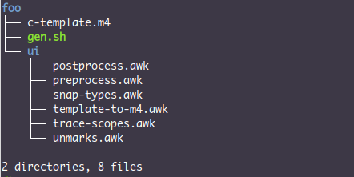

---
title: 用 m4 武装 C
date: 2026 年 11 月 02 日
...

在「[用 m4 武装 xi](../m4-and-xi/index.html)」中，基于 m4 为 xi 实现了代码文件载入功能。对于 C 语言而言，m4 能做什么呢？我首先想到的是泛型编程。C 语言从 C11 标准开始，提供 `_Generic` 表达式，对泛型编程提供了聊胜于无的支持，与真正意义上的泛型编程相比，相差甚远。在读过《[m4 的咒语](../m4-charm/index.html)》之后，你具备了驾驭 m4 语言的能力，大概会想，能否基于 m4 在 C 语言的外围建立泛型编程机制呢？

# C11 泛型

一个 C 语言函数，它可能存在多个版本，甚至有可能是宏函数。在泛型编程中，我们希望有一种机制，能够基于函数所接受的变量类型，在函数的多个版本中自动选出适配者然后调用。例如，`printf` 函数有以下版本

```c
#define print_int(x) printf("%d\n", (x))
#define print_string(x) printf("%s\n", (x))
#define print_double(x) printf("%lf\n", (x))
void print_foo(struct foo x) {
    .... .... ...
}
```

假设有一个变量 `a`，其类型为 `double`，调用 `print` 函数打印其值，

```c
double a = 3.14;
print(a);
```

此时，我们会希望有一种机制能自动将 `print(a)` 转换为 `print_double(a)`。若你熟悉 C11，应该知道，基于 `_Generic` 宏能构造一个 `print` 宏，可根据 `a` 的类型，将 `a` 转发给相应的函数，例如

```c
#define print(x) _Generic((x),          \
    int:          print_int,            \
    char *:       print_string,         \
    const char *: print_string,         \
    double:       print_double,         \
    struct foo:   print_foo             \
)(x)
```

然而，`_Generic` 选择的结果必须是表达式。函数名本质上是地址，属于表达式，故而 `print_foo` 作为选择结果是可行的。`print_int` 之类的宏名是 C 预处理过程中的符号，并非表达式，而且是有参数宏的非法调用，亦即宏名后未有跟随参数，C 预处理器会将其视为未声明的标识符，亦即 `print` 宏的定义无法通过编译，更遑论 `print(a)` 时去选择适当的类型分支了。若要解决这个问题，必须将 `print_int`，`print_string` 和 `print_double` 定义为函数。

`_Generic` 的另一个局限是，只能基于 1 个参数选择函数版本。如果 `print` 的各个版本是打印两个变量的值，例如

```c
void print_int_double(int x, double y) {
        printf("(%d, %lf)\n", x, y);
}
void print_double_int(double x, int y) {
        printf("(%lf, %d)\n", x, y);
}
```

则 `print` 宏在用 `_Generic` 选择函数版本时，需要作两次选择，亦即

```c
#define print(x, y) _Generic((x),        \
    int: _Generic((y),                   \
            double: print_int_double)    \
    double: _Generic((y),                \
            int:    print_double_int     \
)(x, y)
```

然而这样写是错误的，`_Generic` 要求你必须写出全量组合，亦即你需要提供面向两种类型所有组合的函数版本的选择分支，即使你不需要 `print_int_int` 和 `print_double_double`，也必须定义它们，亦即

```c
void print_int_int(int x, int y) {}
void print_double_double(double x, double y) {}
void print_int_double(int x, double y) {
        printf("(%d, %lf)\n", x, y);
}
void print_double_int(double x, int y) {
        printf("(%lf, %d)\n", x, y);
}
#define print(x, y) _Generic((x),            \
    int: _Generic((y),                       \
            int: print_int_int,              \
            double: print_int_double),       \
    double: _Generic((y),                    \
            int:    print_double_int,        \
            double: print_double_double)     \
)(x, y)
```

如果 `print` 需要处理 3 个甚至更多个参数呢……所以我说，`_Generic` 只是 C11 对泛型编程提供的聊胜于无的支持。若用 m4 在 C 语言的创造泛型机制，会更好吗？

# 变量类型

由于 m4 与 C 毫无实质上的交集，这意味着 m4 能够根据变量的类型选择相应的宏、函数甚至任意语句，然而也意味着 m4 无法利用 C 编译器的一切功能。故而要解决的第一个问题是，如何随时获得变量类型。

编写程序，扫描 C 代码，获得所有变量的类型，对于 m4 语言并不现实，它不适合编写复杂程序。定义一个 m4 宏，用它取代 C 变量声明/定义语法，在调用这个宏的过程中，将变量类型保存下来，这个方案非常适合 m4。

按照《[m4 的咒语](../m4-charm/index.html)》介绍的 m4 宏编程基本思维，先从我们想要得到的结果出发，倒推宏的定义。假设 `$1` 是类型，`$2` 是变量名，`$3` 是变量的值，并且 `$3` 可能不存在，也可能存在，我希望得到的结果是

```
$2 $1`'ifelse(`$3', `', `', ` = $3')
```

> 想必你是知道的，m4 引号包含空文本时，它可以作为文本的间隔符，也能在 `ifelse` 语句中作为空值。

若在上述结果之后，基于 `$1` 定义一个宏，将类型亦即 `$2` 保存下来，

```m4
$2 $1`'ifelse(`$3', `', `', ` = $3')define(`_var_$1_t_', `$2')
```

再为上述这个结果添加一层引号，便可定义出 `_var` 宏，

```m4
define(`_var', `$2 $1`'ifelse(`$3', `', `', ` = $3')define(`_var_$1_t_', `$2')')
```

试着用 `_var` 定义或声明几个变量，且以 `_var_变量名_t_` 的方式获得以 m4 宏的形式保存的变量类型信息，

```c
_var(a, int, 42);            /* [_var_a_t_] */
_var(pi, double, 3.14);      /* [_var_pi_t_] */
_var(text, char *, "hello"); /* [_var_text_t_] */
```

展开结果应当是

```c
int a = 42;            /* [int] */
double pi = 3.14;      /* [double] */
char * text = "hello"; /* [char *] */
```

由于我的 C 变量声明或定义习惯是，指针的 `*` 符号紧贴变量名，所以，对 `$2` 和 `$1` 的间隔略作修饰，

```m4
define(`_delsep', `ifelse(regexp(`$1', `\*$'), -1, ` ', `')')
define(`_var', `$2`'_delsep(`$2')$1`'ifelse(`$3', `', `', ` = $3')define(`_var_$1_t_', `$2')')
```

> `regexp` 语句用于判断类型名是否以 `*` 结尾，结果为 -1，表示否，则用 1 个空格间隔类型与变量名，否则以空文本间隔二者。

如此修改，可让上述示例的展开结果为

```c
int a = 42;            /* [int] */
double pi = 3.14;      /* [double] */
char *text = "hello"; /* [char *] */
```

# 作用域

虽然能够在 m4 层面获得 C 语言变量类型信息，但是在 C 语言中，变量是有作用域的，例如

```c
int a = 42;
if (1) {
    double a = 3.14;
}
```

若将上述代码写成 `_var` 形式，且在 `if` 语句之后获取 `a` 的类型，

```c
_var(a, int, 42);
if (1) {
    _var(a, double);
}
/* a 的类型 _var_a_t_ */
```

则展开结果为

```c
int a = 42;
if (1) {
    double a;
}
/* a 的类型 double */
```

如你所见，变量 `a` 记录的类型信息原本是 `int`，但是在 `if` 语句之后，却变为 `double`，这是因为 `_var` 并未考虑 C 语言变量在不同的作用域中会出现同名情况，导致在记录变量类型信息时，当前变量的类型信息总是会覆盖之前所为与之同名的变量所记录的类型信息。要解决该问题，必须跟踪 C 语言作用域，亦即跟踪花括号的嵌套层次。该任务对于 m4 而言是复杂的，可是对于 `awk` 之类的语言则简单许多，而 m4 语言所擅长的是记录信息，并对所记录的信息作一些处理。

可以定义两个 m4 宏，`_begin_scope_` 记录作用域开始，`_end_scope_` 记录作用域结束，用计数器 `_scope_` 记录嵌套层次，

```
define(`_scope_', 0)
define(`_begin_scope_', `define(`_scope_', incr(_scope_)){')
define(`_end_scope_', `define(`_scope_', decr(_scope_))}')
```

`_begin_scope` 会在每个作用域开始时，让 `_scope_` 增 1，然后展开为 `{`，而 `_end_scope_` 则相反，在作用域结束时，让 `_scope_` 减 1，然后展开为 `}`，例如

```c
/* `_scope_' 的值为 _scope_ */
if (1) _begin_scope_
    /* `_scope_' 的值为 _scope_ */
    if (0) _begin_scope_
        /* `_scope_' 的值为 _scope_ */
    _end_scope_
    /* `_scope_' 的值为 _scope_ */
_end_scope_
/* `_scope_' 的值为 _scope_ */
```

展开结果为

```c
/* _scope_ 的值为 0 */
if (1) {
    /* _scope_ 的值为 1 */
    if (0) {
        /* _scope_ 的值为 2 */
    }
    /* _scope_ 的值为 1 */
}
/* _scope_ 的值为 0 */
```

显然，如果将 C 源码文件里的所有表征作用域的花括号 `{` 和 `}` 分别换成 `_beging_scope_` 和 `_end_scope_`，在 m4 层面便可基于 `_scope_` 的值跟踪作用域了，至少能跟踪到作用域的当前深度。假设 C 源码文件为 foo.c，若不想写脚本替换作用域符号，可以用 `sed` 命令，

```console
$ sed 's/{/_begin_scope_/g; s/}/_end_scope_/g' foo.c
```

只是如此替换，很容易误伤位于代码注释或者字符串中的花括号，稳妥起见，可以写一个 awk 脚本，实现更为精确的花括号替换。在这个时代，这种脚本属于体力活，不必自己写，可以交给 AI……以下脚本 trace-scopes.awk 便是 DeepSeek 所写，

```awk
# trace-scopes.awk
# 用法：awk -f trace-scopes.awk foo.c
BEGIN {
    # normal | string | char | line_comment | block_comment
    state = "normal"
}
{
    line = $0
    out  = ""
    n    = length(line)
    for (i = 1; i <= n; i++) {
        c  = substr(line, i, 1)
        c2 = substr(line, i + 1, 1)
        if (state == "normal") {
            if (c == "/" && c2 == "/") {
                out = out c c2; i++; state = "line_comment"
            } else if (c == "/" && c2 == "*") {
                out = out c c2; i++; state = "block_comment"
            } else if (c == "\"") {
                out = out c; state = "string"
            } else if (c == "'") {
                out = out c; state = "char"
            } else if (c == "{") {
                out = out "_begin_scope_"
            } else if (c == "}") {
                out = out "_end_scope_"
            } else {
                out = out c
            }
        } else if (state == "string" || state == "char") {
            out = out c
            if (c == "\\") { # 处理转义：\ 及紧随其后的字符原样输出
                i++; out = out substr(line, i, 1)
            } else if (state == "string" && c == "\"") {
                state = "normal"
            } else if (state == "char" && c == "'") {
                state = "normal"
            }
        } else if (state == "line_comment") {
            out = out c # 行注释整行原样输出
        } else if (state == "block_comment") {
            out = out c
            if (c == "*" && c2 == "/") { # 块注释结束
                out = out c2; i++; state = "normal"
            }
        }
    }
    print out
    if (state == "line_comment") state = "normal" # 行注释到行尾自动结束
}
```

假设 foo.c 文件的内容为

```
/* `_scope_' 的值为 _scope_ */
if (1) {
    /* `_scope_' 的值为 _scope_ */
    if (0) {
        /* `_scope_' 的值为 _scope_ */
    }
    /* `_scope_' 的值为 _scope_ */
}
/* `_scope_' 的值为 _scope_ */
```

执行 `awk` 命令，

```console
$ awk -f trace-scopes.awk foo.c
```

便可得到

```
/* `_scope_' 的值为 _scope_ */
if (1) _begin_scope_
    /* `_scope_' 的值为 _scope_ */
    if (0) _begin_scope_
        /* `_scope_' 的值为 _scope_ */
    _end_scope_
    /* `_scope_' 的值为 _scope_ */
_end_scope_
/* `_scope_' 的值为 _scope_ */
```

假设上述 m4 宏的定义是在 c-template.m4 文件中，将 awk 和 m4 命令组合起来，

```console
$ awk -f trace-scopes.awk foo.c | m4 c-template.m4 -
```

> m4 支持多个文件输入，其命令中的 `-` 符号表示标准输入（stdin），可用于通过管道将其他命令的输出作为 m4 的输入。

便可得到

```c
/* _scope_ 的值为 0 */
if (1) {
    /* _scope_ 的值为 1 */
    if (0) {
        /* _scope_ 的值为 2 */
    }
    /* _scope_ 的值为 1 */
}
/* _scope_ 的值为 0 */
```

在 `_var` 的定义中，将 `_scope_` 的值添加到 `_var_变量名_t_`，便可区分出不同作用域中的同名变量，同时也能正确获取其类型信息，

```m4
define(`_var', `$2`'_delsep(`$2')$1`'ifelse(`$3', `', `', ` = $3')define(`_var_$1_t_'_scope_, `$2')')
```

m4 宏定义写成单行，很容易过长，但不能随意将其断开，否则在宏的展开结果中引入多余的换行符和空格。在宏调用语句的参数间隔符后断行，通常是安全的，因为 m4 会自动忽略每个参数前后的空白字符。`_var` 可写成

```m4
define(`_var', 
       `$2`'_delsep(`$2')$1`'ifelse(`$3', `', 
                                    `', ` = $3')define(`_var_$1_t_'_scope_, `$2')')
```

倘若在任意位置断行，需要用 `dnl`，并注意所开的新行行首不要出现空白字符，例如

```m4
define(`_var', `$2`'_delsep(`$2')$1`'ifelse(`$3', `', `', ` = $3')dnl
define(`_var_$1_t_'_scope_, `$2')')
```

这种修改，很容易误以为第 2 行的 `define` 语句是独立的宏定义，实际上它是 `_var` 展开语句中定义的。为了防止这种误认，可以用引号包含空文本充当缩进，

```m4
define(`_var', `$2`'_delsep(`$2')$1`'ifelse(`$3', `', `', ` = $3')dnl
`'`'define(`_var_$1_t_'_scope_, `$2')')
```

基于 `_begin_scope_`，`_end_scope_` 以及 `_var` 宏，可以记录任意作用域中的变量类型，例如

```
_var(a, int, 42);
if (1) {
    _var(a, double);
    if (0) {
        _var(a, char *);
        /* a 的类型 indir(`_var_a_t_'_scope_) */
    }
    /* a 的类型 indir(`_var_a_t_'_scope_) */
}
/* a 的类型 indir(`_var_a_t_'_scope_) */
```

> 注意，直接用 `_var_a_t__scope` 无法获得 `a` 的类型信息，因为 `_scope_` 和前面的文本结合，若是用引号包含的空文本作为间隔，m4 也不认为那是一个宏的名字，故而只能先拼出宏名，然后 `indir` 以间接方式调用。

展开结果为

```c
int a = 42;
if (1) {
    double a;
    if (0) {
        char *a;
        /* a 的类型 char * */
    }
    /* a 的类型 double */
}
/* a 的类型 int */
```

由于下文需要经常获取所记录的变量类型，需专门为此定义一个宏，将变量的名字传给它，它便给出其类型，

```m4
define(`_type_name', `indir(`_var_$1_t_'_scope_)')
```

于是，上述示例可简化为

```c
_var(a, int, 42);
if (1) {
    _var(a, double);
    if (0) {
        _var(a, char *);
        /* a 的类型 _type_name(a) */
    }
    /* a 的类型 _type_name(a) */
}
/* a 的类型 _type_name(a) */
```

# 类型 id

当我们能够成功拿到每个变量的类型之后，需要考虑的问题便是，如何基于这些类型选择函数、宏、表达式或者代码片段的版本？例如，若变量 `a` 的类型是 `int`，则可选 `print_int` 这样的函数名，可是若类型为 `char *` 或者 `struct {...}` 甚至函数指针之类呢？此时，函数名便不可能直接以类型名作为后缀了。

在标识命名规则上，C 语言只允许使用字母、数字和下划线，故而可用的后缀名也只能是这些符号。若是以数字代表类型名，将其作为任何名字的后缀都是合规的。这意味着需要在 m4 层面，将类型名映射为数字。例如，若 `int` 类型用数字 `1` 表示，则 `print_int` 便可表示为 `print_1`，若 `char *` 类型用 `3` 表示，则打印字符串的函数可表示为 `print_3`。


在上文最后一个版本的 `_var` 定义中，是通过

```m4
define(`_var_$1_t_'_scope_, `$2')
```

完成变量名至类型名的映射。用类似的办法，为类型也定义一个计数器，

```m4
define(`_type_', 0)
```

然后在 `_var` 的定义中，将 `_type_` 增 1，并将其作为 `_$2_type` 的定义，

```m4
define(`_$2_type_', define(`_type_', incr(_type_))_type_)
```

> 注意，在上述宏定义里，需要注意，宏体不可以加引号，需要其内容比 `define` 先展开方能达成建立类型到数字映射的目的。不要忘记，无论是 `define` 语句还是普通宏调用语句，参数总是比宏本身先展开。

在 `_var` 的定义中，`$2` 表示类型名，假设 `$2` 是 `int`，则上述代码定义的是 `_int_type_`，其值为 `_type_` 的当前值。不过，若是 `_var` 多次遇到 `int` 类型的变量，意味着 `_int_type_` 也会被定义多次，且其值会多次递增。倘若希望每种类型到 `_type_` 的值的映射只被定义一次，可以用 `ifdef` 语句检测 `_$2_type` 宏是否存在，若存在则不再定义，否则给出其定义，

```m4
ifdef(`_$2_type_', `', `define(`_$2_type_', _type_`'define(`_type_', incr(_type_)))')
```

将这行代码插入 `_var` 宏的定义里，

```m4
define(`_var', `$2`'_delsep(`$2')$1`'ifelse(`$3', `', `', ` = $3')dnl
`'`'define(`_var_$1_t_'_scope_, `$2')ifdef(`_$2_type_', `', 
                                           `define(`_$2_type_', 
                                                   _type_`'define(`_type_', 
                                                                 incr(_type_)))')')
```

便可在每次使用 `_var` 定义或声明变量时，不仅能记录变量的类型信息，而且也能将类型信息映射为数字，该数字称为**类型 id**。

为了方便基于类型名查询其对应的 id，定义一个辅助宏，

```m4
define(`_type_id', ``_'indir(`_$1_type_')')
```

若将上述内容确定的宏汇集至 c-template.m4 文件，则有

```m4
dnl c-template.m4
divert(-1)
dnl 作用域
define(`_scope_', 0)
define(`_begin_scope_', `define(`_scope_', incr(_scope_)){')
define(`_end_scope_', `define(`_scope_', decr(_scope_))}')
dnl 变量类型
define(`_type_', 0)
define(`_delsep', `ifelse(regexp(`$1', `\*$'), -1, ` ', `')')
define(`_var', `$2`'_delsep(`$2')$1`'ifelse(`$3', `', `', ` = $3')dnl
`'`'define(`_var_$1_t_'_scope_, `$2')ifdef(`_$2_type_', 
                                           `', 
                                           `define(`_$2_type_', 
                                                   _type_`'define(`_type_', 
                                                                 incr(_type_)))')')
define(`_type_name', `indir(`_var_$1_t_'_scope_)')
define(`_type_id', ``_'indir(_$1_type_)')
divert(0)dnl
```

将测试文件 foo.c 修改为

```c
_var(a, int, 42);
if (1) {
    _var(a, int);
    if (0) {
        _var(a, char *);
        /* a 的类型 _type_name(a), 类型 id 为 _type_id(_type_name(a)) */
    }
    /* a 的类型 _type_name(a), 类型 id 为 _type_id(_type_name(a)) */
}
/* a 的类型 _type_name(a), 类型 id 为 _type_id(_type_name(a)) */
```

执行

```console
$ awk -f trace-scopes.awk foo.c | m4 c-template.m4 -
```

所得结果为

```c
int a = 42;
if (1) {
    int a;
    if (0) {
        char *a;
        /* a 的类型 char *, 类型 id 为 _2 */
    }
    /* a 的类型 int, 类型 id 为 _1 */
}
/* a 的类型 int, 类型 id 为 _1 */
```

# 表达式

虽然我也很想快进到思考如何构造模板形式的函数和数据类型，可是我们必须考虑一种特殊的变量，即表达式，例如 `print(a + b)`，此时 `a + b` 的类型是什么呢？或者更简单的情况，`print(42)`，此时 `42` 的类型是什么呢？前文定义的 `_var` 宏没法处理这些非常规情况，不过这些也不是 `_var` 应该处理的情况。表达式应该需要有一个 `_expr` 宏来记录其类型。

假设 `_expr` 的参数 `$1` 是表达式，`$2` 是其类型，我希望得到展开结果是

```m4
$1`'define(`_expr_$1_t_'_scope, `$2')dnl
`'`'ifdef(`_$2_type_', 
          `', 
          `define(`_$2_type_', 
                  define(`_type_', incr(_type_))_type_`')')
```

亦即，将 `$1` 作为 `_expr` 的展开结果，随后记录表达式类型，并构造该类型与类型 id 的映射。将以上代码套上一层引号，便可构成 `_expr` 的定义，

```m4
define(`_expr', `$1`'dnl
`'`'define(`_expr_$1_t_'_scope_, `$2')dnl
`'`'ifdef(`_$2_type_', 
          `', 
          `define(`_$2_type_', 
                  define(`_type_', incr(_type_))_type_`')')')
```

为了获得指定表达式类型，重新定义辅助宏 `_type_name`，

```m4
define(`_type_name', `ifdef(`_var_$1_t_'_scope_, 
                            `indir(`_var_$1_t_'_scope_)',
                            `ifdef(`_expr_$1_t_'_scope_,
                                  `indir(`_expr_$1_t_'_scope_)', `')')')
```

`_type_id` 宏暂时无需重新定义，它只与类型有关。

构造几个表达式，测试 `_expr` 是否可用，

```
print(expr(a + b, int));       /* _type_name(a + b) */
if (1) {
    int a = expr(42.0, float); /* _type_name(42.0) */
}
print(a + b);                  /* _type_name(a + b) */
```

上述代码展开结果为

```c
print(a + b);       /* int */
if (1) {
    int a = 42.0; /* float */
}
print(a + b);                  /* int */
```

> 注意，由于 C 语言表达式中可能会出现逗号和单引号等符号，可能会污染 m4 代码。对于逗号之类的符号，只需要用 m4 的引号便可逃逸，但是遇到单引号，m4 便无能为力，除非使用 `changequote` 对 m4 自身的引号修改为其他字符，此事暂且待定。

也许你已经发现了，`_var` 和 `_expr` 中有一部分代码是重复的，即

```m4
ifdef(`_$2_type_', 
      `', 
      `define(`_$2_type_', 
              define(`_type_', incr(_type_))_type_`')')
```

可将这部分代码单独定义为一个宏，

```m4
define(`_def_type', 
       `ifdef(`_$1_type_', 
              `', 
              `define(`_$1_type_', 
                      define(`_type_', incr(_type_))_type_`')')')
```

`def_type` 的用途是基于类型名，定义 `_类型名_type` 宏，若该宏已经存在，则什么都不做。

基于 `_def_type`，`_var` 和 `_expr` 的定义可简化为

```m4
define(`_var',
       `$2`'_delsep(`$2')$1`'ifelse(`$3', `',
                                    `',
                                    ` = $3')define(`_var_$1_t_'_scope_, `$2')_def_type(`$2')')
define(`_expr', `$1`'define(`_expr_$1_t_'_scope_, `$2')_def_type(`$2')')
```

基于 `_def_type` 宏，可让 `_type_id` 宏也具备为类型名和类型 id 构造映射的能力，

```m4
define(`_type_id', ``_'_def_type(`$1')indir(`_$1_type_')')
```

# 函数版本

既然 `_var` 能记录变量类型，`_expr` 能记录表达式类型，那么函数的类型信息是否也能用同样的方式记录下来呢？假设用于记录函数类型的宏为 `_func`，其 `$1` 参数是函数名，`$2` 是函数的参数表，`$3` 是函数的返回类型。`_func` 的展开结果是 C 语言函数的声明，亦即其展开结果的第一部分应该是

```m4
$3 $1`'$2
```

例如

```
_func(print, (int x, double y), void);
```

展开结果应当是

```c
void print(int x, double y);
```

然而，这个结果却并非我想要的。原因很简单，既然是用 m4 在 C 语言的外围提供泛型编程扩展，应当支持 `print` 函数有多个版本，亦即 `_func` 展开结果中的函数名应该含有特定信息，从而与其他版本区分开来。同名函数，其不同之处在于参数类型。在前文中，已设法将变量和表达式类型都映射为数字，若在函数的参数列表中提取参数类型，将它们转换为数字并嵌入函数名，问题便得以解决。

可是，从 `(int x, double y)` 这样的参数表中提取 `int` 和 `double`，对于 m4 而言是颇为困难的任务，即使对于 awk 之类的脚本语言亦非易事。函数的参数表虽然并没有太多内容，然而涉及的情况有时会颇为复杂。若是直接在代码中用特殊符号，将需要记录的类型标记出来，然后再写 awk 脚本处理，应当会容易许多。例如，

```c
_func(print, (<int> a, <double> b), void);
```

假设 `int` 类型的 id 为 1，`double` 类型的 id 为 3，则可以用 `print_t_1_3` 作为该 `print` 函数的版本名。若函数的参数并非都用于构造函数版本名，无需标记其类型，例如

```c
_func(print, (<int> a, char *sep, <double> b), void);
```

所生成的 `print` 版本名依然是 `print_t_1_3`。提取类型名并将其转换为类型 id 的任务，我交给 DeepSeek，它写出来 snap-types.awk 脚本，

```awk
#!/usr/bin/awk -f
{ buf = buf $0 "\n" }
END {
    n = 0
    s = buf
    while (match(s, /<[^<>]*>/)) {
        ty = substr(s, RSTART + 1, RLENGTH - 2)
        # 只去首尾空白，内部原样保留
        sub(/^[ \t\r\n]+/, "", ty)
        sub(/[ \t\r\n]+$/, "", ty)
        n++
        item[n] = "_def_type(`" ty "')indir(`_" ty "_type_')"
        s = substr(s, RSTART + RLENGTH)
    }
    SEP = "`_'"
    out = ""
    for (i = 1; i <= n; i++) {
        if (i > 1) out = out SEP
        out = out item[i]
    }
    printf "%s", out
}
```

snap-types.awk 脚本用法为

```console
$ echo '(<double> a, int b, <char *> c)' | awk -f snap-types.awk 
_def_type(`double')indir(`_double_type_')`_'_def_type(`char *')indir(`_char *_type_')
```

以防 `_func` 的定义过于复杂，对于含有版本信息的函数名，可为其构造过程定义一个专用宏，

```m4
define(`_func_name', `$1`_'esyscmd(`echo '$2' | awk -f snap-types.awk')')
```

我希望

```
_func_name(print, `(<double> a, char *b, <int> c)')
```

的展开结果是 `print_3_1`，然而这却是不可能的。`_func_name` 宏在定义阶段便会被 m4 判错，原因是，为了让 `esyscmd` 中的 echo 命令足够安全，我用单引号将其参数围住，可是 shell 层面的单引号与 m4 的右引号会发生冲突，导致 `_func_name` 的定义无法被 m4 接受。要解决这个问题，可以利用 m4 的引号临时修改机制，将 shell 层面所用的单引号定义为 m4 宏，然后在 `esyscmd` 中使用它，

```m4
changequote([[,]]) # 将左右引号更改为 [[ 和 ]]
define([[_RSQ_]], [[']]) # 定义 _RSQ_，其展开结果是右单引号
changequote # 恢复 m4 默认引号
define(`_func_name', `$1`_'esyscmd(`echo '_RSQ_`$2'_RSQ_` | awk -f snap-types.awk')')
```

注意，`esyscmd` 的参数实际上是 5 个部分拼接而成，即

```
`echo '
_RSQ_
`$2'
_RSQ_
` | awk -f snap-types.awk'
```

之所以如此拼接，是为了让 `_RSQ_` 有机会被 m4 展开。讨论这样的细节，总是令人难以愉快，不过琐事要我们的命，也养着我们。

函数的参数表中所用的类型标记 `<` 和 `>`，在 `_func` 的展开结果里需要清除掉，否则会生成不合法的 C 代码。该过程也可以让 DeepSeek 为我们写一个 awk 脚本完成，

```awk
# unmarks.awk
# 整段收集，以支持跨行标记
{ buf = buf $0 }
END {
    out = ""
    s = buf
    while (match(s, /<[^<>]*>/)) {
        # 保留 < 之前的内容
        out = out substr(s, 1, RSTART - 1)
        # 只取尖括号内部，丢掉 < 和 >
        out = out substr(s, RSTART + 1, RLENGTH - 2)
        # 跳过整个 <...> 继续
        s = substr(s, RSTART + RLENGTH)
    }
    out = out s
    # 用 printf 避免 awk 额外补换行
    printf "%s", out
}
```

类似于 `_func_name`，为去除类型标记也专门定义一个宏，

```m4
define(`_unmark',`esyscmd(`echo '_RSQ_`$1'_RSQ_` | awk -f unmarks.awk')')
```

例如

```
_unmark(`(<double> a, int b, <char *>c)')
```

展开结果为

```
(double a, int b, char *c)
```

至此，便可将 `_func` 定义出来，

```m4
define(`_func', `$3 _func_name(`$1', `$2')_unmark(`$2')')
```

`_func` 的用法如下，

```m4
_func(print, `(<double> a, int b, <char *>c)', void);
```

上述文本的展开结果为

```c
void print_3_2(double a, int b, char *c);
```

`3` 表示 `double` 类型，`2` 表示 `char *` 类型，故而 `print_3_2` 蕴含了函数的类型信息。

# 实参转发

在处理函数调用时，若能根据实参的类型构造出同样的函数名，则意味着选出了正确的函数，于是便相当于实现了 m4 版本的 `_Generic`。一个具有多个版本的函数，在 C 语言层面中完全不可能存在，但是在 m4 层面能够以宏的形式存在的，它就像一个 Hub，将数据发送到目标设备。在构造这样的宏之前，先定义一个辅助宏，用于简化变量或表达式类型 id 获取过程，

```
define(`_arg_t', `_`'_type_id(_type_name(`$1'))')
```

以三个参数的多版本 `print` 函数为例，若根据第 1 个和第 3 个参数完成函数匹配和调用，其 m4 宏可写为

```
define(`print', ``$0'_arg_t($1)_arg_t($3)($1, $2, $3)')
```

> 在 m4 宏定义中，`$0` 表示宏名。上述代码为了防止 m4 陷入宏的递归展开，为 $0 加了一层引号保护。

`print` 宏能够将其参数转发给匹配的 `print` 函数版本，例如

```
_func(`print', `(<int> x, char *y, <int> z)', void);
_func(`print', `(<int> x, char *y, <double> z)', void);
_func(`print', `(<double> x, char *y, <double> z)', void);
_var(a, int, 42);
_var(b, char *, "hello");
_var(c, double, 3.14);
print(a, b, c);
print(a, b, _expr(`c + 2.0', int));
```

展开结果为

```c
void print_1_1(int x, char *y, int z);
void print_1_2(int x, char *y, double z);
void print_2_2(double x, char *y, double z);
int a = 42;
char *b = "hello";
double c = 3.14;
print_1_2(a, b, c);
print_1_1(a, b, c + 2.0);
```

暂且不必挂关心上述代码是否合乎 C 语法，只需关心 `print` 的实参是否正确转发给了类型与之匹配的函数版本。

在 `print` 宏的定义里，可以针对一些类型作特化处理，例如，当 `a` 的类型为 `int` 且 `c` 的类型为 `double` 时，可以直接将参数转发给 `printf` 函数，

```m4
define(`print', 
       `ifelse(_type_name($1), `int',
               `ifelse(_type_name($3), `double',
                       `printf("%d, %s, %lf", $1, $2, $3)',
                       ``$0'_arg_t($1)_arg_t($3)($1, $2, $3)')',
               ``$0'_arg_t($1)_arg_t($3)($1, $2, $3)')')
```

于是上述示例的最后两行，在新的 `print` 宏的作用下，展开结果为

```c
printf("%d, %s, %lf", a, b, c);
print_1_1(a, b, c + 2.0);
```

我知道对于不熟悉 m4 语言的人，上述 `print` 宏的定义已宛若魔咒。不过，一旦你理解了 m4 咒语的基本逻辑，看懂 `print` 的定义并不难，甚至你能发现，`_arg_t($1)_arg_t($3)` 有些啰嗦，可以将其封装为一个辅助宏，

```m4
define(`_args_t', 
       `ifelse(`$1', `', 
               `', 
               `_arg_t(`$1')$0(shift($@))')')
```

> `$0` 是宏名，`shift` 可将宏参数列表左移，亦即去掉第 1 个参数。`$@` 表示当前宏的所有参数。

`_args_t` 是一个递归宏，每次递归过程都会消耗掉参数表中最左侧的参数，直至列表剩下最后一个参数为止，其展开结果是为每个参数套上 `_type` 宏，例如

```m4
_args_t(`a', `b', `foo', `bar')
```

展开结果为

```
_arg_t(a)_arg_t(b)_arg_t(foo)_arg_t(bar)
```

基于 `_args_t` 宏，`print` 宏可修改为

```m4
define(`print', 
       `ifelse(_type_name($1), `int',
               `ifelse(_type_name($3), `double',
                       `printf("%d, %s, %lf", $1, $2, $3)',
                       ``$0'_args_t($1, $3)($1, $2, $3)')',
               ``$0'_args_t($1, $3)($1, $2, $3)')')
```


上述 `print` 定义中的嵌套 `ifelse` 语句，若写成类 C 伪码，形式为

```
if (_type_name($1) == `int') {
    if (type_name($3) == `double') {
        `printf("%d, %s, %lf", $1, $2, $3)'
    } else {
        ``$0'_args_t($1, $3)$1, $2, $3)'
    }
} else {
    ``$0'_args_t($1, $3)($1, $2, $3)'
}
```

显然，这种逻辑可以简化为

```
if (_type_name($1) == `int' && type_name($3) == `double') {
        `printf("%d, %s, %lf", $1, $2, $3)'
} else {
    ``$0'_args_t($1, $3)($1, $2, $3)'
}
```

于是更为简单的 `print` 定义是

```m4
define(`print', 
       `ifelse(_type_name($1)` && '_type_name($3), `int && double',
               `printf("%d, %s, %lf", $1, $2, $3)',
               ``$0'_args_t($1, $3)($1, $2, $3)')')
```

像

```
_type_name(`$1')` && '_type_name(`$3')
```

这样的语句，在写 `print` 这样的函数实参转发宏时可能会经常出现，故而为其定义一个辅助宏，以提供简写形式，

```m4
define(`_args_t_name',
       `ifelse(`$2', `',
               `_type_name(`$1')',
               `_type_name(`$1') and $0(shift($@))')')
```

基于 `_args_t_name` 宏，`print` 的定义可改写为

```m4
define(`print', 
       `ifelse(_args_t_name($1, $3), `int and double',
               `printf("%d, %s, %lf", $1, $2, $3)',
               ``$0'_args_t($1, $3)($1, $2, $3)')')
```

# 模板

若是基于 m4 为 C 语言提供结构体模板，便可构造一些容器类型，例如

```m4
define(`Array_type',`typedef struct {
        $1 n;
        $2 *body;
} `$0_'_type_id($1)`_'_type_id($2)')
define(`Array', `$0_type_`'_type_id(`$1')_`'_type_id(`$2')')
```

以下语句可以生成一些确定类型的定义，并基于这些类型定义对象，

```c
/* 容器类型 */
Array_type(int, int);
Array_type(size_t, char *);
/* 容器对象 */
Array(int, int) a;
Array(size_t, char *) b;
```

展开结果为

```c
/* 容器类型 */
typedef struct {
        int n;
        int *body;
} Array_type_1_1;
typedef struct {
        size_t n;
        char * *body;
} Array_type_2_3;
/* 容器对象 */
Array_type_1_1 a;
Array_type_2_3 b;
```

虽然上述方案可行，但是容易吓退一些不熟悉甚至也没有计划学习 m4 语言的人，当尽力令其简化。首先，定义辅助宏 `_with`，用于将一组类型转化为类型名的后缀数字，

```m4
define(`_with', 
       `ifelse(`$2', `', 
               `_type_id(`$1')', 
               `_type_id(`$1')$0(shift($@))')')
```

于是，`Array_type` 的定义便可简化为

```m4
define(`Array_type', `typedef struct {
        $1 n;
        $2 *body;
} `$0'_with($@)')
```

`Array` 的定义可简化为

```m4
define(`Array', `$0_`type'_with($@)')
```

> 注意，写成 `$0_type` 不可以，因为 `Array` 的展开结果中含有 `Array_type`，后者会被 m4 再度展开，导致出现错误结果。

现在，m4 形式的 C 结构体模板，在语法上已近乎最简了，但是除了我之外，应该不会有人喜欢。不过，可以为该形式的模板设计一个更简洁的语法，例如

```
@template(Array) {
        $1 n;
        $2 *body;
}
```

参照结构体模板语法，将函数模板语法设计为

```
@func_template(函数名)(参数表){
        /* ... 函数体 ... */
}
```

例如

```
@func_template(add)($1 a, $1 b){
        return a + b;
}
```

对应的 m4 代码为

```m4
define(`add_func', ``add'_with($@)($1 a, $2 b) {
        return a + b;
}
dnl')
define(`add_with', ``add'_with($@)')
```

`add_func` 宏用于生成函数模板实例，例如

```m4
double add_func(double);
```

假设 `double` 类型的 id 为 2，则上述语句的展开结果为

```c
double add_2(double a, double b) {
    return a + b;
}
```

`add_with` 宏用于生成特定版本的函数名，以调用对应的函数，例如

```m4
add_with(double)(a, b);
```

展开结果为

```c
add_2(a, b);
```

基于上述设计，我让 DeepSeek 写出了 可将 `@template` 和 `@func_template` 转换为 m4 代码的 awk 脚本，只是该脚本分为预处理、转换和后处理三个阶段，分别对应 preprocess.awk，template-to-m4.awk 和 postprocess.awk 脚本。这三个脚本的具体内容和用途见下一节。

# 泛型层

现在可以收网了，我们的收获是，

* c-template.m4：提供 `_begin_scope_`，`_end_scope_`，`_var`, `_expr`, `_func` 等关键字；
* snap-types.awk：从函数参数表中类型标记 `<...>` 中获取类型；
* unmarks.awk：从函数参数表去除类型标记 `<...>`；
* preprocess.awk, template-to-c.awk, trace-scopes.awk 以及 postprocess.awk：将 C 代码中的 `@template` 和 `@func_template` 块转换为 m4 代码，然后将 C 代码中表示作用域开始和结束的花括号分别替换为 `_begin_scope_` 和 `_end_scope_`。

上述文件只有 c-template.m4 是我们所写，其他 awk 脚本皆由 DeepSeek 所写。这些文件我已打包，位于

> <https://liyanrui.github.io/2026/m4-and-c/test/c-template.zip>

现在，假设我们要创建一个小型 C 项目，其目录为 foo，若希望使用本文档创建的 C 泛型层，可按照以下步骤创造项目目录 foo，

```console
$ wget https://liyanrui.github.io/2026/m4-and-c/test/c-template.zip
$ unzip c-template.zip && rm c-template.zip
$ mv c-template foo
$ cd foo
```

此时，foo 目录的结构如下图所示，



在 foo 项目里，我要构造几个简单的例子，演示其泛型层的基本用法。首先，在 foo 目录创建 defs.template 文件，其内容为

```m4
#include <stdio.h>
divert(-1)
define(`print',
       `ifelse(_arg_t(`$2'), _type_id(`int'), `printf("%s%d%s", $@)',
               _arg_t(`$2'), _type_id(`double'), `printf("%s%.3f%s", $@)',
               `$0'_arg_t($2)($@))')
divert(0)dnl
_func(`print', (const char *prefix, <const char *>a, const char *suffix), void) {
        printf("%s%s%s\n", prefix, a, suffix);
}
```

> `_arg_t` 可宏可根据实参变量名获得其类型 id，`_type_id` 可基于类型名获得类型 id。c-template.m4 能保证同一类型的 id 是相等的。

这些代码看着很吓人，不过对于读过[《m4 的咒语》](https://zhuanlan.zhihu.com/p/2100470786247213189)的人而言，可一眼洞悉其意。在 m4 的 -1 流中定义的 `print` 宏，用于将参数转发给合适的代码。在 m4 的 0 号流中定义了 `print` 函数的 `const char *` 版本。

执行以下命令，可将 defs.template 的内容展开，

```console
$ awk -f ui/preprocess.awk defs.template \
      | awk -f ui/template-to-m4.awk \
      | awk -f ui/trace-scopes.awk \
      | awk -f ui/postprocess.awk \
      | m4 c-template.m4 -
```


展开结果为

```c
#include <stdio.h>
void print_1(const char *prefix, const char *a, const char *suffix) {
        printf("%s%s%s\n", prefix, a, suffix);
}
```

需要注意的是，在 m4 的 -1 流里，宏定义是有效的，但是所有的文本会被 m4 抛弃，这意味着 `print` 宏定义中所引入空行，不会被输出。

gen.sh 脚本将上述冗长的管道命令封装了起来，执行以下命令，依然可正确展开 defs.template，

```console
$ ./gen.sh defs.template
```

为了演示 `print` 宏以及 `print` 函数的 `const char *` 版本的用法，可新建 foo.template 文件，其内容为

```c
int main(void) {
        _var(a, int, 42);
        _var(b, double, 3.14);
        print("a = ", a, "\n");
        print("b = ", b, "\n");
        print("", _expr("hello", const char *), "\n");
        return 0;
}
```

`_var` 记录了 `a` 和 `b` 的类型信息，`print` 宏会根据二者的类型选出合适的 `printf` 语句。注意，第 3 条 `print` 宏调用语句，其第二个参数是表达式，`_expr` 将其类型信息 `const char *` 也记录了下来，使得 `print` 宏能为之选出 `print` 的 `const char *` 版本。倘若执行

```console
$ ./gen.sh defs.template foo.template
```

便可展开 defs.template 和 foo.template 中的内容，并将结果一并输出，结果为

```c
#include <stdio.h>
void print_1(const char *prefix, const char *a, const char *suffix) {
        printf("%s%s%s\n", prefix, a, suffix);
}
int main(void) {
        int a = 42;
        double b = 3.14;
        printf("%s%d%s", "a = ",a,"\n");
        printf("%s%.3f%s", "b = ",b,"\n");
        print_1("c = ","hello","\n");
        return 0;
}
```

现在想必你已经掌握了这个 C 泛型层的基本用法了，接下来，可以修改 defs.template，定义一个简单的结构体模板，

```c
#include <stdio.h>
@template(Array) {
        size_t n;
        $1 *body;
}
```

`$1` 是模板参数。此时，若执行 gen.sh 脚本，将 defs.template 展开，结果只是 

```c
#include <stdio.h>
```

原因是 `@template` 块本质上是定义了一些 m4 宏，需要调用这些宏，才能生成模板实例代码，例如将 defs.template 修改为

```c
#include <stdio.h>
@template(Array) {
        size_t n;
        $1 *body;
}
Array_type(int);
Array_type(double);
```

亦即给 `Array` 模板填上 `int` 和 `double` 参数，展开后，便可得到两个结构体类型的定义，

```c
#include <stdio.h>
typedef struct {
        size_t n;
        int *body;
} Array_type_1;
typedef struct {
        size_t n;
        double *body;
} Array_type_2;
```

在模板代码中自然不能直接用 `Array_type_1` 这样的类型去声明变量，上述的 `@template` 块会定义 `Array` 宏，只需为其设定类型参数，便可声明变量，例如在 defs.template 中增加以下代码，

```c
Array(int) a;
Array(double) b;
```

则这两行代码会被 gen.sh 展开为

```c
Array_type_1 a;
Array_type_2 b;
```

最后来看函数模板的用法。在上述示例所用的 defs.template 文件中添加以下内容，

```m4
@func_template(array_print)(Array($1) *a) {
        printf("{");
        for (size_t i = 0; i < a->n - 1; i++) {
            print("", _expr(a->body[i], $1), `", "');
        }
        print("", _expr(a->body[a->n - 1], $1), "}\n");
}
```

此时，若使用 gen.sh 展开 defs.template，也会一无所得，但是会暗自定义出 `array_print_func` 和 `array_print_with` 宏，牵着用于生成函数实例，后者用于根据指定类型调用相应的函数版本，例如在 defs.template 里增加以下内容

```m4
void array_print_func(double);

array_print_with(double)(b);
```

其展开结果为

```c
void array_print_2(Array_type_2 *a) {
        printf("{");
        for (size_t i = 0; i < a->n - 1; i++) {
            print("", a->body[i], ", ");
        }
        print("", a->body[a->n - 1], "}\n");
}

array_print_2(b);
```

# 总结

c-template.m4 以及一干 awk 脚本为 C 语言构造的外围泛型层，与 C++ 模板泛型机制相比，依然相去甚远，但是作为一个试验或雏形，基本能符合我的预期，我甚至有些自信，认为该方案可以用在小型 C 项目里，前提是不要畏惧 m4 语言。我是很希望 m4 代码不要暴露在模板代码里，可是在实参转发的实现上，若不将 m4 的元编程能力暴露出来，以处理各种难以自动化的情况，则不啻自缚双手。还是将 m4 语言当作半个世纪之前的 C 父留给我们的礼物吧。
